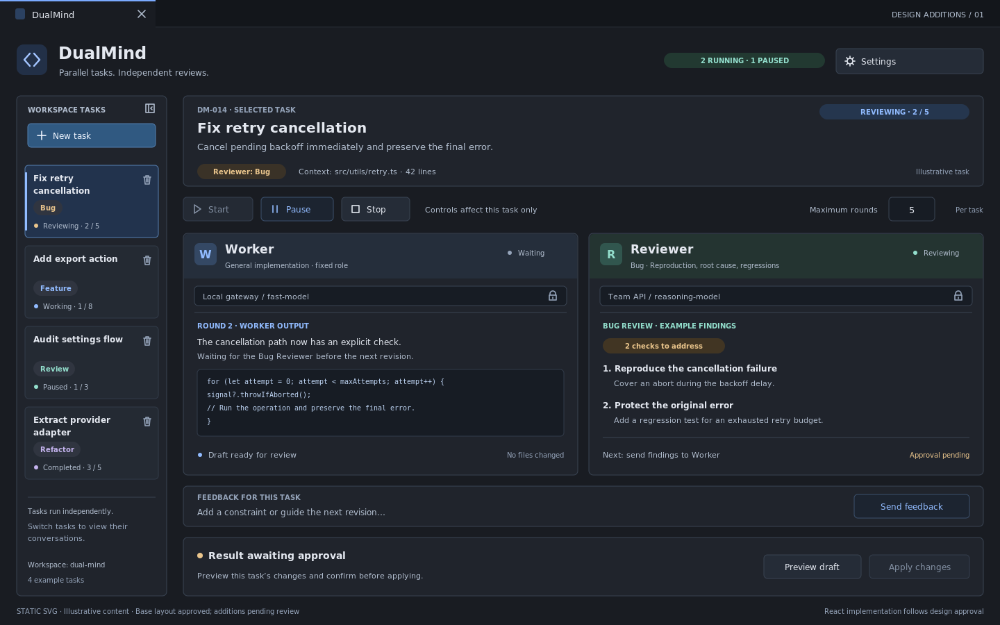

**English** | [简体中文](./README.zh.md)

# 🧠 DualMind

**Two AI minds are better than one.**

DualMind is an AI pair-programming extension project for VS Code. It brings task preparation, implementation, and independent review into one workspace, with a visible path from a request to a reviewed change.

## Project status

**Source 0.0.2 · Local version record · Unpublished**

The React workbench supports local task drafts, connection settings, Reviewer presets, and English / Simplified Chinese. Model execution and code application are planned capabilities; the optional conversation preview is explicitly read-only example content.

Historical 0.0.1 publication: available on the [Visual Studio Marketplace](https://marketplace.visualstudio.com/items?itemName=Pro-qing.dual-mind) as **Pro-qing.dual-mind**, version **0.0.1**, published 2026-11-18 with the Preview label. [GitHub Preview 2](https://github.com/Pro-qing/dual-mind/releases/tag/v0.0.1-preview.2) was also published on 2026-11-18. [Release notes](./docs/en/release-notes-preview-2.md).

The [0.0.2 version notes](./docs/en/release-notes-0.0.2.md) record source capabilities and verification. The [changelog](./CHANGELOG.md) distinguishes local versions from historical public artifacts.

## Two complementary roles

- **Worker:** Keeps a general implementation role, completing the task and revising from feedback.
- **Reviewer:** Uses the task’s chosen Bug, Feature, Review, Refactor, or custom review focus. Each draft retains its role instructions as a snapshot.

The intended collaboration follows **Generate → Review → Revise → Approve**. Developers guide the process and decide whether to apply a reviewed result.

## Available locally

- **Task workbench:** Create, select, edit, and delete workspace-scoped drafts in the two-column layout.
- **Connection settings:** Save OpenAI-compatible endpoints and independent agent model defaults, with API keys stored by VS Code.
- **Model discovery:** Save a connection with an optional model, set its key in the native password prompt, explicitly query models, then search/select or manually enter IDs for defaults and drafts. Queries verify list access only.
- **Reviewer presets:** Edit bilingual built-in instructions or manage custom roles in their original language.
- **Language selection:** Follow VS Code or choose English / Simplified Chinese without rewriting saved task content.
- **Example preview:** Explore the intended conversations and parallel-task appearance without creating records or sending requests.

## Planned capabilities

Model inference, streamed conversations, independent parallel sessions, pause/stop controls, automated review iterations, editor context, and explicit application of reviewed changes remain under development.

## Interface designs

All seven SVG / PNG scenes are retained as adopted design references. [API model discovery](./docs/design/dual-mind-api-model-discovery.png) and [task model selection](./docs/design/dual-mind-task-model-selection.png) are implemented in the development branch. The published 0.0.1 artifact retains its original behavior. Some illustrated execution states belong to future capabilities. [Workbench SVG](./docs/design/dual-mind-workbench.svg) · [Full design gallery](./docs/en/design.md).

## Documentation and contribution

- [Usage guide](./docs/en/usage.md) — Marketplace / VSIX installation, workbench, language settings, and limitations.
- [Development guide](./docs/en/development.md) — Environment, builds, debugging, and tests.
- [Architecture](./docs/en/architecture.md) — State ownership and module responsibilities.
- [Roadmap](./docs/en/roadmap.md) — Delivered and planned milestones.
- [Contributing](./CONTRIBUTING.md) — Participation and repository conventions.
- [All documentation](./docs/en/README.md) — Complete guide and policy index.

## License

[MIT License](./LICENSE). [Licensing and bundled notices](./docs/en/licensing.md).
