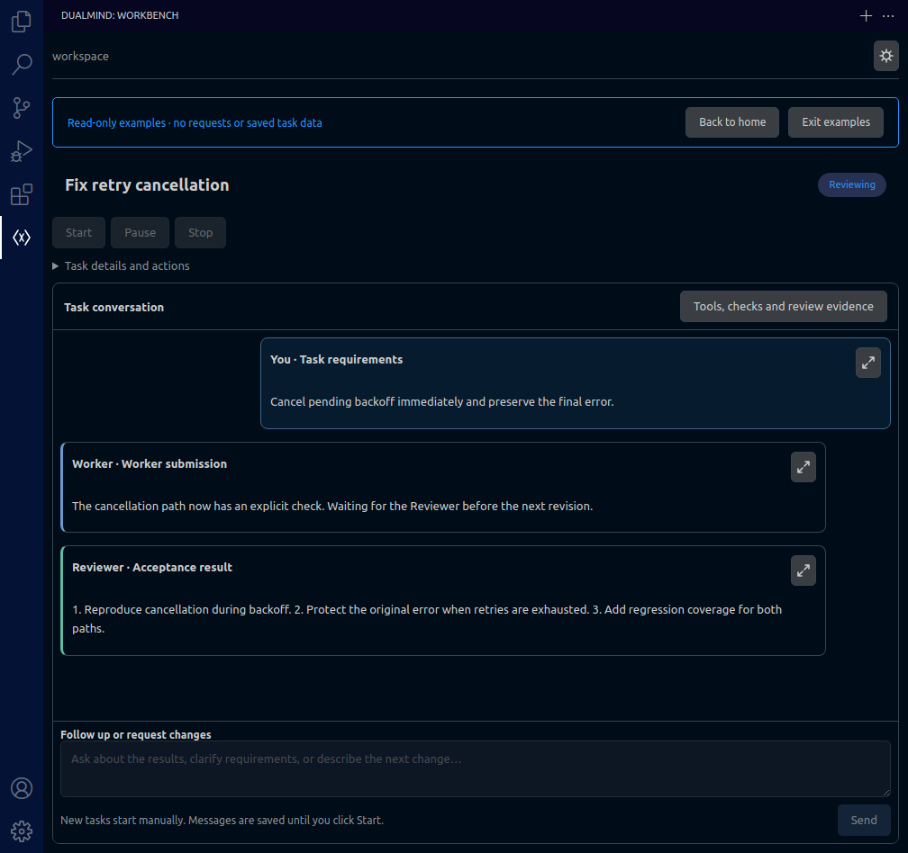

[English](./README.md) | **简体中文**

# 🧠 DualMind

**双脑协同，胜过单兵作战。**

在 VS Code 中，让两个 AI 分工完成规划、编码与审查。**Reviewer 制定方案并验收，Worker 实施和验证。** 你随时介入引导、查看修改，并决定如何整合成果。

无论是修复问题、开发功能、审查代码，还是重构模块，都可以把需求、实施、反馈和验证放在同一个任务工作区中，让两个角色分别维护各自的对话上下文。

_当前界面，内容为内置只读示例。示例不发送模型请求，也不修改项目文件。_

## 如何协作

**你的需求 → Reviewer 规划 → Worker 实施与验证 → Reviewer 审查 → 通过或继续修复**

Reviewer 先将需求整理为执行方案和验收条件。Worker 按方案修改文件、运行相关检查，再由 Reviewer 查看实际成果和验证记录，确认通过或提出下一轮修改要求。

你可以补充需求、提出问题、暂停、停止或继续执行。任务结束后，也可以在同一任务中追问结果或提出后续修改。审查让过程更容易核对，是否采用成果仍由你判断。

## 核心能力

- **明确的双角色分工。** 选择 Bug、Feature、Review、Refactor 或自定义审查侧重点。Worker 负责实施，Reviewer 负责规划，并依据任务的验收条件检查成果。
- **自选模型与服务。** 接入 OpenAI 兼容 API、Anthropic Messages 或 Command Code 兼容 API，为 Worker 和 Reviewer 独立选择模型；可以共用服务，也可以使用不同连接。支持查询模型列表或手动填写模型 ID，API 密钥由 VS Code 保存。
- **隔离任务修改。** 从本地基点分支创建独立 Git 工作树，也可直接使用当前分支或指定分支。先查看差异、打开任务目录，再决定保留哪些成果。
- **查看执行过程与验证依据。** 按角色阅读对话、命令输出、检查和审查结果；暂停后补充反馈，并继续可恢复的运行。两个角色分别管理上下文，自动摘要帮助较长的任务继续进行。
- **自主处理成果。** 显式提交任务修改、合入本地目标分支、处理冲突，在保存成果后清理隔离工作树，或将保存的成果恢复为新任务。审查通过不会自动发布你的修改。

## 快速开始

1. **安装 DualMind。** 按[安装说明](./docs/zh/usage.md)选择 Marketplace、VSIX 或从源码构建。功能以所安装版本为准，源码与已发布版本可能不同。
2. **打开项目。** 打开已有提交和分支的可信任 Git 工作区，点击活动栏 DualMind 图标，或运行 **DualMind: 打开工作台**。
3. **配置模型。** 在设置中保存 API 连接、设置密钥，并为 Worker 和 Reviewer 选择模型；也可以保存新任务的默认配置。
4. **创建并开始任务。** 写清目标和约束，选择审查侧重点与 Git 策略，然后点击**开始**。仅创建任务不会发送模型请求。
5. **查看并整合成果。** 跟进对话、检查差异和验证记录，按需补充反馈；满意后，通过任务的成果操作提交或合入修改。

想先看看界面？点击**查看示例**，无需配置 API，也不会修改项目文件。

## 运行要求

支持基线为 **Ubuntu 20.04+ x64、VS Code 1.100.0+、Git 2.25+**。需要可用的兼容模型 API 和凭据，以及项目自身所需的开发工具链。模型请求会把相关任务上下文发送到你配置的服务；本地工作台不等于离线推理。

当前一次执行一个任务。平台详情见[环境说明](./docs/zh/environment.md)，后续能力见[路线图](./docs/zh/roadmap.md)。

## 文档与参与

[使用说明](./docs/zh/usage.md) · [开发指南](./docs/zh/development.md) · [完整文档](./docs/zh/README.md) · [更新日志](./CHANGELOG.zh.md)

欢迎反馈问题、提出想法或参与开发。协作流程和仓库约定见[贡献指南](./CONTRIBUTING.zh.md)。

项目采用 [MIT 许可证](./LICENSE)，第三方软件信息见[许可及随包声明](./docs/zh/licensing.md)。
