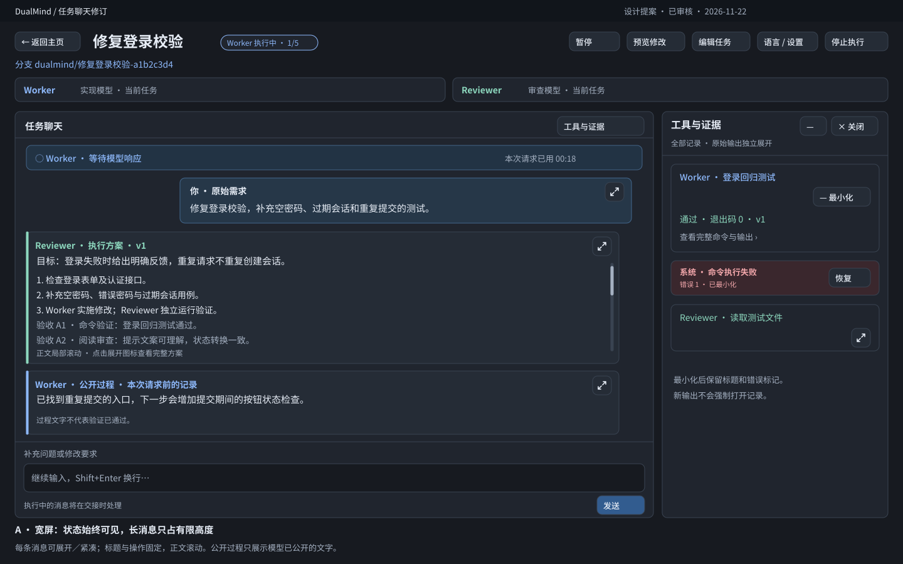
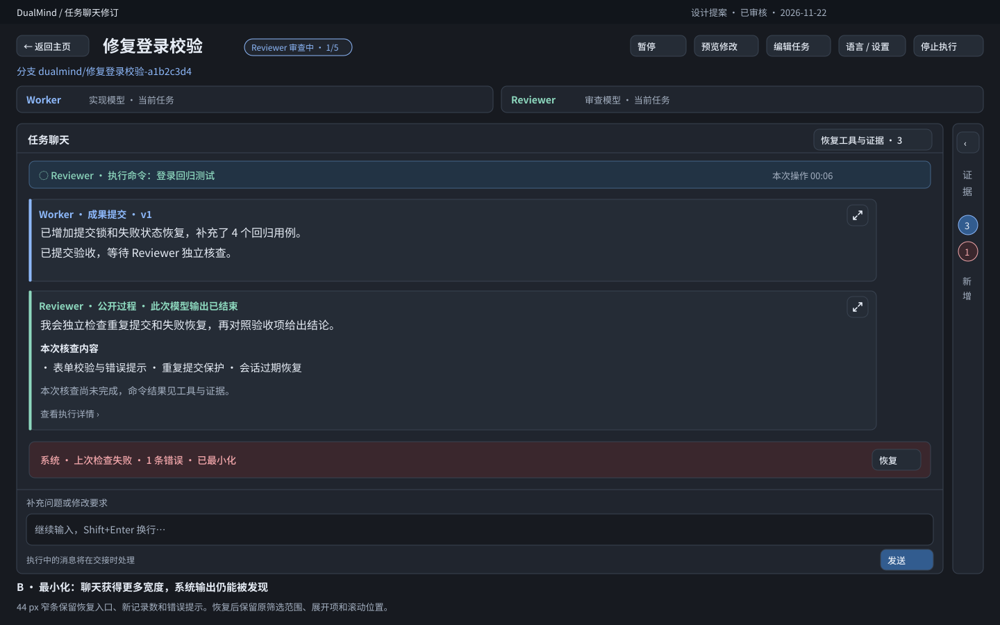
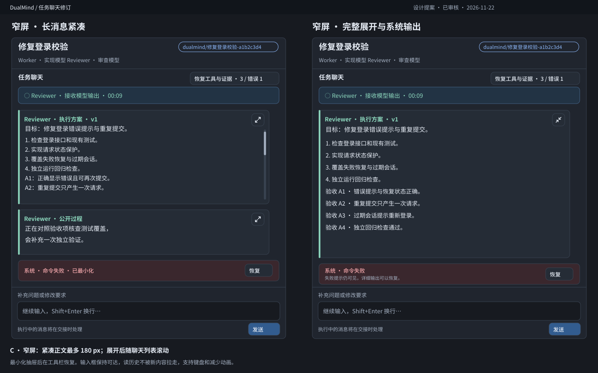

# Activity, compact chat and minimization: UI revision proposal

[简体中文](../zh/chat-progress-proposal.md) · [Design index](./design.md)

**Status: approved and implemented.** Date: November 22, 2026. These three SVG/PNG pairs are static interaction examples. Model text, timings, counts and results are illustrative. The 17 approved designs remain intact; this proposal adds scenes 18–20.

On November 22, 2026, the user approved the designs with one refinement: expansion/compaction controls use simple icons, with no visible Expand text. The revised SVGs reflect this. The chat now consumes activity and public-process data and implements sizing, minimization and Webview preferences. These images remain design references, not runtime screenshots.

## 18. Wide: activity and public process

[Editable SVG](../design/v0.0.4/dual-mind-chat-progress-proposal.svg) · [PNG preview](../design/v0.0.4/dual-mind-chat-progress-proposal.png)

A chat activity bar shows role, phase, current operation and elapsed time, including waiting with no model text. The first valid stream event changes the state to receiving a response; tools and commands have separate states. Elapsed time is calculated in the frontend without per-second log entries or invented percentage completion. Pause, stop, failure and restart display actual execution status, without a stale spinner.

Public text is merged per model request into a role-labelled process card, updated while streaming and retained for later reading. It is distinct from a plan, submission or verdict. Only redacted public text is displayed, never private reasoning, streamed tool arguments or encrypted protocol state.

Every message, including requirements, user follow-ups, process, plans, submissions, reviews and system messages, has icon-only Expand/Compact controls with bilingual tooltips and accessible names. The default body height is at most 240 CSS pixels: short messages remain natural-height, long bodies scroll internally, with title, time and controls outside that body. Expanded content uses the same font size and its full height in the chat list.

## 19. Wide: minimized evidence panel and individual outputs

[Editable SVG](../design/v0.0.4/dual-mind-chat-minimized-proposal.svg) · [PNG preview](../design/v0.0.4/dual-mind-chat-minimized-proposal.png)

The approximately 360-pixel panel gains a minimize action, leaving an approximately 44-pixel rail and more width for chat. The rail retains restoration, new-record counts and error badges. Close remains a distinct action. New output updates indicators without automatically restoring the panel.

System messages, commands and output records can separately minimize to a title, outcome, error indicator and restore action. Errors remain discoverable. Restoring retains scope, expanded records and scroll position; no persisted output is deleted or truncated.

## 20. Narrow: compact and expanded reading

[Editable SVG](../design/v0.0.4/dual-mind-chat-compact-narrow-proposal.svg) · [PNG preview](../design/v0.0.4/dual-mind-chat-compact-narrow-proposal.png)

The left example shows compact long messages and the right shows the same plan expanded. Narrow message bodies are limited to 180 CSS pixels. Evidence continues using the existing drawer; minimization leaves a toolbar restore entry and counts, with no permanent side rail. The composer stays reachable.

Manual sizing and minimization preferences are stored per task in Webview state, accepting legacy navigation-only state. Language/task changes, panel reopening and streaming preserve choices. History reading preserves its anchor; new content follows only near the bottom. Buttons have bilingual accessible names and keyboard focus, and motion respects reduced-motion preferences.

## New branch naming (backend implemented)

A newly prepared managed workspace uses `dualmind/<task-name>-<short-id>`, such as `dualmind/修复登录-a1b2c3d4`. Normalize names with NFKC, retain Unicode letters/numbers and hyphens, lowercase ASCII letters, replace other characters with hyphens, merge/trim separators and limit the slug to 48 Unicode code points. Empty slugs become `task`. Take the first 8 hex characters of the task UUID without hyphens; existing branches cause fallback to 12, then all 32 characters, then a conflict error.

Naming version and result freeze at initial preparation; renaming a task does not rename its branch. Legacy `dualmind/task/<UUID>/worker` branches and interrupted registrations remain recoverable. Current/existing-branch strategies do not rename branches. Workspace ownership remains strictly checked; occupied branches are never adopted.

## Approval and implementation

The user approved scenes 18–20 on November 22, 2026 and requested icon-only sizing controls. The implementation retains the approved message heights, activity strip, minimized rail, narrow drawer and error visibility. UI preferences use versioned Webview state with legacy navigation restoration; only IDs, display modes, scope, scroll offset and record counters are stored, never message text or credentials. The active chat requests public process cards explicitly. Actual tests and platform limits are recorded in the [development log](./development-log.md).
