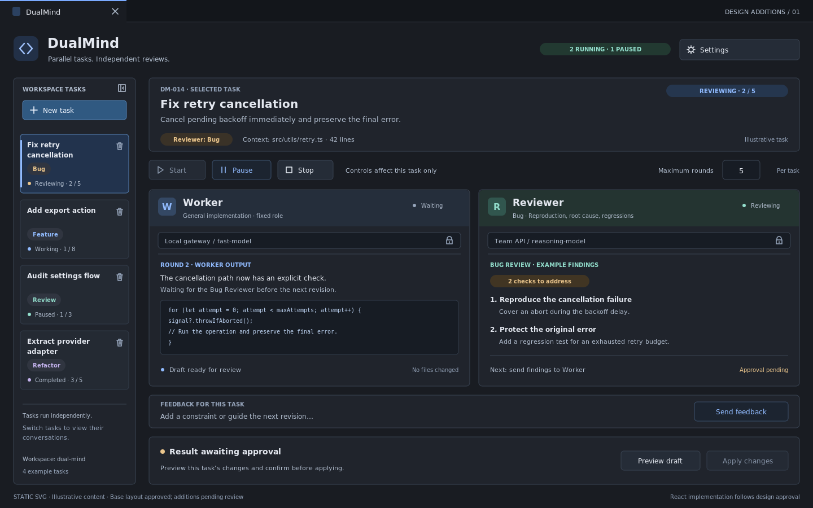
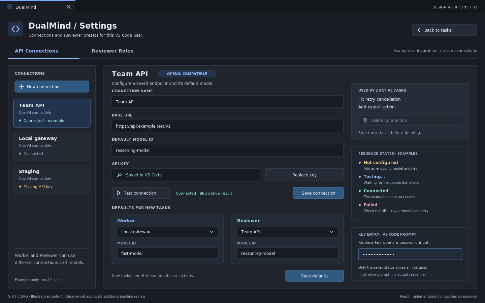

# UI designs: current implementation and historical references

[简体中文](../zh/design.md) · [Documentation](./README.md)

**Current capabilities:** [worktrees, context summaries and artifact operations](./task-lifecycle.md), together with [tool-error handling](./tool-errors.md), were introduced in 0.0.6 with host and frontend support. [Scenes 30–34](./task-lifecycle-proposal.md) and [scenes 35–37](./tool-errors-proposal.md) retain their original approval and implementation records.

**Approved new designs:** [Compact task list](./task-home-compact-proposal.md), scenes 28–29, covers 240/320/480px homes, long names, keyboard focus, read-only examples, and deletion confirmation. These drawings document changes recorded November 23, 2026 and now archived on local `master`, in the 0.0.5 development archive after the original `v0.0.5` tag and retained in full in 0.0.6.

[Native sidebar workbench](./sidebar-workbench-proposal.md) scenes 24–27 were **approved on November 22, 2026** and implemented on November 23. The complete workbench uses the Primary or Secondary Side Bar, compact navigation, collapsible task details and manual **Keep Terminal in Editor Area**. Old editor tabs are retained only for migration. The original 27 design approvals and historical artwork are preserved.

**New approved revision:** [Activity, compact chat and minimization](./chat-progress-proposal.md), scenes 18–20. Approved November 22, 2026 with icon-only sizing buttons; implemented. The 17 earlier approvals remain intact. These remain static design references.

**New approved proposal:** [Task chat and follow-up](./task-chat-proposal.md) adds scenes 14–17: wide chat, a narrow evidence drawer, queued messages and follow-up after execution. The four designs are approved; implementation is complete; see [actual task chat validation](./task-chat-validation.md).

**New approved revision:** [Dual-agent planning and acceptance](./execution-cycle-proposal.md), approved 2026-11-20; implemented; see [validation coverage](./execution-cycle-validation.md).
**Approved and implemented revision:** [Task home, detail, and errors](./task-pages-proposal.md) adds scenes 8–11 for separate home/detail pages, manual start after creation, and consistent bilingual errors. Scenes 8–11 were approved on 2026-11-20 and implemented; scenes 1–7 and their historical descriptions below are preserved.

**Source version: 0.0.8 · Locally prepared; awaiting manual publication by the maintainer.** Recorded November 25, 2026. See the [0.0.8 version notes](./release-notes-0.0.8.md) for features, validation and artifacts. Historical versions, design archives and validation records retain their meaning.

**All 40 SVG/PNG pairs are approved.** Scenes 38–40 were approved November 25, 2026 and integrated: provider/protocol settings, compact task header, exclusive context/results panels and request/role log groups. Actual backgrounds follow the VS Code theme; artwork palettes are illustrative. Original assets and historical labels remain intact; runtime checks are recorded separately in the [development log](./development-log.md).

Each scene is **1440 × 900**, contains editable SVG text and vector elements. Historical scenes mainly use dark palettes; 0.0.7 includes light and dark examples, while implementation always follows the host theme. Early scenes use English labels; later revisions mainly use Simplified Chinese. Each group has explanations in both languages. The SVGs have no embedded images, scripts, external fonts, or external resources. The PNGs are rendered previews.

## Browse by version

The [design archive index](../design/README.md) maps versions to scenes and counts: 0.0.1 → 1–5, 0.0.2 → 6–7, 0.0.3 → 8–17, 0.0.4 → 18–23, 0.0.5 → 24–37, and 0.0.7 → 38–40 (approved). Each folder has paired SVG/PNG assets and a README. These folders describe development versions, not complete snapshots of each initial tag: scenes 8–17 followed the original `v0.0.3` tag, and the sidebar moves from earlier 0.0.4 candidate validation into the 0.0.5 source milestone. Historical artwork and tags remain unchanged.

## Design gallery

| Scene                                          | Editable source                                                       | Preview                                                               |
| ---------------------------------------------- | --------------------------------------------------------------------- | --------------------------------------------------------------------- |
| 1. Parallel task workbench                     | [SVG](../design/v0.0.1/dual-mind-workbench.svg)                       | [PNG](../design/v0.0.1/dual-mind-workbench.png)                       |
| 2. API Connections                             | [SVG](../design/v0.0.1/dual-mind-api-settings.svg)                    | [PNG](../design/v0.0.1/dual-mind-api-settings.png)                    |
| 3. Reviewer Roles                              | [SVG](../design/v0.0.1/dual-mind-reviewer-roles.svg)                  | [PNG](../design/v0.0.1/dual-mind-reviewer-roles.png)                  |
| 4. New task                                    | [SVG](../design/v0.0.1/dual-mind-new-task.svg)                        | [PNG](../design/v0.0.1/dual-mind-new-task.png)                        |
| 5. Delete task                                 | [SVG](../design/v0.0.1/dual-mind-delete-task.svg)                     | [PNG](../design/v0.0.1/dual-mind-delete-task.png)                     |
| 6. API model discovery                         | [SVG](../design/v0.0.2/dual-mind-api-model-discovery.svg)             | [PNG](../design/v0.0.2/dual-mind-api-model-discovery.png)             |
| 7. Task model selection                        | [SVG](../design/v0.0.2/dual-mind-task-model-selection.svg)            | [PNG](../design/v0.0.2/dual-mind-task-model-selection.png)            |
| 8. Task home                                   | [SVG](../design/v0.0.3/dual-mind-task-home-proposal.svg)              | [PNG](../design/v0.0.3/dual-mind-task-home-proposal.png)              |
| 9. Task detail                                 | [SVG](../design/v0.0.3/dual-mind-task-detail-proposal.svg)            | [PNG](../design/v0.0.3/dual-mind-task-detail-proposal.png)            |
| 10. Create task                                | [SVG](../design/v0.0.3/dual-mind-task-create-proposal.svg)            | [PNG](../design/v0.0.3/dual-mind-task-create-proposal.png)            |
| 11. Errors and narrow view                     | [SVG](../design/v0.0.3/dual-mind-task-states-proposal.svg)            | [PNG](../design/v0.0.3/dual-mind-task-states-proposal.png)            |
| 12. Planning and acceptance                    | [SVG](../design/v0.0.3/dual-mind-execution-cycle-proposal.svg)        | [PNG](../design/v0.0.3/dual-mind-execution-cycle-proposal.png)        |
| 13. Additional command settings                | [SVG](../design/v0.0.3/dual-mind-execution-settings-proposal.svg)     | [PNG](../design/v0.0.3/dual-mind-execution-settings-proposal.png)     |
| 14. Chat and evidence panel                    | [SVG](../design/v0.0.3/dual-mind-task-chat-proposal.svg)              | [PNG](../design/v0.0.3/dual-mind-task-chat-proposal.png)              |
| 15. Narrow evidence drawer                     | [SVG](../design/v0.0.3/dual-mind-task-chat-narrow-proposal.svg)       | [PNG](../design/v0.0.3/dual-mind-task-chat-narrow-proposal.png)       |
| 16. Queued messages                            | [SVG](../design/v0.0.3/dual-mind-task-chat-queued-proposal.svg)       | [PNG](../design/v0.0.3/dual-mind-task-chat-queued-proposal.png)       |
| 17. Questions and continued changes            | [SVG](../design/v0.0.3/dual-mind-task-chat-followup-proposal.svg)     | [PNG](../design/v0.0.3/dual-mind-task-chat-followup-proposal.png)     |
| 18. Activity and chat                          | [SVG](../design/v0.0.4/dual-mind-chat-progress-proposal.svg)          | [PNG](../design/v0.0.4/dual-mind-chat-progress-proposal.png)          |
| 19. Chat and output minimization               | [SVG](../design/v0.0.4/dual-mind-chat-minimized-proposal.svg)         | [PNG](../design/v0.0.4/dual-mind-chat-minimized-proposal.png)         |
| 20. Compact chat and narrow view               | [SVG](../design/v0.0.4/dual-mind-chat-compact-narrow-proposal.svg)    | [PNG](../design/v0.0.4/dual-mind-chat-compact-narrow-proposal.png)    |
| 21. Failure and continued execution            | [SVG](../design/v0.0.4/dual-mind-recovery-failure-proposal.svg)       | [PNG](../design/v0.0.4/dual-mind-recovery-failure-proposal.png)       |
| 22. Recovery activity and retries              | [SVG](../design/v0.0.4/dual-mind-recovery-running-proposal.svg)       | [PNG](../design/v0.0.4/dual-mind-recovery-running-proposal.png)       |
| 23. Narrow recovery                            | [SVG](../design/v0.0.4/dual-mind-recovery-narrow-proposal.svg)        | [PNG](../design/v0.0.4/dual-mind-recovery-narrow-proposal.png)        |
| 24. Native primary sidebar                     | [SVG](../design/v0.0.5/dual-mind-sidebar-left-proposal.svg)           | [PNG](../design/v0.0.5/dual-mind-sidebar-left-proposal.png)           |
| 25. Native secondary sidebar                   | [SVG](../design/v0.0.5/dual-mind-sidebar-right-proposal.svg)          | [PNG](../design/v0.0.5/dual-mind-sidebar-right-proposal.png)          |
| 26. Sidebar widths                             | [SVG](../design/v0.0.5/dual-mind-sidebar-widths-proposal.svg)         | [PNG](../design/v0.0.5/dual-mind-sidebar-widths-proposal.png)         |
| 27. Sidebar forms and evidence                 | [SVG](../design/v0.0.5/dual-mind-sidebar-forms-proposal.svg)          | [PNG](../design/v0.0.5/dual-mind-sidebar-forms-proposal.png)          |
| 28. Compact task home (approved)               | [SVG](../design/v0.0.5/dual-mind-task-home-compact-proposal.svg)      | [PNG](../design/v0.0.5/dual-mind-task-home-compact-proposal.png)      |
| 29. Task-list interactions (approved)          | [SVG](../design/v0.0.5/dual-mind-task-home-interactions-proposal.svg) | [PNG](../design/v0.0.5/dual-mind-task-home-interactions-proposal.png) |
| 30. Worktree base selection（已审核）          | [SVG](../design/v0.0.5/dual-mind-workspace-base-proposal.svg)         | [PNG](../design/v0.0.5/dual-mind-workspace-base-proposal.png)         |
| 31. Context budgeting and compaction（已审核） | [SVG](../design/v0.0.5/dual-mind-context-compaction-proposal.svg)     | [PNG](../design/v0.0.5/dual-mind-context-compaction-proposal.png)     |
| 32. Commit and merge artifacts（已审核）       | [SVG](../design/v0.0.5/dual-mind-artifact-integration-proposal.svg)   | [PNG](../design/v0.0.5/dual-mind-artifact-integration-proposal.png)   |
| 33. Merge conflicts（已审核）                  | [SVG](../design/v0.0.5/dual-mind-merge-conflicts-proposal.svg)        | [PNG](../design/v0.0.5/dual-mind-merge-conflicts-proposal.png)        |
| 34. Cleanup and artifact restoration（已审核） | [SVG](../design/v0.0.5/dual-mind-workspace-cleanup-proposal.svg)      | [PNG](../design/v0.0.5/dual-mind-workspace-cleanup-proposal.png)      |
| 35. Tool and command outcomes                  | [SVG](../design/v0.0.5/dual-mind-tool-results-proposal.svg)           | [PNG](../design/v0.0.5/dual-mind-tool-results-proposal.png)           |
| 36. Repeated-error pause and continuation      | [SVG](../design/v0.0.5/dual-mind-tool-pause-proposal.svg)             | [PNG](../design/v0.0.5/dual-mind-tool-pause-proposal.png)             |
| 37. Historical failures and acceptance         | [SVG](../design/v0.0.5/dual-mind-acceptance-errors-proposal.svg)      | [PNG](../design/v0.0.5/dual-mind-acceptance-errors-proposal.png)      |
| 38. Provider and protocol settings (approved)  | [SVG](../design/v0.0.7/dual-mind-model-provider-proposal.svg)         | [PNG](../design/v0.0.7/dual-mind-model-provider-proposal.png)         |
| 39. Compact task header (approved)             | [SVG](../design/v0.0.7/dual-mind-compact-task-header-proposal.svg)    | [PNG](../design/v0.0.7/dual-mind-compact-task-header-proposal.png)    |
| 40. Request-grouped logs (approved)            | [SVG](../design/v0.0.7/dual-mind-request-grouped-logs-proposal.svg)   | [PNG](../design/v0.0.7/dual-mind-request-grouped-logs-proposal.png)   |

## Historical descriptions of scenes 1–7

The following sections preserve the original workbench/model-selection context, including its two columns, draft terminology and intended parallel interactions; they do not describe all current capabilities. Scenes 8–11 and 12–13 record the intermediate task-page and execution-cycle revisions. Scenes 14–20 and the usage guide describe current chat layout.

### 1. Parallel task workbench



A collapsible workspace task list sits beside the approved two-column layout. Each item shows its name, Reviewer role, state, round count, and delete action. The example has two running tasks, one paused task, and one completed task. Selecting an item changes the displayed conversation without stopping other tasks.

Start, pause, stop, human feedback, round limits, and result application belong to the selected task. Worker keeps its general implementation role. Reviewer displays the task's chosen review focus. Each agent has its own connection and model; the lock icons indicate the current run's configuration is fixed. A draft's bindings and round limit can be edited before starting; the initial round limit is five.

The result area keeps review approval separate from the user's decision to apply changes. Multiple tasks may produce drafts concurrently; each result requires its own preview and explicit application. The drawing applies no code.

### 2. API Connections



The shared Settings entry has **API Connections** and **Reviewer Roles** tabs. Connections are local user configurations for OpenAI-compatible endpoints, with a name, Base URL, default model ID, and saved-key status. New, save, delete, and test actions are shown. Worker and Reviewer have independently editable default connections and model IDs; newly created tasks inherit them.

**Set key / Replace key** opens a VS Code password input managed by the extension host. Settings shows only whether a key is saved; it does not display or receive the stored value. The separate prompt inset uses placeholder dots, not an actual credential. Connection-test feedback illustrates not configured, testing, connected, and failed states; none represents a real request.

Deletion is disabled while a connection is referenced by running or paused tasks. The editor lists the affected tasks and directs the user to stop them first. A saved default change affects future tasks; an active run retains its selected configuration. A saved draft with an unavailable connection must select a valid configuration before starting.

### 3. Reviewer Roles


The four built-in presets change **Reviewer only**:

| Role     | Default review focus                                                            |
| -------- | ------------------------------------------------------------------------------- |
| Bug      | Reproduction, root cause, effectiveness of the fix, and regression risk         |
| Feature  | Requirement coverage, acceptance criteria, boundary behavior, and compatibility |
| Review   | Correctness, security, maintainability, and test coverage                       |
| Refactor | Preserved behavior, structural improvement, and regression verification         |

Built-in names are fixed. Their purpose and review instructions can be edited and restored to defaults. **New role** opens the same editor with editable name, purpose, and instructions; custom roles also have edit and delete actions. Selecting a custom role replaces the built-in choice for that task, so there is exactly one Reviewer preset.

Task creation captures the selected role name and instructions. Later editing, resetting, or deleting that preset does not change existing tasks or their histories, including drafts. Removing a custom preset removes it from future selections. The fixed Worker role is shown as an informational card, with no role editor.

### 4. New task


Name, requirements, and one Reviewer role are required. The dialog confirms the two connection/model selections and a per-task round limit. The example deliberately leaves the Reviewer connection unset: **Create draft** remains available, while starting later requires both agents' API configurations to be complete. That disabled Start state must include a Settings entry and identify the missing configuration.

Creating a draft selects it in the workbench without starting model requests. Cancelling creates no task. The other tasks can continue running while this dialog is open.

### 5. Delete task


Confirmation names the task and explains that only its record and conversation histories will be removed. Workspace files and other tasks are preserved. Draft, stopped, completed, or fully failed tasks can use **Delete task** directly. Running or paused tasks use **Stop and delete**: request stop, wait for acknowledgement, then remove the record. During stopping, the destructive action is disabled. If stopping fails, retain the task and its history and offer retry; cancellation of the dialog performs no action.

After deletion, select another remaining task; after the last deletion, show **No tasks yet** with **New task**. The side panels and lower note in this scene are labeled state examples for design review, not additional dialogs that would all open together.

## Implemented model discovery additions

Scenes 6–7 extend the adopted layout and define the implemented connection and model selection flow. These two scenes define model selection, not execution; overall execution capability is documented in the current version notes.

### 6. API connection and model discovery


The center shows a saved connection and an open model selector. The right-hand cards are separate state examples for review, not panels shown together in the product. `example-model-*`, connection names, counts, and times are illustrative; no model is recommended or assumed to be available to an account.

New connections prefill `https://api.openai.com/v1`; the Base URL remains editable for OpenAI-compatible services. The **default model is optional** so the first-use sequence can be: save name and Base URL → set the key in VS Code's password prompt → **Test & fetch models** → choose a default if desired → save. Current `0.0.1` still requires a default model when saving; the development branch now allows an empty default. **Set key / Replace key** continues to show only saved-key status in the page.

**Test & fetch models** verifies access to the model-list endpoint and returns model IDs. **Refresh** repeats that query. Both require a saved connection and key; editing the Base URL requires saving before either query can run. Opening a page or selector does not automatically send a request. The visible result reports a count and query time, with success described as **Model list accessible**, not an inference test. Availability in a returned list does not establish chat or code-task suitability.

The editable selector searches model IDs while allowing an ID to be typed directly, including one absent from the list. Opening it shows suggestions; typing filters them. Returned IDs are displayed and saved verbatim, without translation or an invented friendly name. A successful query never selects the first model automatically or overwrites the current selection. Existing Worker/Reviewer default settings remain in the API page and reuse this same control; this scene focuses on the connection editor.

The state examples cover an unsaved connection, missing key, in-progress request, success in the center panel, an empty list, a failed request, and an edited address. Disable duplicate requests while fetching. On an empty list, unsupported endpoint or other failure, retain manual input and the selected ID; offer retry when configuration permits. Address/key changes invalidate old results, so another query is needed. An empty successful list is distinct from a failed query.

### 7. Task model selection


The main panel shows a new-task dialog with separate connections and model IDs: Worker uses an illustrative OpenAI selection; Reviewer uses a manually entered gateway ID with a missing key. **Create draft** remains available. The side insets show an edit-draft case, connection switching, and narrow layout; they are review references outside the dialog.

New drafts inherit the saved Worker/Reviewer defaults. Each selector uses only the selected connection's suggestions and offers fetch/refresh plus manual entry. Explicitly changing a connection uses that connection's default model, which may be blank, in the current form. Refreshing a list does not change the selected ID. Opening an existing draft keeps its bindings even when an ID is absent from the latest list; only an explicit edit and save changes them. Editing retains its Reviewer role snapshot; the built-in role choices in the main panel apply to creating a draft.

A missing key disables query actions for that connection but does not prevent typing an ID or saving the draft. A list failure also preserves typed and saved values. Choosing different connections for the two agents never mixes their suggestions or results. The main task sidebar and conversation layout remain as approved.

### Language, keyboard, and narrow-window behavior

| English label            | Simplified Chinese label |
| ------------------------ | ------------------------ |
| Test & fetch models      | 测试并获取模型           |
| Fetch / Refresh          | 获取模型／刷新模型       |
| Default model — Optional | 默认模型（可选）         |
| Search or type an ID     | 搜索或输入模型 ID        |
| Model list accessible    | 模型列表可访问           |
| Fetching models…         | 正在获取模型…            |
| No models returned       | 未返回模型               |
| Query failed             | 查询失败                 |
| Save draft               | 保存草稿                 |

All explanatory text, statuses, validation and errors will have both languages; model IDs and user-entered connection names keep their original text. Language switching preserves current form values and selections.

The editable combobox has an accessible label, keyboard focus, and a scrollable suggestion list. Tab traverses controls; Up/Down navigate an open list, Enter selects its highlighted option, and Escape closes the list before the dialog. Typing an unmatched ID keeps it as a manual value. Closing the list alone does not submit the form or clear the current ID. Long IDs retain their complete value, scroll in the input, and are available in full on focus/hover; suggestion rows may wrap to avoid losing the identifying suffix.

Below 900 CSS pixels, Worker and Reviewer stack, in that order. Connection settings use one scrollable column, with wrapping query controls and status text. Menus stay within the visible dialog, scroll independently, and may open upward when space below is limited. Save/cancel actions remain reachable. Reference-state cards in these drawings are explanatory material, not additional runtime panels.

## Historical layout and state conventions for scenes 1–7

- Tasks and conversation history are organized by workspace. Connections, default model bindings, and role presets are local to the VS Code user. Credential values belong in the host's secret storage.
- Background progress updates the task list; the selected task alone supplies the two conversation columns. A task reaching an error, pause, or completion does not stop another task.
- Below 1200 CSS pixels, collapse the task sidebar to a Tasks button opening a drawer. Below 900 CSS pixels, stack Worker above Reviewer. Settings forms and dialogs become scrollable single-column layouts; controls may wrap without hiding task identity or actions.
- During implementation, use VS Code theme variables, accessible control labels, visible focus indicators, and keyboard navigation. These static drawings do not implement interaction.

## Review and implementation gate

The owner has approved scenes 1–40. Approval for 38–40 on November 25, 2026 explicitly requires theme-aware backgrounds. Historical labels inside the artwork do not describe current status. Built-in Reviewer definitions, saved snapshots and illustrative data retain their meaning; future changes follow the [contribution guide](../../CONTRIBUTING.md).

See [Architecture](./architecture.md) for implemented module responsibilities and [Protocol](./protocol.md) for task association and configuration boundaries. Implemented settings/execution messages, role handoffs and file-access boundaries are documented there.

## Updating and validating previews

SVG is the editable source. Keep a same-name PNG beside every SVG. Preserve approved assets and obtain design review before revisions. The following maintenance commands regenerate only model-discovery scenes 6–7; each other proposal documents its own commands and scope. Use a separate Python environment with CairoSVG 2.7.1, from the repository root:

```bash
for scene in dual-mind-api-model-discovery dual-mind-task-model-selection; do
  python3 -m cairosvg "docs/design/v0.0.2/${scene}.svg" -o "docs/design/v0.0.2/${scene}.png"
done
npm run docs:check
npm run format:check
```

Inspect each rendered image at full size for clipping, missing characters, overlap, and alignment. The documentation checker discovers every SVG/PNG pair (currently 40), requires the original baseline scenes 1–7, and checks canvas size, accessible title/description, editable text, static-vector constraints, and matching PNG dimensions. Updating designs or documentation does not indicate that a public VSIX has been rebuilt or replaced. Rendering and visual inspection remain necessary to verify layout. CairoSVG is optional design tooling, not a runtime or standard build dependency.

## Execution interface in the development branch

Settings categories are API Connections, Defaults, Task execution, Reviewer Roles, Model context and Saved artifacts. Separate Provider/protocol controls expose Chat Completions, Responses, Anthropic Messages and Command Code compatibility access. Titles and primary actions share a compact header, secondary details start collapsed, and context/results expand exclusively. Chat and evidence group by user request and then role, preserving the persistent composer. Evidence uses a roughly 360px column or a drawer capped at 430px below 1100px. One task runs per workspace; see [Usage](./usage.md).

## Approved additions: November 22, 2026

| Scene                          | Source                                                             | Preview                                                            |
| ------------------------------ | ------------------------------------------------------------------ | ------------------------------------------------------------------ |
| 18. Public process / 公开过程  | [SVG](../design/v0.0.4/dual-mind-chat-progress-proposal.svg)       | [PNG](../design/v0.0.4/dual-mind-chat-progress-proposal.png)       |
| 19. Minimized panel / 最小化   | [SVG](../design/v0.0.4/dual-mind-chat-minimized-proposal.svg)      | [PNG](../design/v0.0.4/dual-mind-chat-minimized-proposal.png)      |
| 20. Narrow messages / 窄屏消息 | [SVG](../design/v0.0.4/dual-mind-chat-compact-narrow-proposal.svg) | [PNG](../design/v0.0.4/dual-mind-chat-compact-narrow-proposal.png) |

## Approved: execution recovery

The original 20 designs remain. [Scenes 21–23](./recovery-proposal.md) were approved on 2026-11-22 and now provide failure recovery, preparation, bounded retry and narrow-screen notices. Illustrated task data and historical artwork labels remain examples.
