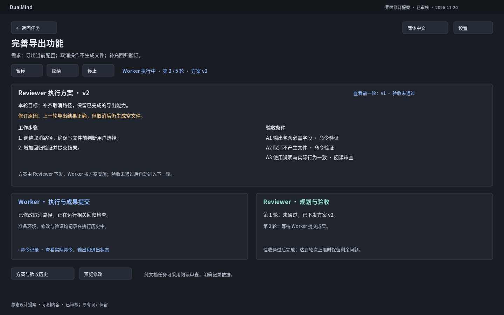
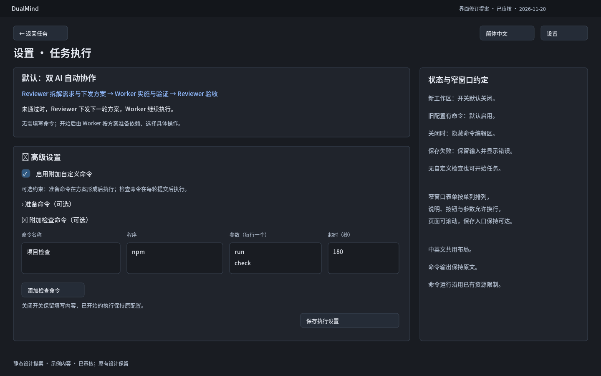

# Dual-agent planning and acceptance: interface revision

[简体中文](../zh/execution-cycle-proposal.md) · [Design index](./design.md)

Status: approved and implemented. Date: 2026-11-20. Existing scenes 1–11 are retained. These designs describe intended behavior, not runtime validation results.

Subsequent revision: [task chat and follow-up](./task-chat-proposal.md) replaces the two-column detail layout below with chat and independent evidence. This document preserves the original design. Reviewer planning, Worker implementation, Reviewer acceptance and additional-command settings still apply; see [Usage](./usage.md) for current layout.

## Task detail

[Editable SVG](../design/v0.0.3/dual-mind-execution-cycle-proposal.svg)

Reviewer reads requirements and relevant files, then issues a plan. Worker implements and validates it, submitting artifacts for acceptance. Reviewer either approves or supplies the next executable plan. The current plan appears before the two conversation columns, with its version, objective, revision reason, steps and acceptance criteria. Command verification and reading review have distinct labels. History retains plans, submissions, reviews and actual command evidence. The example shows a second round after unsuccessful acceptance.

Before execution, explain that Start first asks Reviewer to plan. During planning, Worker waits. Approval completes the task; exhausted rounds show outstanding work. Pause, feedback, continue and stop remain available. Documentation-only work may use reading review with reasons and evidence.

## Execution settings

[Editable SVG](../design/v0.0.3/dual-mind-execution-settings-proposal.svg)

The default view explains the two roles. Collapsed advanced settings contain an additional-command switch. Disabled commands retain their values and hide their editors. New settings default off; existing nonempty configurations default on. Enabled preparation runs after planning; additional checks are mandatory after every submission. Failed saves retain input; active runs retain frozen settings. The right-hand annotations are design notes, not a product sidebar.

## Interaction and language

Controls and application states support English and Chinese; user text, model responses and raw output retain their language. Below 900 CSS pixels, plan content, conversations and command forms stack vertically. Long text wraps; output scrolls locally and the page scrolls vertically. Disclosure controls support keyboards, pending saves prevent duplicate submissions, and language changes retain input. Implementation and actual validation are reported separately on delivery.

See the [validation record](./execution-cycle-validation.md), including environment-dependent coverage gaps.

Runner revision (2026-11-20): approved SVG/PNG assets remain as the original design record. Their resource-limit annotation now refers to timeout, output and cancellation behavior; the product no longer requires systemd/cgroup or fixed memory/swap quotas. Layout and interaction are unchanged.
