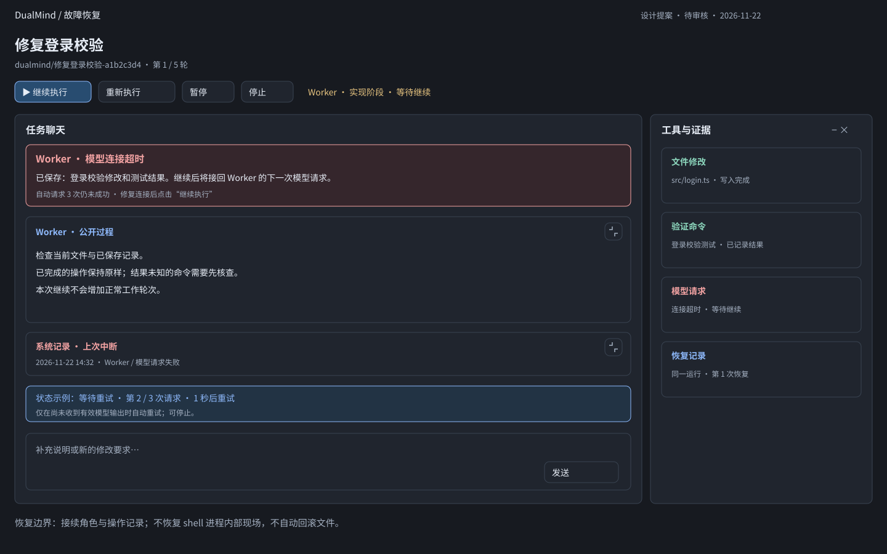
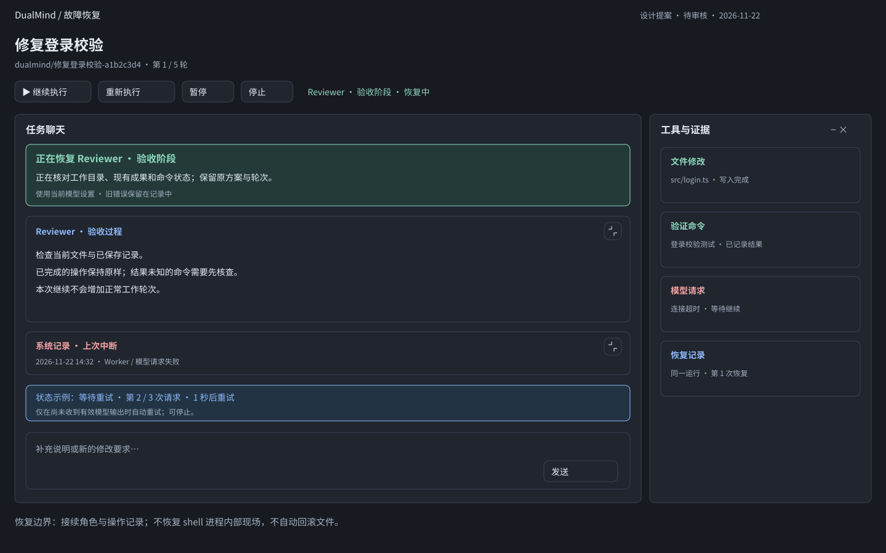
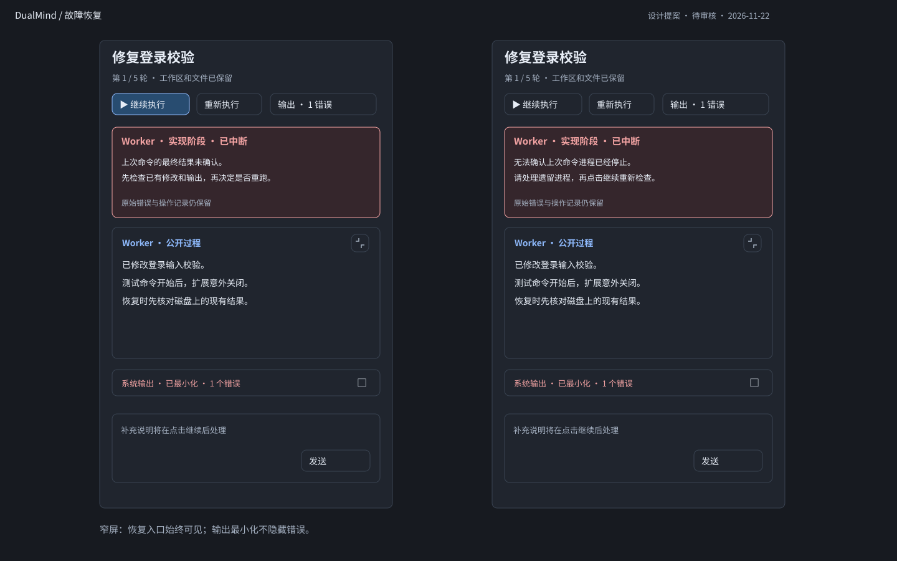

# System interruption and continued execution: UI proposal

[简体中文](../zh/recovery-proposal.md) · [Design index](./design.md) · [Recovery mechanism](./execution-recovery.md)

**Status: approved on 2026-11-22 and integrated.** Scenes 21–23 extend the original 20 approved designs. Task names, errors, times and counters in the artwork remain static examples; historical “pending” labels in the approved assets are retained. Actual validation is recorded in the [development log](./development-log.md).

## 21. Wide failure and recovery

[SVG](../design/v0.0.4/dual-mind-recovery-failure-proposal.svg) · [PNG](../design/v0.0.4/dual-mind-recovery-failure-proposal.png)

Keep the existing run controls and add a play icon with Continue execution. Restart, Pause and Stop remain. The interruption notice identifies Worker or Reviewer, the phase, cause and saved position. Message sizing remains icon-only. The separate retry example illustrates a cancellable attempt count; it is not displayed as active at the same time as the failure notice.

## 22. Recovery checks and bounded retries

[SVG](../design/v0.0.4/dual-mind-recovery-running-proposal.svg) · [PNG](../design/v0.0.4/dual-mind-recovery-running-proposal.png)

Clicking first displays recovery checks and disables duplicate starts. Directory, model, process and artifact checks precede the resumed role. The original error and work round remain. No invented percentages or reset display preferences. Retry waiting and normal execution have distinct status text.

## 23. Narrow layout and unconfirmed processes

[SVG](../design/v0.0.4/dual-mind-recovery-narrow-proposal.svg) · [PNG](../design/v0.0.4/dual-mind-recovery-narrow-proposal.png)

The left example can be inspected and continued; the right is blocked by uncertain process shutdown. Continue can recheck but cannot bypass this blocker. The reason stays visible, including error counts when output is minimized. Damaged records or missing recovery points explain disabled recovery and retain Restart. Messages sent during failures wait for recovery.

## Approval and implementation

The user explicitly approved all three designs on 2026-11-22. `Execution.tsx` connects the existing host resume operation, `Recovery.tsx` shows the saved position and blockers, and `ChatActivity.tsx` displays actual retry attempts and a local countdown. Failed conversation runs also expose recovery. Message sizing remains icon-only and display preferences persist.
