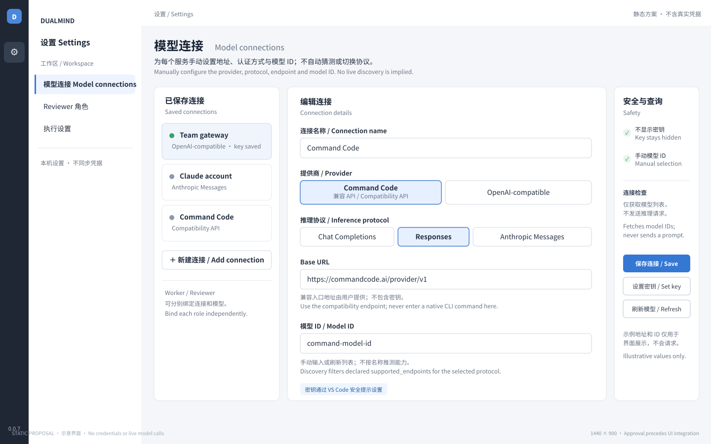
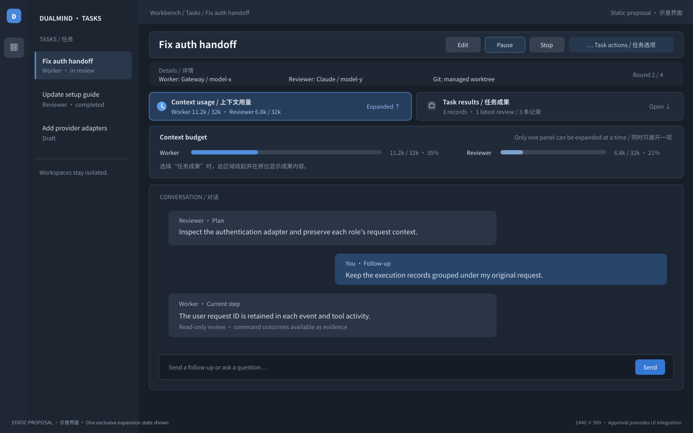
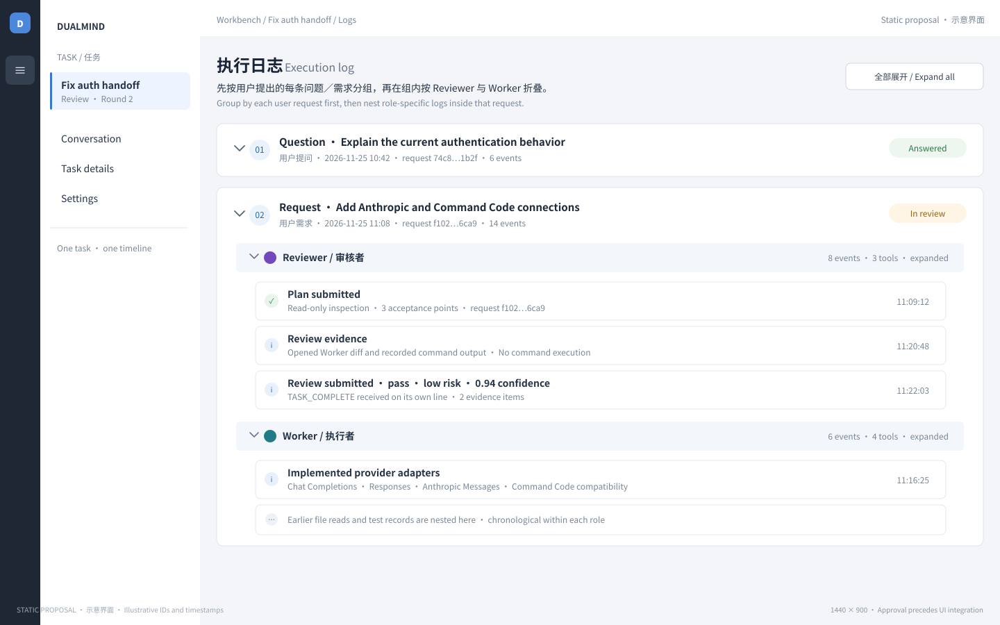

# Model access and compact review workbench: interface proposal

[简体中文](../zh/review-workbench-proposal.md) · [Design index](./design.md)

**Status: approved November 25, 2026; integrated into 0.0.7 source.** The owner requires backgrounds to match the current VS Code theme. Original SVG/PNG assets remain static references; their light/dark palettes do not fix the product theme. Runtime checks are recorded in the [development log](./development-log.md).

**Release attribution:** approved and integrated during 0.0.7 development, these changes are delivered in 0.0.8. Original design paths and approval dates remain unchanged.

## 38. Model-provider settings

[Editable SVG](../design/v0.0.7/dual-mind-model-provider-proposal.svg) · [PNG preview](../design/v0.0.7/dual-mind-model-provider-proposal.png)

Provider and inference protocol are explicit fields. OpenAI-compatible Chat Completions/Responses, Anthropic Messages, and Command Code's compatibility API share manually entered URLs, keys and model IDs. Keys stay in the host password prompt. Refreshing models only retrieves IDs; Command Code filters declared endpoint support. No automatic endpoint inference or protocol fallback is proposed.

## 39. Task title and exclusive context/results panels

[Editable SVG](../design/v0.0.7/dual-mind-compact-task-header-proposal.svg) · [PNG preview](../design/v0.0.7/dual-mind-compact-task-header-proposal.png)

The task title and actions occupy one compact row. Existing details remain beneath it. Context usage and task results share the next row and one expansion state: opening either closes the other, and selecting an already-open item collapses it. The expanded section appears beneath the row. Narrow layouts must preserve accessible actions without horizontal overflow.

## 40. Logs grouped by request, then role

[Editable SVG](../design/v0.0.7/dual-mind-request-grouped-logs-proposal.svg) · [PNG preview](../design/v0.0.7/dual-mind-request-grouped-logs-proposal.png)

Each user question or modification request has its own collapsible group, labelled with the original message and status. Reviewer and Worker sections collapse independently inside the group. Events remain chronological within each role; the host's stable request ID prevents identical text or concurrent updates from mixing requests. Legacy records lacking a request ID remain in an explicit earlier-records group. The same grouping applies to chat process records and evidence, without merging the private model histories.

## Review boundary

Approval covers provider controls, the compact task header, exclusive context/results panels and request/role accordions. Implementation retains the native sidebar, wraps narrow actions, and uses theme variables for backgrounds, inputs, selection, borders and text, including live theme changes. Original artwork and approvals remain intact. Example names, times and results are not execution evidence. Future visual changes follow [CONTRIBUTING.md](../../CONTRIBUTING.md).

## 0.0.8 compact interface and request groups

Titles, editing and run controls share a compact area and wrap in narrow sidebars. Context and artifacts sit side by side, initially closed; opening either closes the other and clicking it again closes both. Switching preserves internal state. VS Code theme variables drive backgrounds and controls, including live light, dark and high-contrast changes.

Chat and evidence group by `userRequestId`, with separate Reviewer, Worker and system folds; equal text never merges distinct requests. Initial runs use `initial:<runId>` and their saved requirements snapshot. Older events without request IDs belong to Earlier records. The current or latest request starts open and historical groups closed; expand/collapse-all and manual choices are saved separately per task and surface. Counts describe loaded records; Handled does not mean acceptance passed. Original requirements and errors remain readable, with pagination, reading anchors, persistent composer and recovery notices retained.
