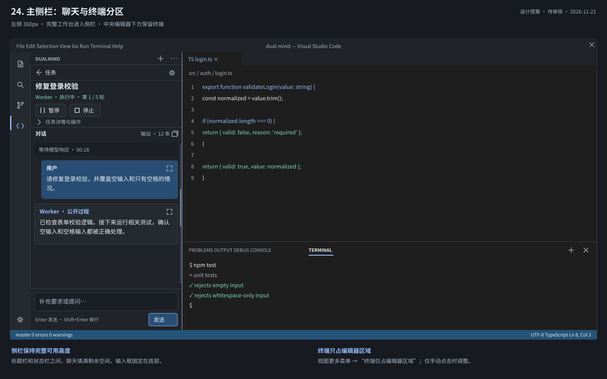
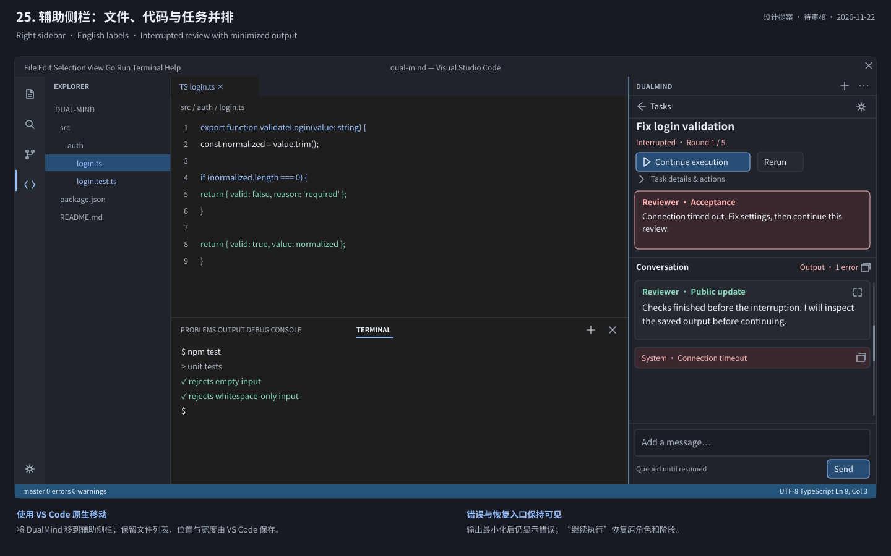
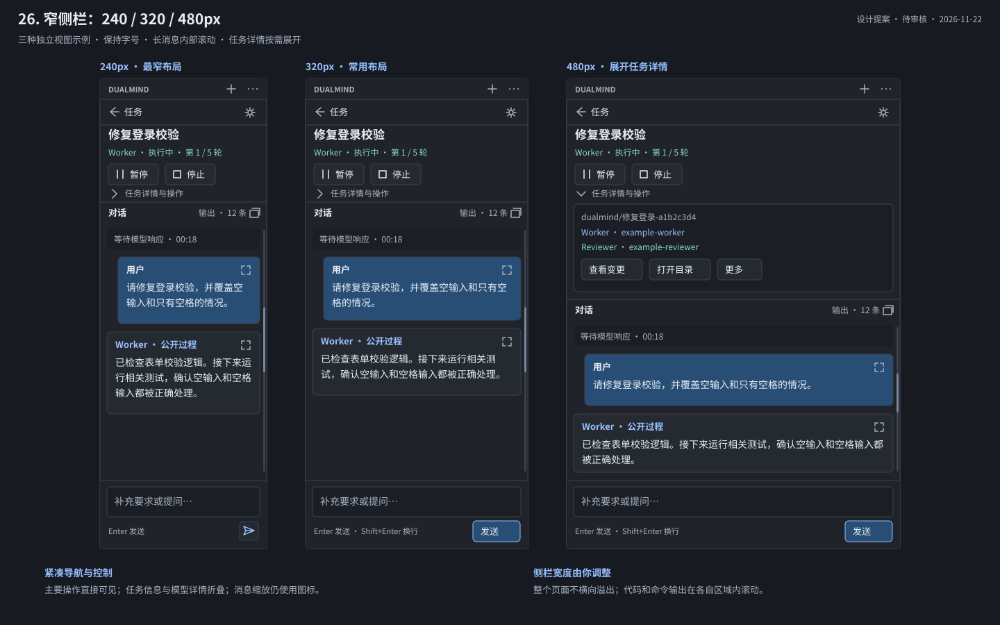
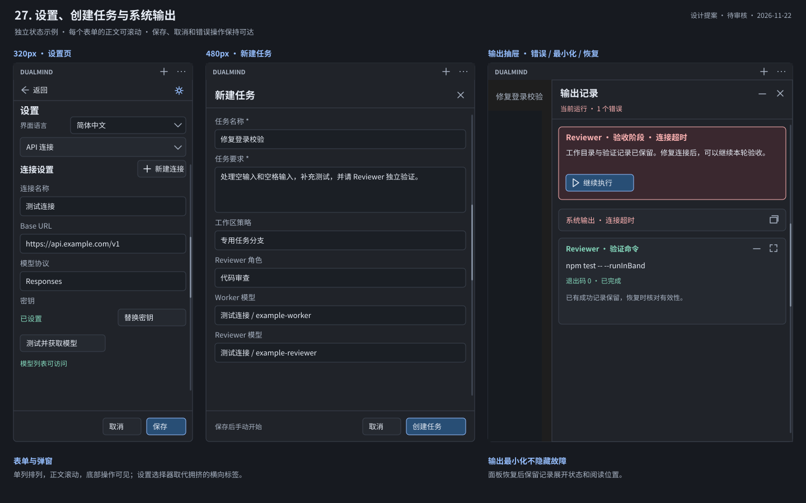

# Native sidebar workbench: UI proposal

[简体中文](../zh/sidebar-workbench-proposal.md) · [Design index](./design.md) · [Current usage](./usage.md)

**Version assignment (November 23, 2026):** this document retains the initial sidebar implementation/validation with a 0.0.4 candidate. Current source is **0.0.5**; scenes 24–27 now live in `docs/design/v0.0.5/`, corresponding to local tag `v0.0.5`. See the [0.0.5 notes](./release-notes-0.0.5.md) for this version operation.

**Status: scenes 24–27 were approved on November 22, 2026 and implemented on November 23.** The approved SVG/PNG artwork and original constraints remain below; historical review labels inside the drawings do not reflect current approval status. A native `WebviewView` now hosts the complete workbench; old tabs exist only for upgrade migration. Initial validation used a 0.0.4 candidate; current assignment is 0.0.5. See [actual validation](./sidebar-workbench-validation.md).

Every canvas is 1440 × 900 with editable text and static vectors. Tasks, code, model names, counts, errors, elapsed times and terminal output are examples, not execution or validation results. Width labels identify the designed Webview content width; the extension will not force a VS Code sidebar width.

## Confirmed interaction

- The complete workbench uses only a native sidebar, defaulting to the Primary Side Bar. Users can move it to the Secondary Side Bar through VS Code's title context menu or dragging. VS Code retains position and width; opening the workbench does not reset its location.
- The workbench uses the available height between title and status bars. A new view overflow and Command Palette action, **Keep Terminal in Editor Area**, centers the bottom panel only when invoked. It does not automatically reset the user's layout. A full-width panel can still occupy the area below the sidebars.
- The native view-title plus button creates tasks; page navigation retains Back and Settings. Language moves into Settings, with a selector for settings categories. Body text keeps its size.
- Task detail initially collapses branch, model and secondary actions. Run status, Pause, Stop, Continue execution and failure explanations stay discoverable. Expanded detail exposes branch/model information, Preview changes, Open directory and further actions.
- The composer stays at the bottom of the chat area and messages fill the remaining height. Long messages scroll internally; size controls remain icons. Very narrow or short windows allow necessary scrolling without hiding controls.
- Evidence uses a drawer at narrow widths. Minimizing the panel or a system record preserves counts, error indicators and recovery access. New output does not automatically expand it.

## 24. Primary Side Bar and terminal

[SVG](../design/v0.0.5/dual-mind-sidebar-left-proposal.svg) · [PNG](../design/v0.0.5/dual-mind-sidebar-left-proposal.png)

The left workbench is 360px wide; the center retains the code editor and bottom terminal. Chat fills the sidebar's remaining height, independently of the terminal's upper edge. The native view-title overflow menu owns the manual panel-alignment action. Page navigation does not duplicate the native New task button.

## 25. Secondary Side Bar and recovery

[SVG](../design/v0.0.5/dual-mind-sidebar-right-proposal.svg) · [PNG](../design/v0.0.5/dual-mind-sidebar-right-proposal.png)

The right sidebar is 400px wide and uses English labels. Explorer and the editor remain available. An interrupted Reviewer acceptance request identifies its role and phase and exposes Continue execution. A minimized system error keeps its error indicator. Existing recovery semantics remain; hiding or moving the sidebar does not restart a task.

## 26. 240 / 320 / 480px widths

[SVG](../design/v0.0.5/dual-mind-sidebar-widths-proposal.svg) · [PNG](../design/v0.0.5/dual-mind-sidebar-widths-proposal.png)

These are independent size examples, not three simultaneous workbenches. The 240px variant uses an icon-only Send button, while 320px and 480px retain its label; accessible names remain consistent. The 480px variant expands task details. Text wraps to available width; code and commands may scroll within their own blocks without horizontal page overflow.

## 27. Settings, task creation and evidence drawer

[SVG](../design/v0.0.5/dual-mind-sidebar-forms-proposal.svg) · [PNG](../design/v0.0.5/dual-mind-sidebar-forms-proposal.png)

The three independent states show 320px Settings, a 480px task form, and a 430px evidence drawer inside a wider sidebar. Language and category selection remain at the top of Settings. Form bodies scroll while Save, Cancel or Create remain at the bottom. The drawer can be minimized or closed; records keep their own icon controls and restore their reading position. Dialogs retain existing keyboard focus containment and dismissal behavior.

## Implemented constraints

- Convert `dualMind.tasks` from a task tree into a `WebviewView`, retaining the container and Open/New/Select task command IDs. Add `dualMind.alignPanelCenter`. The workbench becomes the container's only view; a separate task tree no longer consumes height.
- Keep the execution service independent of page lifetime. Hiding, collapsing or moving does not stop tasks. Restoring a view loads display state, sends a fresh host snapshot and retrieves conversation records from persistence. Asynchronous callbacks belong to their originating view instance.
- Retain the legacy editor serializer solely for upgrade migration. Existing sidebar state wins; otherwise import old navigation and chat preferences. Close the old tab after successful sidebar initialization and provide retry on failure. The serializer must not await Webview rendering.
- Cover both sidebars, movement/reload, terminal resizing, manual centering, repeated opening, bilingual narrow/wide layouts, form scrolling/focus, hiding during execution, legacy-tab migration and recovery-record integrity.
- Run full checks, extension-host tests, real UI regression and packaging with Node.js 24. Report actual coverage for VS Code 1.100.0 and the installed version. The original implementation agreement kept version 0.0.4 without automatic installation, commit or release; the current version/tag change is recorded above.

Following the [contribution guide](../../CONTRIBUTING.md), implementation began after explicit visual approval. Design approval and runtime validation are recorded separately; historical scenes and files remain intact.
