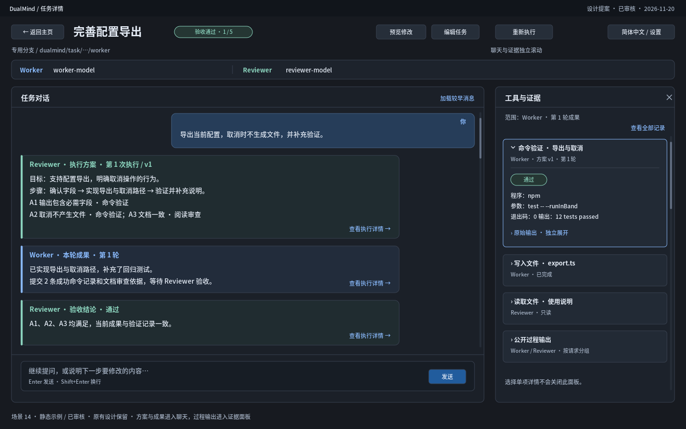
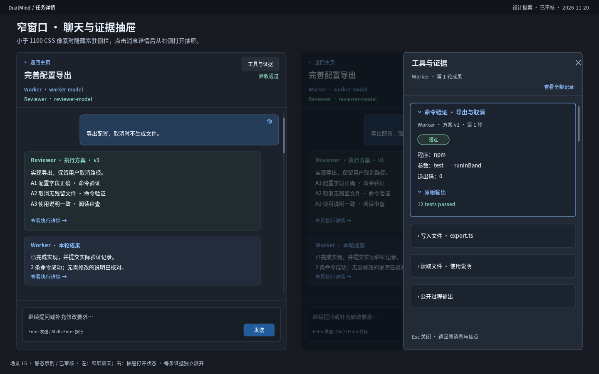
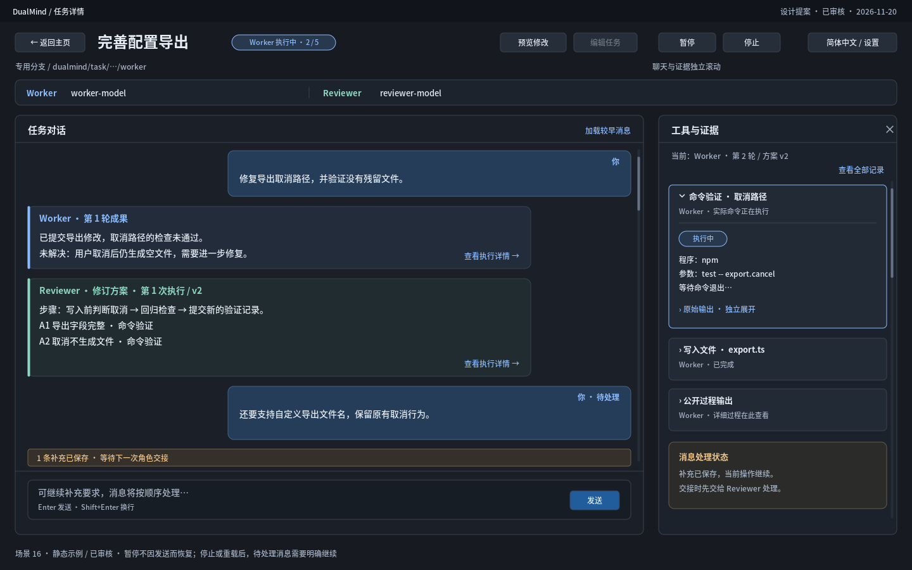
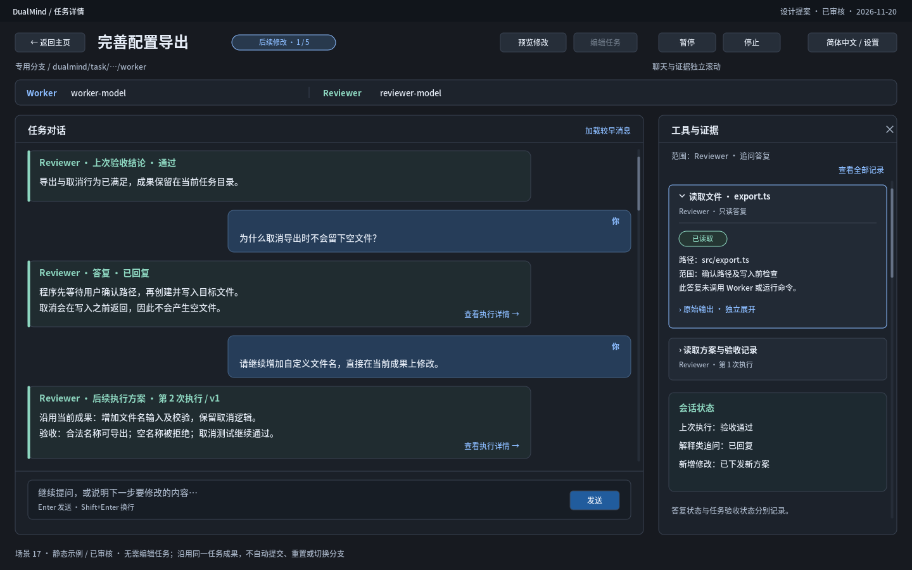

# Task chat and follow-up: interface revision proposal

[简体中文](../zh/task-chat-proposal.md) · [Design index](./design.md)

**Status: approved and implemented.** Date: 2026-11-20. These four SVG/PNG pairs are the review artifacts for this revision. All content is illustrative, not a real execution result. The existing 13 designs and their approval records remain unchanged; this proposal adds scenes 14–17.

The agreed interaction uses compact role/model information, user messages on the right, AI messages on the left, a right-hand evidence panel, questions or further changes after execution, and queued messages during execution. Main chat emphasizes plans and outcomes; ordinary public progress text moves into evidence details.

## 14. Wide chat with evidence panel

[Editable SVG](../design/dual-mind-task-chat-proposal.svg) · [PNG preview](../design/dual-mind-task-chat-proposal.png)

- The header retains the task name, status, branch and actions. Worker and Reviewer show only their role and model, without role descriptions, preset instructions or long progress text.
- Chat is chronological. Users align right; AI aligns left. Each AI title identifies the role, content type and applicable execution, round and plan version. Host errors are system messages, not AI output.
- Original requirements, Reviewer plans and acceptance criteria, Worker submissions and Reviewer verdicts appear once. Ordinary public model text, file operations and raw command output live in the evidence panel. Private reasoning is never displayed.
- The right panel is approximately 360 CSS pixels wide, open by default and explicitly closable. Its title, close button and scope toolbar remain fixed while records scroll independently. Individual records and raw outputs expand separately.
- “View execution details” opens and locates the associated record; repeating the action never closes the panel. “Show all records” clears the message scope. Streaming updates, locale changes and older-history loading preserve expanded items.
- Chat and evidence paginate separately. Reading older messages preserves position; new content shows a “New messages” control. Automatic following occurs only while the user is at the bottom.

## 15. Narrow view and evidence drawer

[Editable SVG](../design/dual-mind-task-chat-narrow-proposal.svg) · [PNG preview](../design/dual-mind-task-chat-narrow-proposal.png)

The left side shows narrow chat; the right side shows the same page with the drawer open. Below an actual viewport width of 1100 CSS pixels, the persistent sidebar becomes a drawer. Both the evidence button and message details links open it. Drawer width is capped at 430 CSS pixels and at the viewport width. Closing restores the original message position and triggering control's focus.

Models, task actions and long messages wrap. The message area and composer adapt to available height. The open drawer traps focus and supports Escape and an explicit close button. Long commands and code scroll locally instead of widening the page. Expanding one record never closes the drawer.

## 16. Sending messages during execution

[Editable SVG](../design/dual-mind-task-chat-queued-proposal.svg) · [PNG preview](../design/dual-mind-task-chat-queued-proposal.png)

- The example shows Worker executing round two. A new user message appears on the right as pending, with a saved-queue notice. Neither the current plan nor the running command falsely claims to have incorporated that message.
- Reviewer handles queued messages at the next role handoff and before final acceptance. Questions can receive read-only answers; changes require an updated plan before Worker acts. User messages are not passed directly as Worker tool instructions.
- Sending does not interrupt the current operation or resume a manually paused task. Stop or host reload preserves pending messages and requires explicit “Continue processing”; old requests are not replayed automatically.
- The active execution retains its round limit. Pending additions cannot be ignored to declare completion. The workspace still allows only one active task.

## 17. Questions and further changes after completion

[Editable SVG](../design/dual-mind-task-chat-followup-proposal.svg) · [PNG preview](../design/dual-mind-task-chat-followup-proposal.png)

The example starts after acceptance. A user asks a question; Reviewer inspects relevant artifacts and returns an answered reply without invoking Worker, executing commands or creating a new acceptance verdict. The user then requests a change: Reviewer issues a follow-up plan, followed automatically by Worker implementation and Reviewer acceptance. Each follow-up execution links to its initiating messages and predecessor, with its round count reset from task configuration. Execution labels distinguish repeated plan version numbers.

Further changes reuse the same task's bound directory and branch, including uncommitted results. Reviewer inspects current files and differences, including user edits. New artifacts require new valid evidence. A changed directory, branch or HEAD preserves the message and reports an error rather than resetting, switching, committing or cleaning files. The existing restart action retains its previous meaning and remains distinct from continuing on current artifacts.

## Input, status and history

- New tasks still require an explicit Start. Chat additions and follow-up are available after execution begins. Original requirements appear as a user message; task editing remains available for configuration changes.
- Clear the submitted text only after persistence succeeds; retain it on failure. Message IDs prevent retries from starting duplicate work. Enter sends, Shift+Enter inserts a newline, and IME composition never sends a message.
- Keep the composer reachable, and do not let a late acknowledgment clear newly typed text. Display Reviewer processing status. Reviewer may ask a clarifying question and await the user's answer.
- Persist conversation across executions under the task. Chat messages and raw evidence have separate pagination; the last 80 raw events no longer stand in for the whole conversation. New execution does not erase earlier history. Legacy records without a role appear as system records rather than inferred authorship.
- New controls, states and errors support both languages. User text, model answers and external output retain their original language. Transport and persistence retain credential-redaction rules.

## Review and implementation status

2026-11-20: the user explicitly approved all four additions and authorized implementation. The previous 13 designs are retained. Chat, evidence, message persistence and Reviewer continuation code are integrated; real UI regression passed; other validation results are recorded as executed. Actual coverage is recorded in [task chat validation](./task-chat-validation.md), separately from the design artifacts. See the [development log](./development-log.md).
