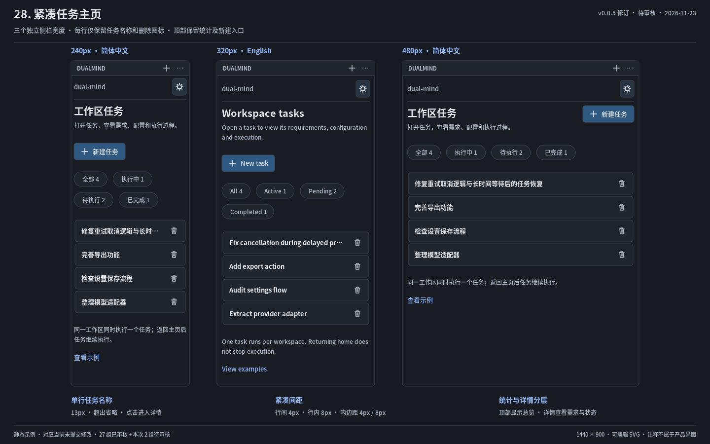
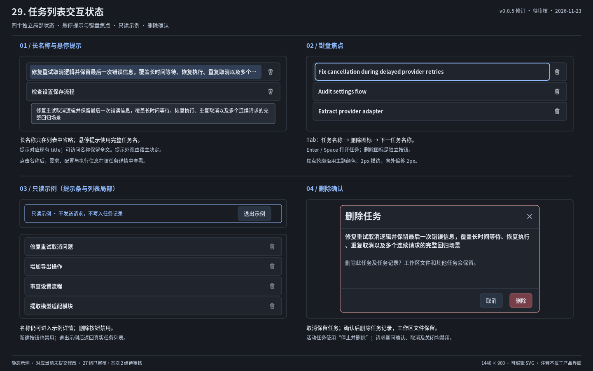

# Compact task list: home and interaction designs

[简体中文](../zh/task-home-compact-proposal.md) · [Design index](./design.md) · [Usage](./usage.md)

**Local Git archive update (November 23, 2026):** the implementation is committed by feature on local `master`, after the original `v0.0.5` tag. Scenes 28–37 are approved and implemented. Earlier review, uncommitted-state and tag statements below retain their historical context; see the [development log](./development-log.md) for current provenance.

**Approval and implementation update (November 23, 2026):** this round approves the existing frontend and integrates these controls. Earlier pending-review wording below retains its historical context; see the [design index](./design.md) for current totals and status.

**Status: scenes 28–29 await review. Recorded November 23, 2026.** These static drawings document the current uncommitted task-list changes. They belong to the `v0.0.5` development archive, follow the existing `v0.0.5` tag, and are not claimed to be in that tag or an existing VSIX. The 27 approved designs and their approval records remain intact: there are now 29 pairs, including two awaiting review. This delivery adds design assets and documentation while preserving the existing frontend and test edits.

Each canvas is **1440 × 900**, follows the dark sidebar style, and contains editable text and static vectors without scripts, embedded images, or external resources. Task names, counts, and states are illustrative, not execution or test results. Dimensions, interaction notes, and review labels outside the product drawings are not product content.

## 28. Compact task home

[Editable SVG](../design/v0.0.5/dual-mind-task-home-compact-proposal.svg) · [PNG preview](../design/v0.0.5/dual-mind-task-home-compact-proposal.png)



The columns show independent 240px Chinese, 320px English, and 480px Chinese examples. VS Code controls the actual width; the designs introduce no forced width. Following current source, retain the native title-bar plus, workspace name, Settings, the home New task button, counts, and View examples. All, Active, Pending, and Completed counts remain informational; individual rows no longer repeat task state.

Each row contains only the task-name button and a separate delete button. Selecting the name opens that task's detail, where requirements, Reviewer role, Git strategy, rounds, and execution state remain available. Home navigation does not change background execution. Longer lists scroll inside sidebar content; the name and delete action stay on the same line at narrow widths.

| Element        | Rule from current source                                    |
| -------------- | ----------------------------------------------------------- |
| Task name      | 13px, one line, ellipsis on overflow                        |
| List spacing   | 4px between rows; zero top margin                           |
| Row layout     | Name fills remaining width; delete does not shrink; 8px gap |
| Row padding    | 4px vertically, 8px horizontally                            |
| Name hint      | Full name in both `title` and accessible name               |
| Narrow sidebar | Rows do not wrap; counts and descriptions wrap as needed    |

Retain the existing empty state and Open folder entry when no workspace is open. This revision adds no filtering, sorting, search, or task fields.

## 29. Task-list interaction states

[Editable SVG](../design/v0.0.5/dual-mind-task-home-interactions-proposal.svg) · [PNG preview](../design/v0.0.5/dual-mind-task-home-interactions-proposal.png)



The four crops are reviewed separately, not as simultaneous states. The read-only example group shows separate banner and list crops; scene 28 covers omitted home elements.

| State or action      | Behavior                                                                                                                                                            |
| -------------------- | ------------------------------------------------------------------------------------------------------------------------------------------------------------------- |
| Long-name hover      | The list uses an ellipsis; the existing `title` exposes the complete name. Tooltip appearance is illustrative and browser/host controlled, not a new custom overlay |
| Keyboard focus       | Tab visits name, delete, then the next name; Enter/Space activate the name. Retain the 2px theme focus outline with a 2px offset                                    |
| Assistive technology | The name button exposes the full name; the delete button uses the localized equivalent of “Delete task: task name”                                                  |
| Read-only examples   | Names still open example details. Delete and the page New task button are disabled; the delete hint is Read-only example. Exit examples restores real tasks         |
| Delete confirmation  | Show the full task name, Cancel, and Delete. Cancel retains the task; confirmation removes the task and its record, keeping workspace files and other tasks         |
| Active task          | Existing nonterminal runs use Stop and delete, following the host's existing stop/delete flow                                                                       |
| Pending request      | Disable row delete buttons and the dialog's confirmation, cancel, and close buttons; Escape does not close a submitting dialog                                      |
| Dialog keyboard      | Trap focus inside the dialog; Escape closes it before submission, restoring the triggering button's focus when still available                                      |

## Mapping to current changes

- `webview/src/Tasks.tsx`: reduce each row to name and delete buttons and add the full-name `title`; retain existing deletion, preview, counting, and navigation logic.
- `webview/src/styles.css`: compact spacing, 13px names, single-line ellipsis, and nonwrapping task rows; the drawings follow these rules.
- `tests/local/ui.test.tsx`: add assertions for name-only rows, long names, opening detail, canceling/confirming deletion, and update preview/navigation queries.
- `scripts/verify-ui.mjs`: locate tasks by their names instead of the removed Open task buttons.

This design delivery does not change product APIs, host messages, or persisted data. Behavior is checked against source and test assertions; static artwork does not establish runtime validation.

## Rendering and checks

Render with **CairoSVG 2.7.1** in an isolated Python environment. The local font is Noto Sans CJK SC, with DejaVu Sans and system sans-serif fallbacks. To regenerate the previews in an environment containing CairoSVG:

```bash
for scene in compact interactions; do
  python -m cairosvg "docs/design/v0.0.5/dual-mind-task-home-${scene}-proposal.svg" -o "docs/design/v0.0.5/dual-mind-task-home-${scene}-proposal.png"
done
npm run docs:check
npm run format:check
git diff --check
```

Inspect PNG text, long names, ellipses, focus, icons, and dialog boundaries, and verify that all 54 existing SVG/PNG files are unchanged. The [development log](./development-log.md) records checks actually run and omitted tests. Design approval and runtime verification are separate records.
