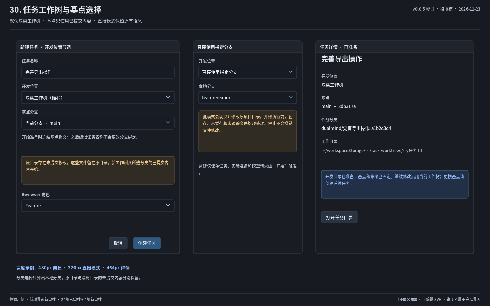
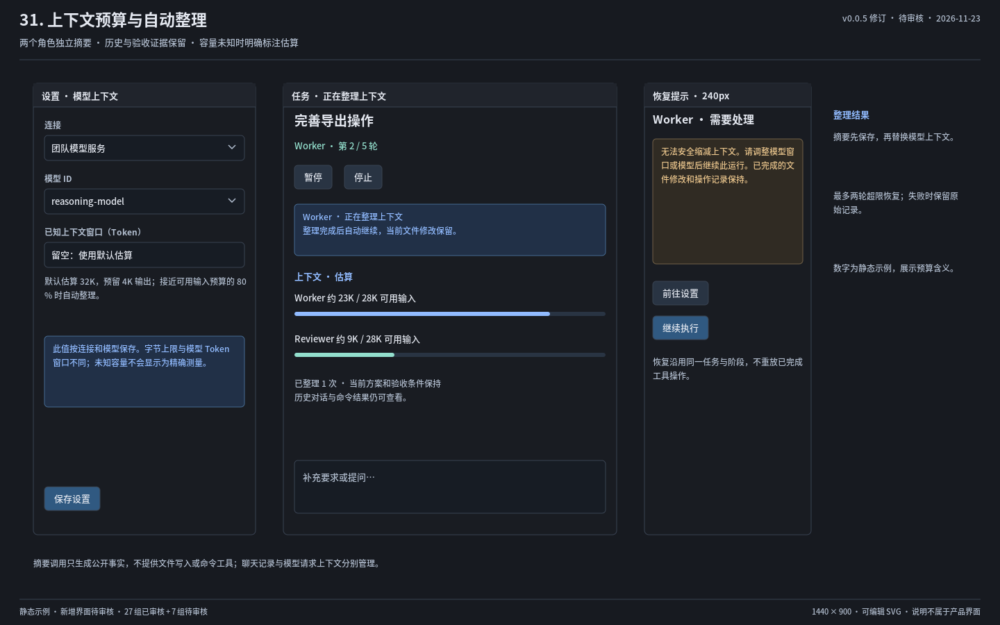
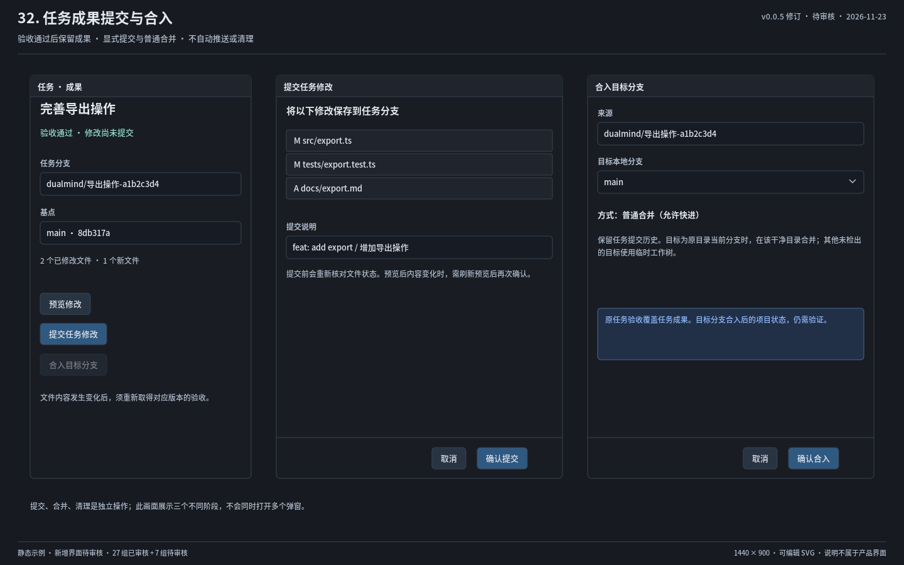
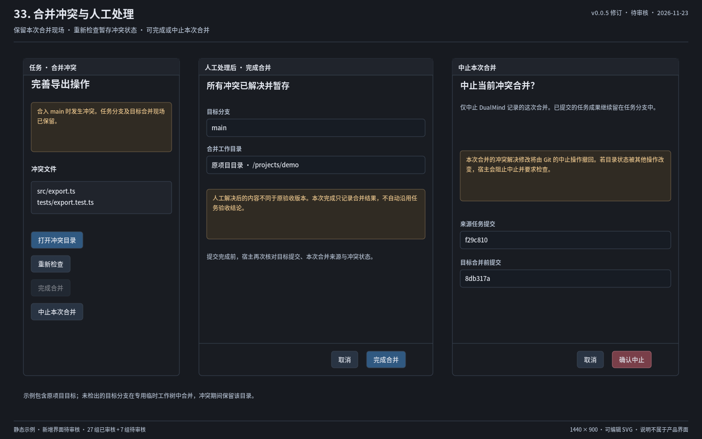
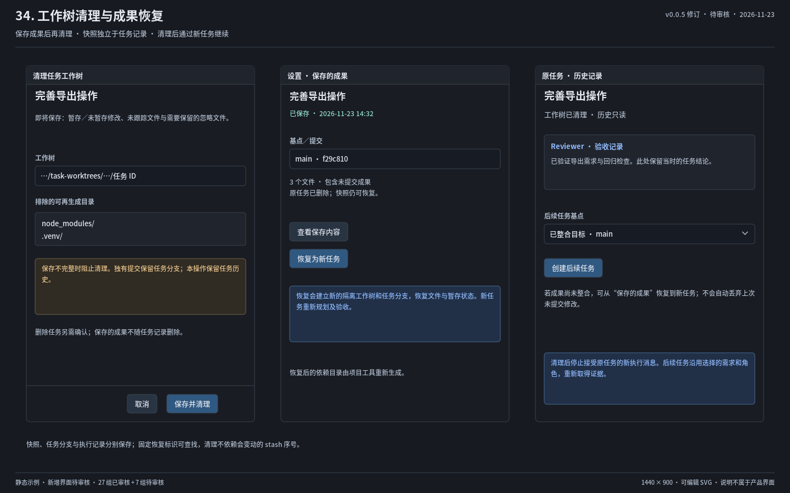

# Worktrees, context, and artifact lifecycle: UI proposal

[简体中文](../zh/task-lifecycle-proposal.md) · [Host behavior](./task-lifecycle.md) · [Design index](./design.md)

**Local Git archive update (November 23, 2026):** the implementation is committed by feature on local `master`, after the original `v0.0.5` tag. Scenes 28–37 are approved and implemented. Earlier review, uncommitted-state and tag statements below retain their historical context; see the [development log](./development-log.md) for current provenance.

**Approval and implementation update (November 23, 2026):** this round approves the existing frontend and integrates these controls. Earlier pending-review wording below retains its historical context; see the [design index](./design.md) for current totals and status.

**Scenes 30–34 await visual approval, November 23, 2026.** Host operations, automatic summaries, and tests are implemented; new base, budget, artifact, conflict, and cleanup/restore controls are not connected yet. Following the contribution guide, these reviewable drawings precede integration of new controls. Scenes 1–27 retain approval and 28–29 remain pending: 34 pairs total, 27 approved and seven awaiting review. Version remains 0.0.5.

All canvases are 1440 × 900 editable static SVG with PNGs rendered by CairoSVG 2.7.1. Directories, branches, timestamps, budgets, and results are examples; footer annotations are not product content. Retain the sidebar, compact home, persistent composer, and existing dialog/focus rules. Columns represent independent states, not simultaneous pages.

## 30. Worktree base selection

[SVG](../design/v0.0.5/dual-mind-workspace-base-proposal.svg) · [PNG](../design/v0.0.5/dual-mind-workspace-base-proposal.png)

Managed mode selects an existing local base, defaulting to the current branch when prepared. Dirty source files remain in place; direct mode retains a clean-directory requirement. Prepared tasks show frozen base and task directory. The create view crops the development-location region; existing required requirements, role, and model fields still apply.

## 31. Context budgeting and compaction

[SVG](../design/v0.0.5/dual-mind-context-compaction-proposal.svg) · [PNG](../design/v0.0.5/dual-mind-context-compaction-proposal.png)

320px shows model-window settings, 480px independent role budgets and compaction, and 240px recoverable failure. Unknown capacity is labelled estimated. Failed summaries permit settings repair and continuation; public history, current plans, and file edits remain.

## 32. Commit and merge artifacts

[SVG](../design/v0.0.5/dual-mind-artifact-integration-proposal.svg) · [PNG](../design/v0.0.5/dual-mind-artifact-integration-proposal.png)

Separate artifact, commit-confirmation, and merge-confirmation views. Commit shows files and an editable message; merge requires accepted, committed content. The original base is the default target, with other local branches available. Ordinary merging retains history and still requires verification of the integrated result.

## 33. Merge conflicts

[SVG](../design/v0.0.5/dual-mind-merge-conflicts-proposal.svg) · [PNG](../design/v0.0.5/dual-mind-merge-conflicts-proposal.png)

Conflicts offer Open directory and Recheck. Completion stays disabled until conflicts are resolved and staged. Abort confirmation explains its effect on current conflict-resolution edits. External changes or branch occupancy produce actionable errors while retaining work.

## 34. Cleanup and artifact restoration

[SVG](../design/v0.0.5/dual-mind-workspace-cleanup-proposal.svg) · [PNG](../design/v0.0.5/dual-mind-workspace-cleanup-proposal.png)

Cleanup previews the directory, preservation scope, and exclusions. Preservation failure keeps records and offers retry information. Delete-with-cleanup explicitly adds that action to the delete confirmation; legacy delete still only removes records. Independent saved-artifact entries restore into new tasks. Cleaned tasks retain read-only history and replace the composer with a follow-up entry.

## Integration after review and validation

After visual approval, connect the fields/actions in TaskForm, task detail, settings, and deletion confirmation. Preserve bilingual copy, keyboard access, long-name hints, and no page-wide overflow at 240/320/480px. Disable duplicate operations during submission, confirm preview tokens, and show pending operations after reload instead of restarting them.

The [development log](./development-log.md) separates design checks from runtime validation. Existing UI regressions cover current controls, not the unimplemented entries illustrated here.
