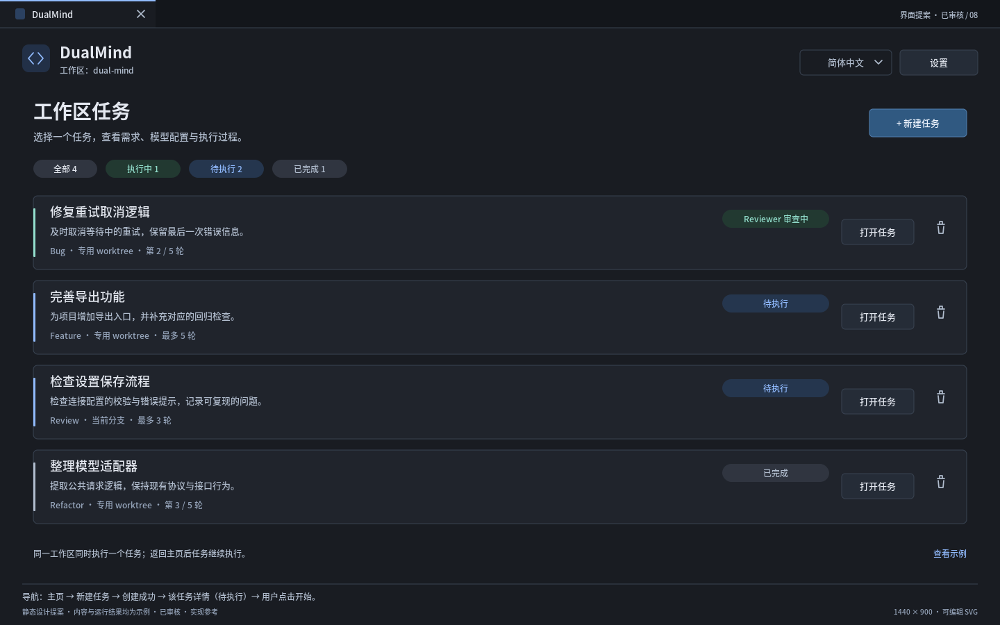
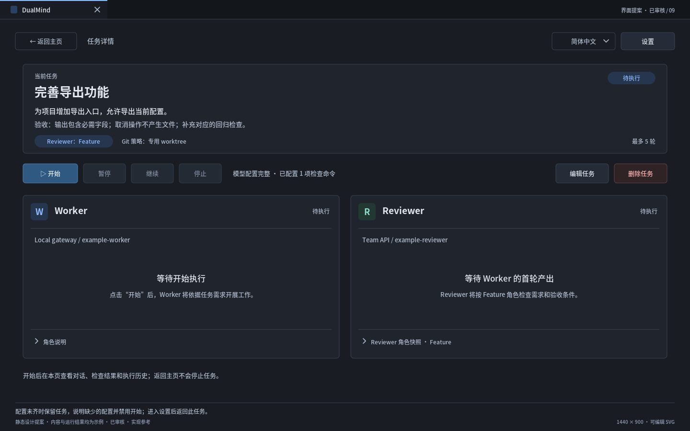
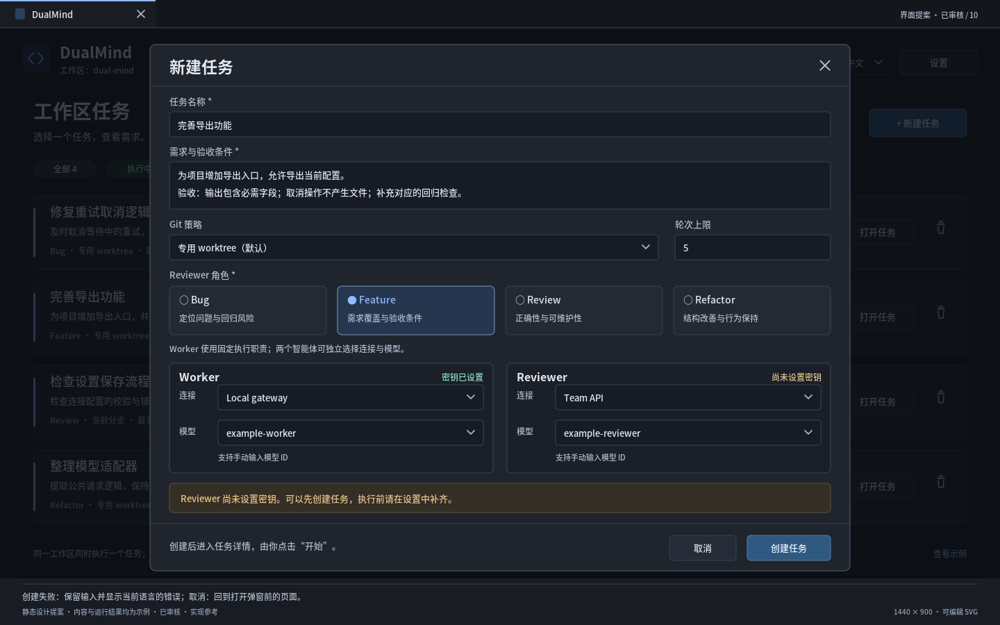
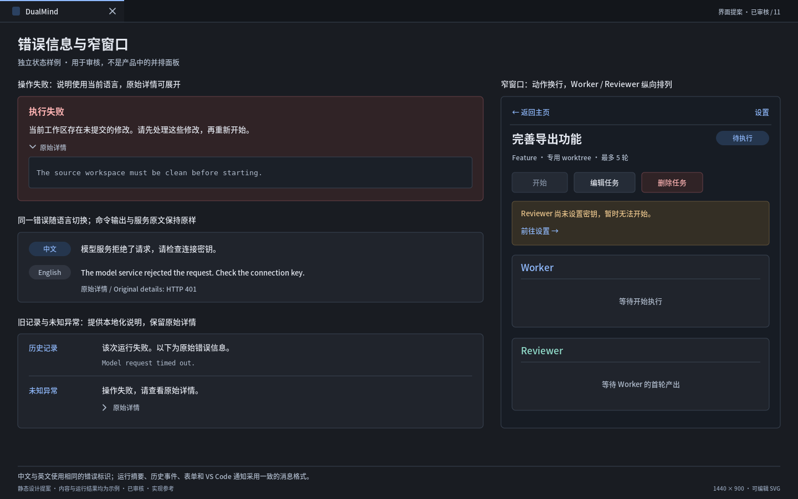

# Task home, detail, and errors: interface revision proposal

[简体中文](../zh/task-pages-proposal.md) · [Design index](./design.md)

**Status: approved and implemented. Approval date: 2026-11-20.** This delivery adds scenes 8–11 as SVG/PNG pairs and preserves scenes 1–7. Task pages, navigation, and error localization are implemented. The drawings remain static references, not actual execution results.

The agreed interaction uses one VS Code tab for the home and task detail pages. Creating a task opens its detail page in the **Pending** state; the user clicks **Start**. Remove the task “draft” concept from the product interface. Existing defaults, role snapshots, model selection, and Git strategies continue to apply.

Subsequent revision: [task chat and follow-up, scenes 14–17](./task-chat-proposal.md), supersedes this proposal’s two-column detail layout. The descriptions and images below retain the design approved on 2026-11-20. Home navigation, manual start, error compatibility and data rules still apply; see [Usage](./usage.md) for current layout.

Later home revision (November 23, 2026): [compact task-list scenes 28–29](./task-home-compact-proposal.md) document current uncommitted source and await review. Rows show only names and deletion, with single-line ellipsis for long names. Scene 8 and the narrow-window descriptions below retain their original approval context.

## Previews

Each canvas is 1440 × 900. These proposals use Simplified Chinese for the main interface, with an English error example in scene 11; the implementation displays one language according to its setting. Graphics and text remain editable, with no external images, font downloads, or scripts. Review notes along the bottom are not product content.

| Scene                         | SVG                                                           | PNG                                                            |
| ----------------------------- | ------------------------------------------------------------- | -------------------------------------------------------------- |
| 8. Separate task home         | [Source](../design/v0.0.3/dual-mind-task-home-proposal.svg)   | [Preview](../design/v0.0.3/dual-mind-task-home-proposal.png)   |
| 9. Separate task detail       | [Source](../design/v0.0.3/dual-mind-task-detail-proposal.svg) | [Preview](../design/v0.0.3/dual-mind-task-detail-proposal.png) |
| 10. Create task               | [Source](../design/v0.0.3/dual-mind-task-create-proposal.svg) | [Preview](../design/v0.0.3/dual-mind-task-create-proposal.png) |
| 11. Errors and narrow windows | [Source](../design/v0.0.3/dual-mind-task-states-proposal.svg) | [Preview](../design/v0.0.3/dual-mind-task-states-proposal.png) |

### 8. Separate task home



Home shows each task's name, requirement summary, Reviewer role, Git strategy, rounds, and current status. Clicking the task name or **Open task** opens its detail page; deletion is a separate action. Counts at the top are informational, not filters. The list scrolls when necessary, and only one task runs per workspace. Retain settings, creation, and the existing read-only sample preview.

An empty workspace shows **No tasks yet** and the creation action; without an open workspace, use the existing **Open folder** entry. Home contains no individual task conversation or execution controls. Navigating to or from home does not affect background execution.

### 9. Separate task detail



The detail header provides **Back to home** and settings, followed by task name, requirements, Reviewer role, Git strategy, and round limit. Worker and Reviewer occupy separate columns. Missing configuration is identified with a settings entry. A new task shows **Pending** and empty conversations awaiting execution; creation makes no model request.

Start, pause, resume, stop, edit, and delete actions follow the current execution state. Running tasks show streamed conversations. Check evidence, history pagination, paused feedback, **Preview changes**, and **Open task directory** retain their behavior below the conversations and scroll with the page. No automatic application action is added. The drawing depicts a task that has not run, so history and result panels are absent.

| Action or restore condition                 | Result                                                                  |
| ------------------------------------------- | ----------------------------------------------------------------------- |
| Creation succeeds                           | Open detail using the task ID returned by saving; wait for manual start |
| Open from home or the VS Code sidebar       | Show that task's detail in the same workbench                           |
| Return home                                 | Show the list while execution continues                                 |
| Enter settings from detail and return       | Restore the originating task detail                                     |
| Delete the current task                     | Return home; stop and confirm an active task before deletion            |
| Reload or reopen the workbench              | Restore the saved page and task ID                                      |
| Restored task no longer exists              | Fall back to home                                                       |
| Restore an old `workbench` navigation state | Open the new home without changing task data                            |

### 10. Create task



Retain the name, requirements, Reviewer role, Git strategy, round limit, and independent model bindings. Use **Create task** as the primary action and **Save task** when editing, with no separate draft submission or confirmation. Git strategies retain managed worktree, current branch, and existing branch options; the last option reveals the existing branch selector. Custom roles remain selectable, and editing preserves the task's role snapshot.

Missing API configuration, credentials, or checks does not block creation; detail explains the prerequisites for execution. Model selectors keep fetching, refreshing, and manual entry and are shown collapsed here. A creation failure appears inside the dialog and preserves input; cancel or close restores the previous page. Prevent duplicate submission while saving. Success closes the dialog and opens the new task detail.

### 11. Errors and narrow windows



These are independent review examples, not simultaneously displayed product panels. Application errors explain the cause and a useful next action in the selected language. Relevant original details expand beneath the message. Language changes immediately reformat structured errors. User input, command output, model responses, and external original errors remain verbatim.

Run summaries, historical errors, forms, bridge timeouts, and native VS Code notifications use shared error identifiers and parameters. Old history and unknown exceptions receive localized context with redacted original details; do not guess identifiers from strings or machine-translate historical text. Native notifications use the same message formatting and expose details through supported VS Code affordances rather than replicating web disclosure controls.

Below 900 CSS pixels, Worker appears above Reviewer. Home rows, detail controls, and settings entries may wrap. Long names and requirements wrap, and full model IDs remain accessible without stretching the layout. Creation becomes a scrollable single column with reachable save and cancel actions. Preserve keyboard navigation, visible focus, dialog focus constraints, and Escape behavior; model suggestions consume Escape before the dialog. Errors are accessible to assistive technology.

## Implementation and validation agreement

The implementation adds explicit home, task detail, and settings navigation with task IDs and settings return targets. Run records continue to determine visible task status. Preserve the existing `status: 'draft'` storage field for compatibility, with no task migration. Add compatible structured error fields while retaining old-record readability. Update both languages, usage and protocol documentation, and relevant tests during implementation.

Acceptance covers successful and failed creation, cancellation, sidebar navigation, settings return, reload restoration, deletion routing, start prerequisites, bilingual errors, old history, single-task execution controls, and narrow layouts. Run `npm run check`, relevant extension-host tests, real UI verification, and packaging. Actual command verification now uses the local process runner without user-level systemd.

The design stage passed documentation and formatting checks, with each PNG inspected for text, boundaries, and overlap. Runtime verification is recorded separately. Re-render with CairoSVG 2.7.1 in a separate Python environment, preserving the original seven pairs:

```bash
for scene in task-home task-detail task-create task-states; do
  python3 -m cairosvg "docs/design/v0.0.3/dual-mind-${scene}-proposal.svg" -o "docs/design/v0.0.3/dual-mind-${scene}-proposal.png"
done
npm run docs:check
npm run format:check
```

Fonts use locally installed Noto Sans CJK SC, with DejaVu Sans and system sans-serif fallbacks. Arrows and disclosure icons use vector paths to avoid missing symbol glyphs.
