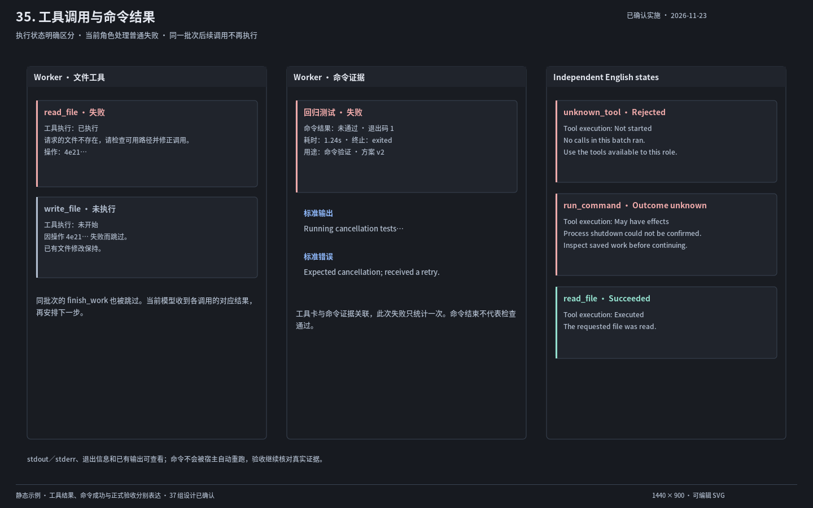
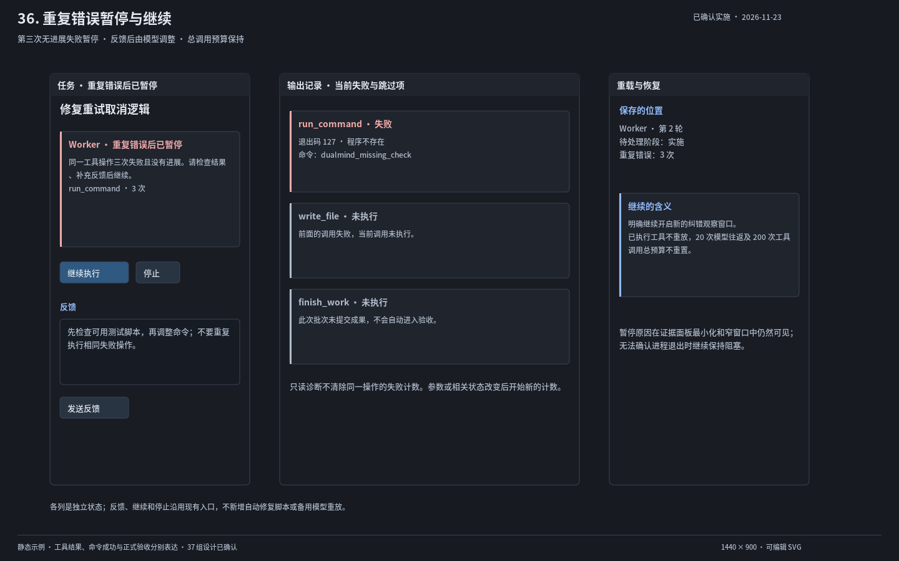
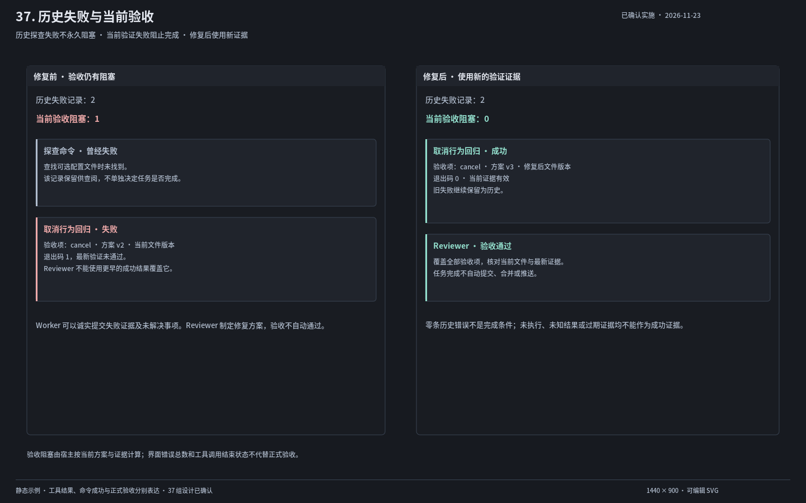

# Tool errors and acceptance: UI implementation record

[简体中文](../zh/tool-errors-proposal.md) · [Behavior](./tool-errors.md) · [Design index](./design.md)

**Confirmed for implementation, November 23, 2026.** This round approves the existing frontend and authorizes tool-error handling and UI integration together. Scenes 35–37 follow that confirmation without an additional review stop. The archive contains 37 designs; original scenes 1–34 and historical labels remain, with current approval recorded in the indexes.

All canvases are 1440 × 900 editable static SVG/PNG, rendered with local fonts. Tasks, output and counts are illustrative, not validation results.

## 35. Tool and command outcomes

[SVG](../design/v0.0.5/dual-mind-tool-results-proposal.svg) · [PNG](../design/v0.0.5/dual-mind-tool-results-proposal.png)

Distinguish tool return, command exit and acceptance. Label failed, rejected, skipped and unknown outcomes; command cards expose both channels and exit information, counting each operation once.

## 36. Repeated-error pause and continuation

[SVG](../design/v0.0.5/dual-mind-tool-pause-proposal.svg) · [PNG](../design/v0.0.5/dual-mind-tool-pause-proposal.png)

Pause after three failures without progress, retaining the role and reason. Users add feedback and explicitly continue without resetting total budgets or replaying completed tools.

## 37. Historical failures and acceptance

[SVG](../design/v0.0.5/dual-mind-acceptance-errors-proposal.svg) · [PNG](../design/v0.0.5/dual-mind-acceptance-errors-proposal.png)

Keep historical failures for inspection. Derive current blockers from the plan and newest evidence; fresh repair evidence can remove blockers without deleting old exploration failures.

The live UI retains evidence drawers, minimization and keyboard focus rules across English/Chinese and 240/320/480px widths. See the [development log](./development-log.md) for checks and resource use.
