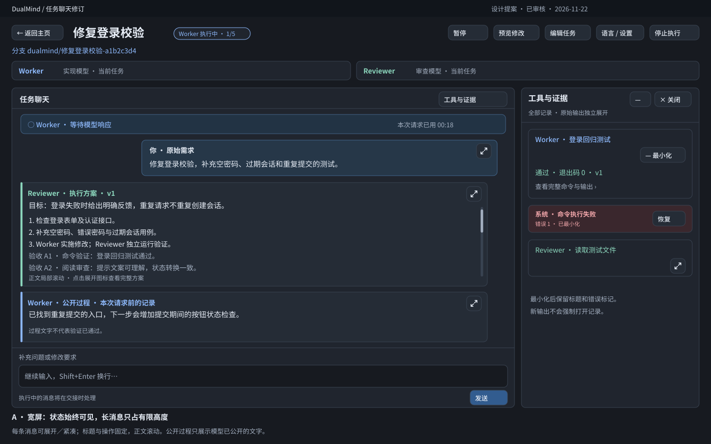
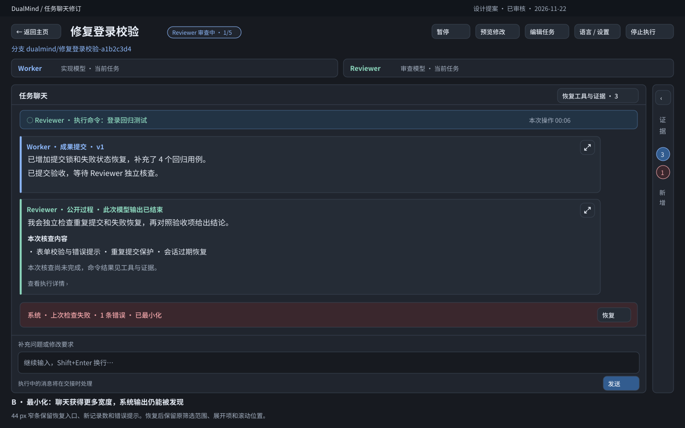
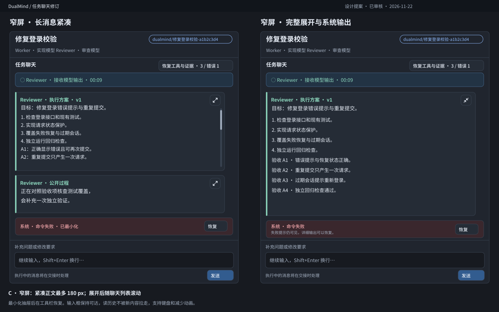

# 过程提示、紧凑聊天与最小化：界面修订提案

[English](../en/chat-progress-proposal.md) · [设计索引](./design.md)

**状态：已审核通过，已实现。** 日期：2026-11-22。以下三组 SVG／PNG 为静态交互示意，所有模型文字、耗时、计数及结果均为样例。已有 17 组已审核设计保持原样，本提案新增场景 18–20。

2026-11-22，用户确认设计基本审核通过，并补充要求：展开／紧凑使用简洁图标，不显示“展开”文字。SVG 已同步这一调整。聊天现已接入活动状态、公开过程、消息缩放、最小化和 Webview 偏好；设计图仍是参考示意，不是实际运行截图。

## 18. 宽屏：状态和公开过程

[可编辑 SVG](../design/dual-mind-chat-progress-proposal.svg) · [PNG 预览](../design/dual-mind-chat-progress-proposal.png)

聊天顶部增加活动条，显示角色、阶段、当前操作与耗时；即使模型没有输出正文，也能看见“等待模型响应”。首个有效流事件后切换为“接收模型输出”；工具和命令有独立状态。耗时由前端计算，不写每秒日志，不显示推测的百分比。暂停、停止、失败和宿主重启分别显示真实执行状态，不保留转圈提示。

模型公开过程按每次请求合并成一张带角色标记的卡片，流式追加，完成后仍能回看；它不代表方案、提交或验收结论。只展示已经脱敏的公开正文，不展示私有推理、工具参数流或加密协议内容。

每条消息，包括需求、用户补充、过程、方案、提交、验收和系统消息，都有图标式展开／紧凑按钮，保留中英文悬停提示和无障碍名称。正文默认最大高度 240 CSS 像素，短消息自然显示，长消息内部滚动；标题、时间与操作按钮留在正文外。展开后不改变字号，正文随聊天列表完整显示。

## 19. 宽屏：证据面板和单条系统输出最小化

[可编辑 SVG](../design/dual-mind-chat-minimized-proposal.svg) · [PNG 预览](../design/dual-mind-chat-minimized-proposal.png)

右侧约 360 像素的面板增加最小化按钮，收成约 44 像素窄条；聊天利用释放的宽度。窄条保留恢复入口、新记录数量和错误标记。原关闭功能保留，最小化与关闭是独立状态。新输出只更新提示，不自动恢复面板。

系统消息、命令及输出记录可单独最小化，只保留标题、结果状态、错误提示与恢复按钮。错误不因最小化而失去可见性。恢复面板或记录时保留筛选范围、展开项与滚动位置；不删除或截断保存的日志。

## 20. 窄屏：紧凑与完整阅读

[可编辑 SVG](../design/dual-mind-chat-compact-narrow-proposal.svg) · [PNG 预览](../design/dual-mind-chat-compact-narrow-proposal.png)

左侧展示长消息紧凑状态，右侧展示同一方案完整展开。窄屏正文最大高度为 180 CSS 像素；右侧证据仍使用既有抽屉，最小化后在聊天工具栏提供恢复入口和计数，不占常驻侧栏。输入区保持可达。

手动展开和最小化偏好按任务保存在 Webview 状态中，兼容当前只保存导航的状态。切换语言、任务、重新打开面板和流式更新不重置选择。读历史时保持锚点，仅在接近底部时跟随新内容。所有按钮有中英文名称、键盘可操作和明确焦点，支持减少动画。

## 新分支规则（后端已实现）

首次创建专用工作区采用 `dualmind/<任务名>-<短ID>`，例如 `dualmind/修复登录-a1b2c3d4`。任务名做 NFKC 规范化，保留 Unicode 文字、数字与连字符，英文转小写，其他字符替换为连字符；合并重复分隔符、去除首尾分隔符，最多 48 个 Unicode 字符，空名称回退 `task`。ID 从任务 UUID 去掉连字符后取前 8 位；分支已存在则依次使用 12 位、完整 32 位，再冲突报错。

命名版本和生成结果在首次准备时固定，后续任务改名不重命名分支。旧 `dualmind/task/<UUID>/worker` 分支及中断登记保持可恢复，当前／指定已有分支模式不改名。工作区身份仍严格校验，绝不接管重名分支。

## 审核与实施

2026-11-22，用户批准场景 18–20，并指定缩放按钮仅显示图标。实现保留已审核的消息高度、活动条、最小化窄条、窄屏抽屉和错误标记。偏好使用带版本的 Webview 状态，兼容旧导航；只保存 ID、显示状态、范围、滚动位置和记录计数，不保存消息正文或凭据。聊天请求显式启用公开过程。实际测试及平台限制记录于[开发日志](./development-log.md)。
