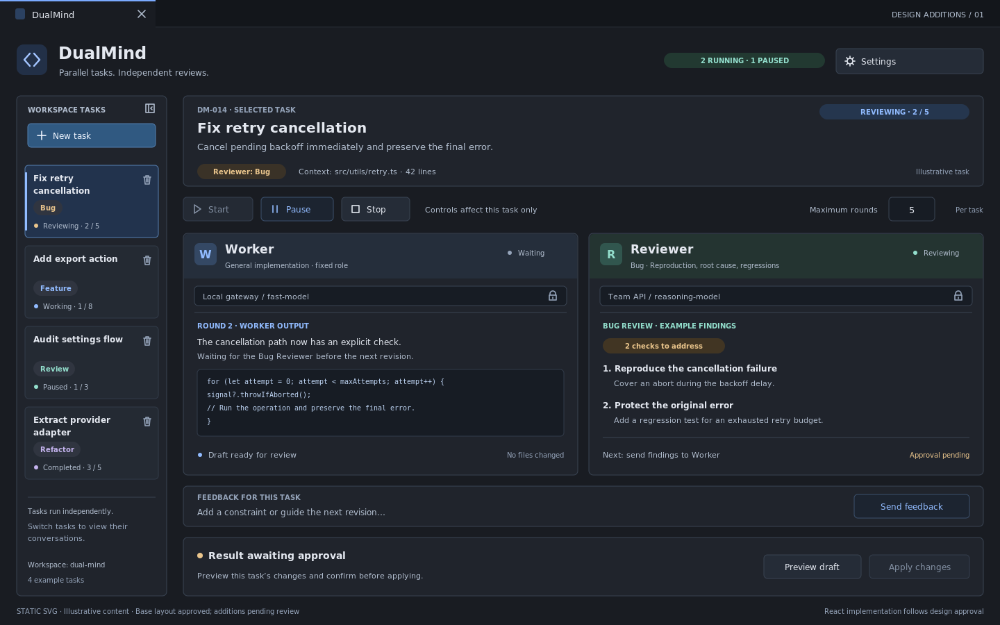
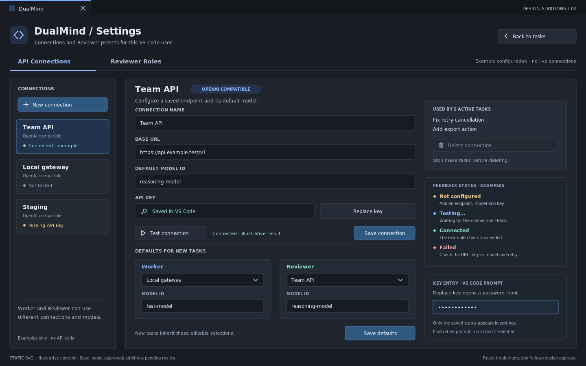
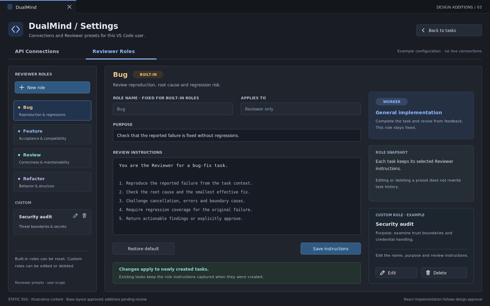
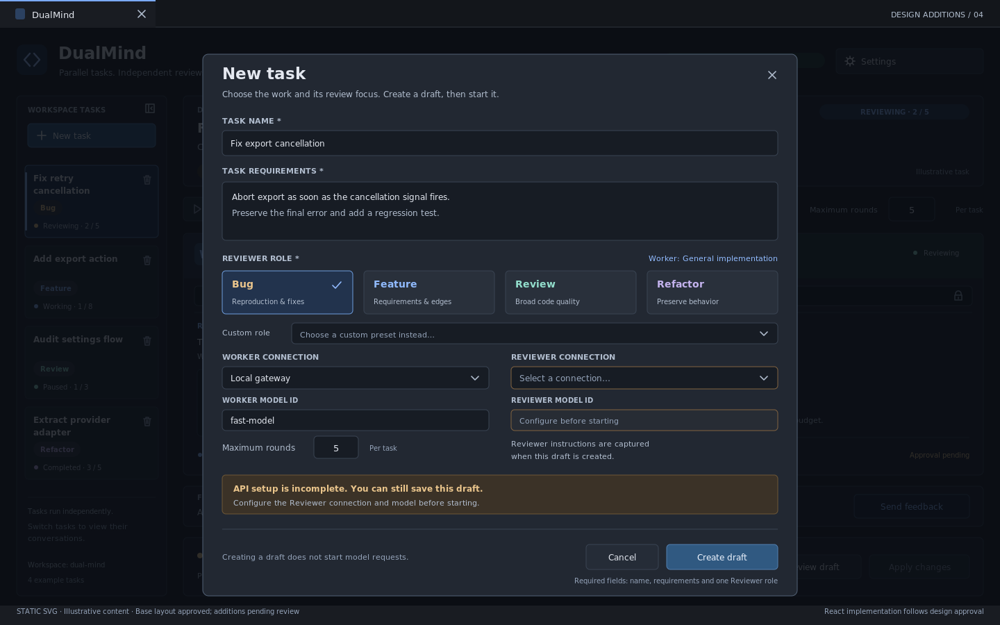
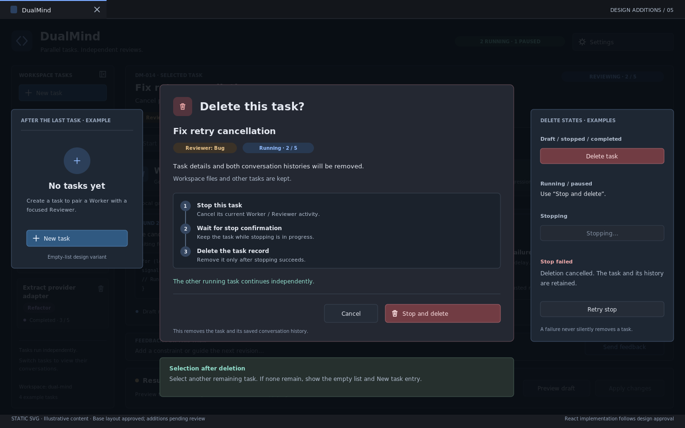

# 已审核界面设计参考

[English](../en/design.md) · [文档索引](./README.md)

**五个场景及任务管理、设置增补设计均已审核通过。** 原始 SVG／PNG 完整保留，包括图中历史审核标签。它们是含示例内容的设计参考，不是当前运行截图。React 工作台现已实现本地草稿、连接／角色设置和双语界面，真实执行及应用结果仍待后续开发，当前行为见[使用说明](./usage.md)。

每张画布均为 **1440 × 900**，采用贴近 VS Code 的深色配色，使用可编辑的 SVG 文字与矢量元素。界面标签为英文，配套中英双语说明。SVG 没有内嵌图片、脚本、外部字体或外部资源，PNG 为渲染预览。

## 设计稿导航

| 场景                 | 可编辑源文件                                  | 预览                                          |
| -------------------- | --------------------------------------------- | --------------------------------------------- |
| 1. 并行任务工作台    | [SVG](../design/dual-mind-workbench.svg)      | [PNG](../design/dual-mind-workbench.png)      |
| 2. API 连接设置      | [SVG](../design/dual-mind-api-settings.svg)   | [PNG](../design/dual-mind-api-settings.png)   |
| 3. Reviewer 角色设置 | [SVG](../design/dual-mind-reviewer-roles.svg) | [PNG](../design/dual-mind-reviewer-roles.png) |
| 4. 新建任务          | [SVG](../design/dual-mind-new-task.svg)       | [PNG](../design/dual-mind-new-task.png)       |
| 5. 删除任务          | [SVG](../design/dual-mind-delete-task.svg)    | [PNG](../design/dual-mind-delete-task.png)    |

### 1. 并行任务工作台



在已认可的双栏布局旁增加可折叠的工作区任务列表，每项显示名称、Reviewer 角色、状态、轮次和删除入口。示例包含两个运行中任务、一个暂停任务和一个已完成任务。选择任务只切换当前显示的对话，不会停止其他任务。

开始、暂停、停止、人工反馈、轮次上限和应用结果均属于当前选中任务。Worker 保持通用执行职责；Reviewer 展示该任务选择的审查侧重点。两个智能体各有独立的连接和模型，锁图标表示当前执行的配置已固定。草稿在开始前可以调整模型绑定和轮次上限，初始上限为五轮。

结果区明确区分审查通过与用户决定应用修改。多个任务可并行产出草稿，每份结果仍需单独预览并明确应用。设计稿不会回写代码。

### 2. API 连接设置



统一 Settings 入口包含 **API Connections** 和 **Reviewer Roles** 两个页签。连接是本机用户级的 OpenAI 兼容接口配置，包含名称、Base URL、默认模型 ID 和密钥保存状态，提供新增、保存、删除和测试操作。Worker 与 Reviewer 分别设置默认连接和模型 ID，新建任务继承这些默认值。

**Set key／Replace key** 通过扩展宿主打开 VS Code 密码输入框。设置页只显示是否已保存密钥，不展示或接收已存储的密钥值。独立的密码输入示例使用占位圆点，不含真实凭据。连接反馈展示未配置、测试中、成功和失败状态，均不代表实际请求结果。

连接被运行或暂停中的任务引用时，删除按钮禁用，并列出需要先停止的关联任务。修改默认值影响后续任务；已开始执行的任务保持其选定配置。保存的草稿若引用了不可用连接，需重新选择有效配置后才能开始。

### 3. Reviewer 角色设置



四类内置预设**只改变 Reviewer**：

| 角色     | 默认审查侧重点                       |
| -------- | ------------------------------------ |
| Bug      | 问题复现、根因、修复有效性和回归风险 |
| Feature  | 需求覆盖、验收条件、边界行为和兼容性 |
| Review   | 正确性、安全性、可维护性和测试覆盖   |
| Refactor | 行为保持、结构改善和回归验证         |

内置名称固定，用途说明和审查指令可编辑并恢复默认。**New role** 打开同一编辑区，允许填写自定义名称、用途和指令；自定义角色还提供编辑和删除操作。选择自定义角色会替代内置选择，每个任务始终只有一个 Reviewer 预设。

新建任务时保存所选角色名称和指令的快照。之后编辑、恢复默认或删除该预设，都不追改已有任务及其历史，包括已经保存的草稿。删除自定义预设只影响后续选择。固定 Worker 以说明卡片展示，不提供角色编辑入口。

### 4. 新建任务



名称、需求和一个 Reviewer 角色为必填项；弹窗同时确认两个连接及模型选择，以及当前任务的轮次上限。示例特意留空 Reviewer 连接：**Create draft** 仍可用，之后开始执行前需要配齐两个智能体的 API 配置。此时禁用的“开始”操作应明确指出缺少的配置，并提供 Settings 入口。

创建草稿后在工作台选中该任务，不立即发起模型请求。取消不创建任务。弹窗打开期间，其他任务可继续运行。

### 5. 删除任务



确认框显示任务名称，并说明仅移除其记录及双方对话历史，保留工作区文件和其他任务。草稿、已停止、已完成或完全失败的任务可以直接 **Delete task**。运行或暂停中的任务使用 **Stop and delete**：请求停止、等待确认、再删除记录。停止期间禁用重复的破坏性操作；停止失败时保留任务和历史并允许重试。取消确认框不执行任何动作。

删除后选择其他剩余任务；删除最后一个任务后显示 **No tasks yet** 和 **New task**。本稿左右侧面板和底部说明明确标注为供审核的状态示例，不表示实际界面同时打开这些弹窗。

## 布局与状态约定

- 任务和对话历史按工作区组织；连接、默认模型绑定及角色预设属于本机 VS Code 用户配置；凭据值由宿主秘密存储管理。
- 后台进度更新任务列表，双栏只展示选中任务。某个任务出错、暂停或完成，不会停止其他任务。
- 宽度低于 1200 CSS 像素时，任务侧栏收为 Tasks 按钮并通过抽屉展开；低于 900 CSS 像素时，Worker 在上、Reviewer 在下。设置表单与弹窗改为可滚动单栏，控制区允许换行，任务身份和操作入口保持可见。
- 实现阶段使用 VS Code 主题变量、可访问的控件标签、明确的焦点标识和键盘导航。这些静态稿不实现交互。

## 审核与实现门槛

所有者已认可完整设计。本地工作台沿用任务、连接和角色布局，并在设置中加入语言选择器。内置 Reviewer 定义分别维护中英文版本，自定义文本和任务快照保留原文。图中的运行状态和连接测试结果，在对应功能实现前仍为示例。

预定职责见[架构说明](./architecture.md)，任务关联和配置边界见[通信协议草案](./protocol.md)。其中区分已实现的本地消息类型与后续执行能力边界。

## 更新与验证预览

SVG 是可编辑源文件，每张 SVG 旁保留同名 PNG，供 README 和 VSIX 文档展示。在安装了 CairoSVG 2.7.1 的 Python 环境中，于仓库根目录重新生成全部预览：

```bash
for svg in docs/design/*.svg; do
  python3 -m cairosvg "$svg" -o "${svg%.svg}.png"
done
npm run docs:check
npm run format:check
npm run package
```

逐张按原尺寸检查裁切、缺字、遮挡和对齐。文档检查脚本扫描全部 SVG／PNG 配对，要求五个场景齐全，并检查画布尺寸、可访问的标题／描述、可编辑文字、静态矢量约束及 PNG 尺寸。布局仍需渲染和目视检查。CairoSVG 是可选设计工具，不属于扩展运行时或标准构建依赖。
