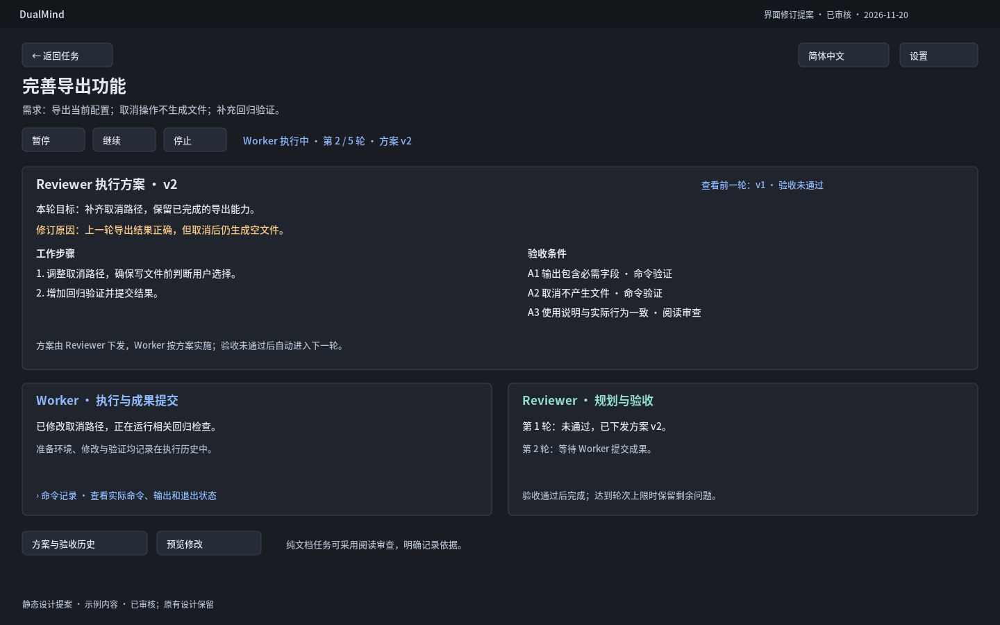
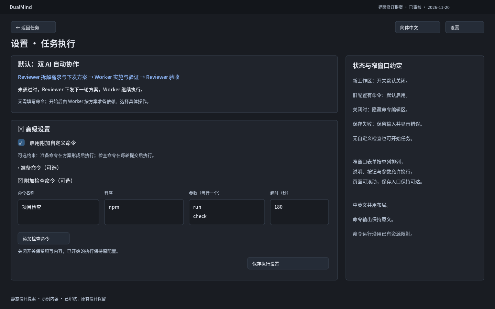

# 双 AI 方案与验收循环：界面修订

[English](../en/execution-cycle-proposal.md) · [设计索引](./design.md)

状态：已审核并实现。日期：2026-11-20。原有场景 1–11 保留。本提案是实施依据，不是运行验证结果。

后续修订：[任务聊天与持续追问](./task-chat-proposal.md)已将下述双栏详情改为聊天及独立证据面板。这里保留原设计；Reviewer 规划、Worker 实施、Reviewer 验收及附加命令设置的约定继续适用，当前布局见[使用说明](./usage.md)。

## 任务详情

[可编辑 SVG](../design/dual-mind-execution-cycle-proposal.svg)

Reviewer 根据需求与相关文件下发方案；Worker 完成实施及验证后提交成果；Reviewer 验收，未通过则下发下一轮方案。当前方案置于双栏对话之前，展示版本、目标、修订原因、步骤及验收项。命令验证与阅读审查分别标记。历史保留方案、成果提交、验收意见及实际命令证据。示例展示第二轮执行，第一轮未通过。

待执行时说明点击开始后先由 Reviewer 制定方案；没有方案时显示正在制定，Worker 等待。验收通过显示完成；轮次耗尽显示未完成及剩余问题。暂停、反馈、继续和停止保持可用。纯文档允许阅读审查，记录无需命令的原因和证据。

## 任务执行设置

[可编辑 SVG](../design/dual-mind-execution-settings-proposal.svg)

默认只说明双 AI 职责；折叠的高级设置包含附加自定义命令开关。关闭时保留数据，隐藏命令编辑区；新配置默认关闭，旧非空配置默认启用。启用后的准备命令在方案形成后执行；附加检查在每轮提交后必跑。保存失败保留输入，正在执行的任务使用原配置。右侧状态说明为设计注释，不是产品侧栏。

## 交互与语言

所有状态与控件提供中英文，用户文本、模型回答和原始输出保持原文。低于 900 CSS 像素时方案内容、双智能体对话及命令表单转为单列。长文本换行，命令输出局部滚动，整个页面可纵向滚动。折叠区可通过键盘操作，保存期间禁用重复提交，语言切换保留输入。新功能实现和验证结果在交付时单独记录。

实际验证结果见[验证记录](./execution-cycle-validation.md)，包含环境未覆盖项。

运行器修订（2026-11-20）：保留已审核 SVG／PNG 作为原设计记录。图中的资源限制注释现指超时、输出和取消机制；产品已移除 systemd/cgroup 与固定内存／交换空间要求，布局和交互不变。
