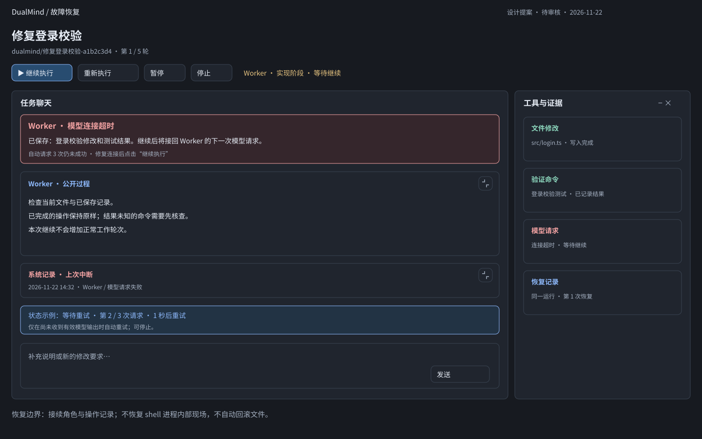
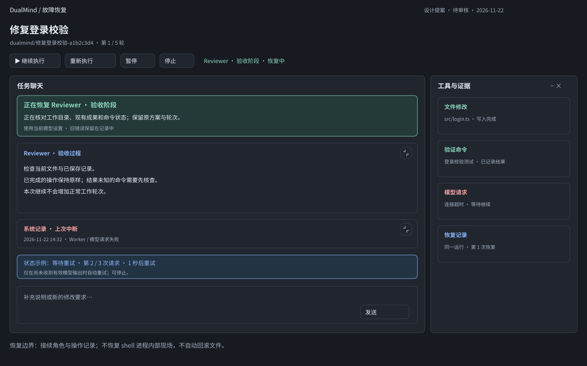
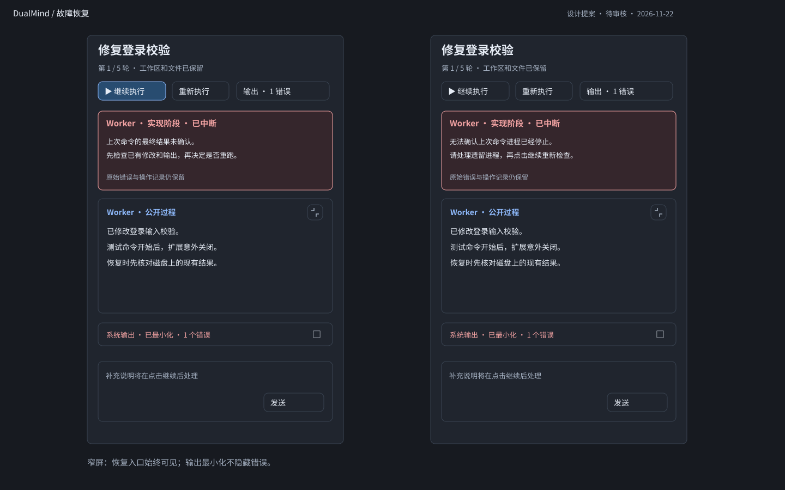

# 系统中断与继续执行：界面提案

[English](../en/recovery-proposal.md) · [设计索引](./design.md) · [恢复机制](./execution-recovery.md)

**状态：2026-11-22 已审核通过并接入。** 场景 21–23 在原 20 组设计上增加恢复界面。图中的任务、错误、时间和计数均为静态示例；已审核资产中的历史“待审核”标签保留。实际验证见[开发日志](./development-log.md)。

## 21. 宽屏：故障与继续执行

[SVG](../design/v0.0.4/dual-mind-recovery-failure-proposal.svg) · [PNG](../design/v0.0.4/dual-mind-recovery-failure-proposal.png)

沿用运行控制区，增加播放图标与“继续执行”文字；保留“重新执行”“暂停”“停止”。中断条明确显示 Worker／Reviewer、阶段、原因及已保存的位置。正文展开／紧凑仍只显示图标。独立的重试状态示例表示可取消的真实等待次数，不与故障状态同时作为活动提示显示。

## 22. 恢复中与有限自动重试

[SVG](../design/v0.0.4/dual-mind-recovery-running-proposal.svg) · [PNG](../design/v0.0.4/dual-mind-recovery-running-proposal.png)

点击后先显示恢复检查，禁用重复启动；核对目录、模型设置、进程和成果后接回原角色。保留原错误记录和同一工作轮次。不显示虚构百分比，不因恢复重置聊天显示偏好。自动重试等待和正常运行用不同状态文字。

## 23. 窄屏与无法确认旧进程

[SVG](../design/v0.0.4/dual-mind-recovery-narrow-proposal.svg) · [PNG](../design/v0.0.4/dual-mind-recovery-narrow-proposal.png)

左侧是可检查并继续的中断，右侧是无法确认旧进程停止的阻塞状态。“继续执行”可重新检查，但不能跳过阻塞。错误说明始终可见；输出最小化后保留错误计数。记录损坏、无恢复点等不可恢复情况显示禁用原因和重新执行入口。故障期间消息先保存，恢复后处理。

## 审核与实现

用户于 2026-11-22 明确批准三张设计稿。`Execution.tsx` 接入宿主已有恢复操作，`Recovery.tsx` 展示保存位置和阻塞原因，`ChatActivity.tsx` 展示实际重试次数并在本地倒计时。中断的答疑运行同样提供恢复入口。消息缩放仍为纯图标，显示偏好继续保留。
