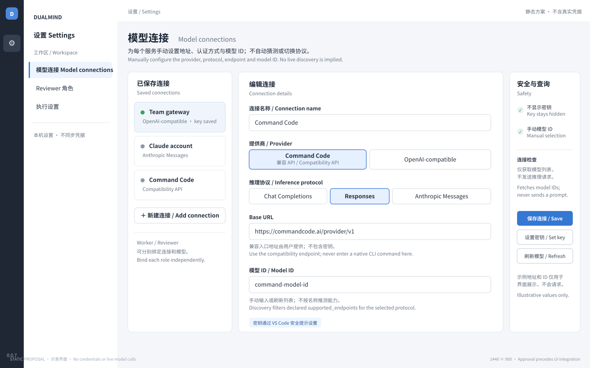
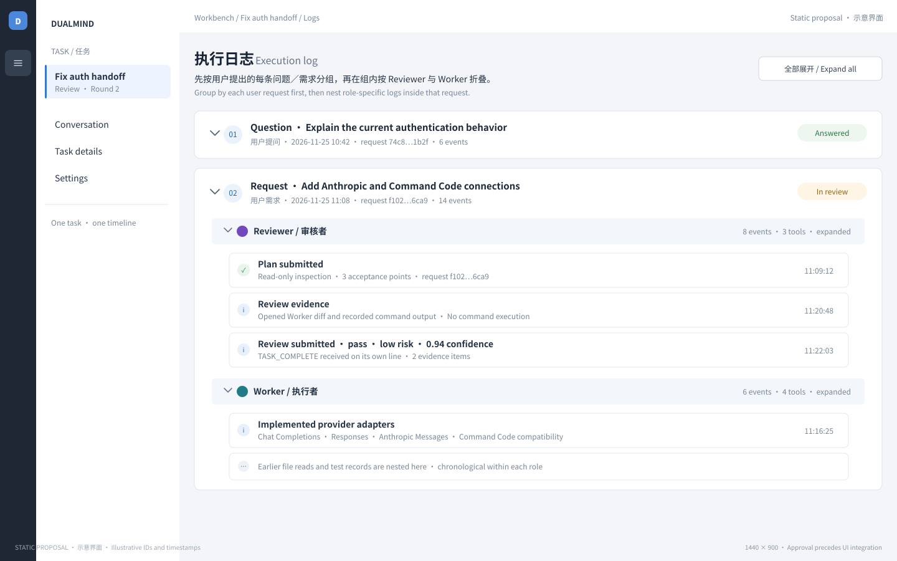

# 模型接入与紧凑审核工作台：界面修订提案

[English](../en/review-workbench-proposal.md) · [设计索引](./design.md)

**状态：待明确审核。** 制作日期：2026-11-25。以下三组 SVG／PNG 均为静态示意，包含模型提供商配置、紧凑任务栏和按请求分组的日志。对应界面源码尚未接入；后端模型适配、只读审核和请求归属可独立于视觉审核推进。

## 38. 模型提供商设置

[可编辑 SVG](../design/v0.0.7/dual-mind-model-provider-proposal.svg) · [PNG 预览](../design/v0.0.7/dual-mind-model-provider-proposal.png)

明确区分 Provider 与推理协议。OpenAI 兼容 Chat Completions／Responses、Anthropic Messages 和 Command Code 兼容 API 均由用户手动填写 URL、密钥和模型 ID。密钥仍通过宿主密码提示输入；刷新只查询模型 ID，Command Code 按声明的端点能力筛选。不自动猜测端点或切换协议。

## 39. 任务标题与上下文／成果互斥面板

[可编辑 SVG](../design/v0.0.7/dual-mind-compact-task-header-proposal.svg) · [PNG 预览](../design/v0.0.7/dual-mind-compact-task-header-proposal.png)

任务标题与任务操作放在同一紧凑行，原有详情仍在下方。模型上下文用量和任务成果共享下一行，并共用一个展开状态：打开一项自动关闭另一项，再次选择已展开项则全部收起。展开内容显示在该行下方。窄布局须保持操作可访问且不出现横向溢出。

## 40. 先按请求、再按角色折叠日志

[可编辑 SVG](../design/v0.0.7/dual-mind-request-grouped-logs-proposal.svg) · [PNG 预览](../design/v0.0.7/dual-mind-request-grouped-logs-proposal.png)

每条用户问题或修改需求都有独立折叠组，标题使用原消息并附状态。组内 Reviewer／审核者与 Worker／执行者分别折叠，角色内事件保持时间顺序。宿主提供稳定请求 ID，避免相同文字或并发更新将不同请求混在一起。缺少请求 ID 的旧记录保留在明确的“更早记录”分组。聊天过程记录和证据面板采用同一分组逻辑，但不会合并两个模型的私有历史。

## 审核边界

按[贡献指南](../../CONTRIBUTING.zh.md)，必须明确审核通过这些图稿后才能实现对应视觉修改。审核范围包括提供商控件、两个紧凑行、上下文／成果互斥展开和请求／角色两层折叠。原有图稿与 37 项审核记录保持不变；示例时间、名称和结果不代表实际执行。
