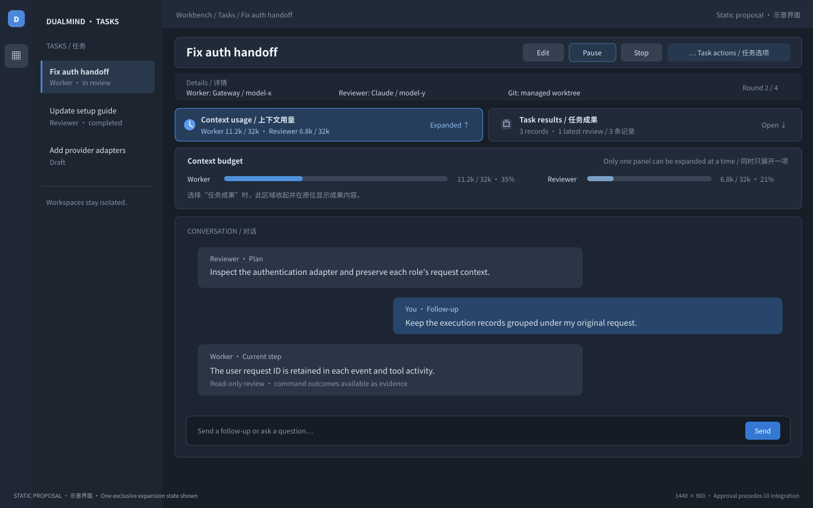

# 模型接入与紧凑审核工作台：界面修订提案

[English](../en/review-workbench-proposal.md) · [设计索引](./design.md)

**状态：2026-11-25 审核通过，已接入 0.0.7 源码。** 用户补充要求：背景色与当前 VS Code 主题一致。三个原始 SVG／PNG 保留为静态参考，浅色／深色配色不固定产品主题；运行验证见[开发日志](./development-log.md)。

**版本归属：** 图稿在 0.0.7 开发期间审核并接入，当前随 0.0.8 交付，原设计目录和审核日期保持不变。

## 38. 模型提供商设置

[可编辑 SVG](../design/v0.0.7/dual-mind-model-provider-proposal.svg) · [PNG 预览](../design/v0.0.7/dual-mind-model-provider-proposal.png)

明确区分 Provider 与推理协议。OpenAI 兼容 Chat Completions／Responses、Anthropic Messages 和 Command Code 兼容 API 均由用户手动填写 URL、密钥和模型 ID。密钥仍通过宿主密码提示输入；刷新只查询模型 ID，Command Code 按声明的端点能力筛选。不自动猜测端点或切换协议。

## 39. 任务标题与上下文／成果互斥面板

[可编辑 SVG](../design/v0.0.7/dual-mind-compact-task-header-proposal.svg) · [PNG 预览](../design/v0.0.7/dual-mind-compact-task-header-proposal.png)

任务标题与任务操作放在同一紧凑行，原有详情仍在下方。模型上下文用量和任务成果共享下一行，并共用一个展开状态：打开一项自动关闭另一项，再次选择已展开项则全部收起。展开内容显示在该行下方。窄布局须保持操作可访问且不出现横向溢出。

## 40. 先按请求、再按角色折叠日志

[可编辑 SVG](../design/v0.0.7/dual-mind-request-grouped-logs-proposal.svg) · [PNG 预览](../design/v0.0.7/dual-mind-request-grouped-logs-proposal.png)

每条用户问题或修改需求都有独立折叠组，标题使用原消息并附状态。组内 Reviewer／审核者与 Worker／执行者分别折叠，角色内事件保持时间顺序。宿主提供稳定请求 ID，避免相同文字或并发更新将不同请求混在一起。缺少请求 ID 的旧记录保留在明确的“更早记录”分组。聊天过程记录和证据面板采用同一分组逻辑，但不会合并两个模型的私有历史。

## 审核边界

本轮已明确批准提供商控件、紧凑任务栏、上下文／成果互斥展开和请求／角色两层折叠。实现保留原生侧栏，窄宽时操作可换行；背景、输入框、选中态、边框及文字使用主题变量，支持实时切换主题。原有图稿与审核记录保持不变；示例时间、名称和结果不代表实际执行。后续视觉修订继续遵循[贡献指南](../../CONTRIBUTING.zh.md)。

## 0.0.8 紧凑界面与请求分组

标题、编辑和运行控制位于同一紧凑区域，窄侧栏按需换行。上下文与成果并排，默认收起；打开一项关闭另一项，再次点击收起，切换保留内部状态。页面背景及控件配色由 VS Code 主题变量驱动，实时跟随浅色、深色及高对比度主题。

聊天与证据按 `userRequestId` 分组，再分别折叠 Reviewer、Worker 和系统记录；相同文字的不同请求不合并。首次执行用 `initial:<runId>` 及运行时保存的需求快照，缺少请求 ID 的历史事件归入“更早记录”。默认展开当前或最近请求，历史组收起；全部展开／收起及手动选择分别按任务、聊天／证据保存。计数表示已加载记录，“已处理”不等同验收通过。原始需求和错误正文仍可展开阅读，消息分页、阅读锚点、常驻输入及恢复提示保留。
