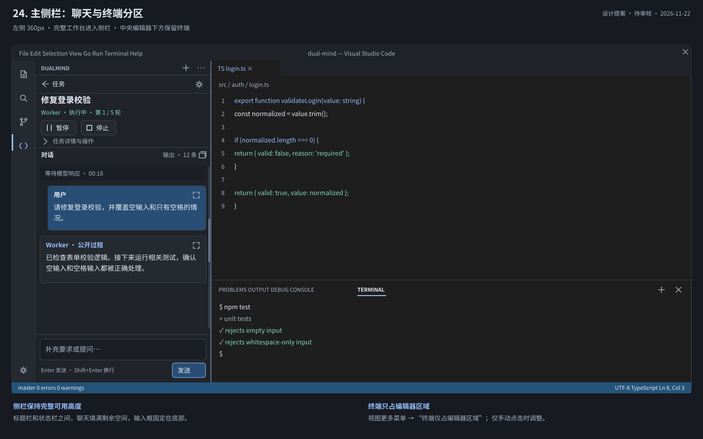
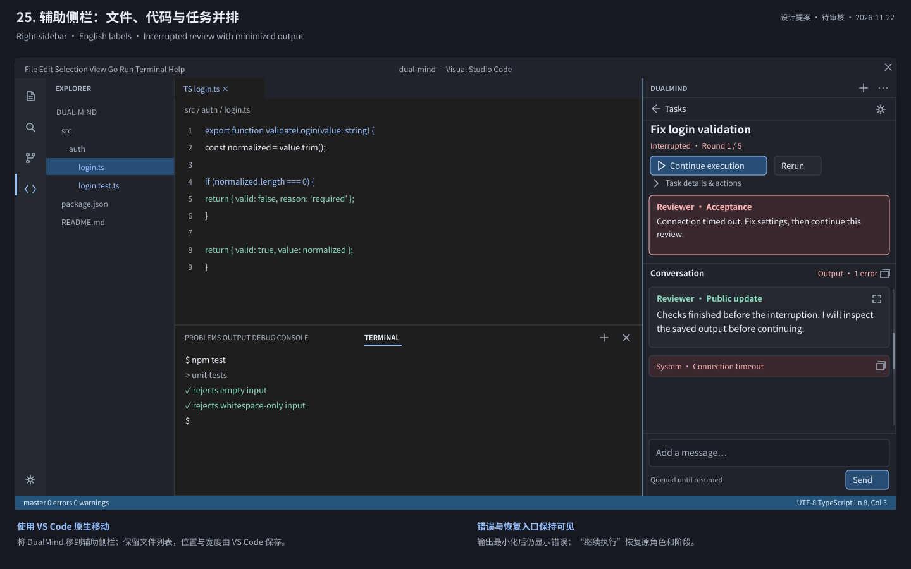
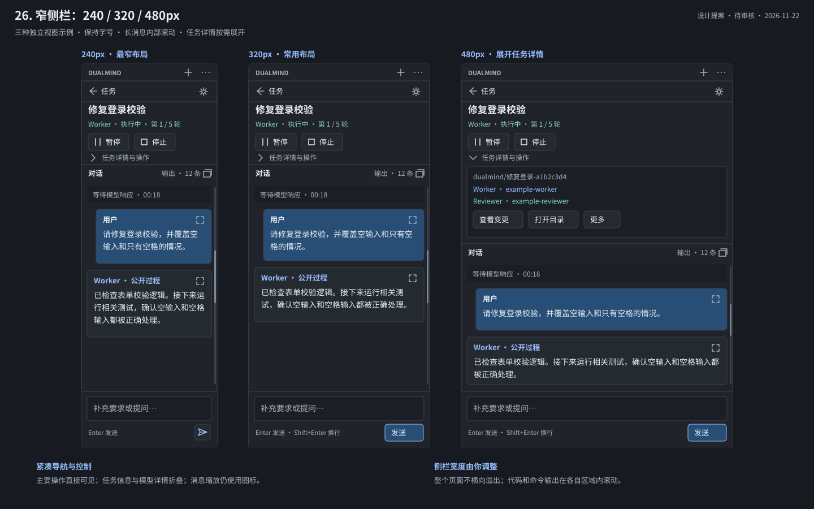
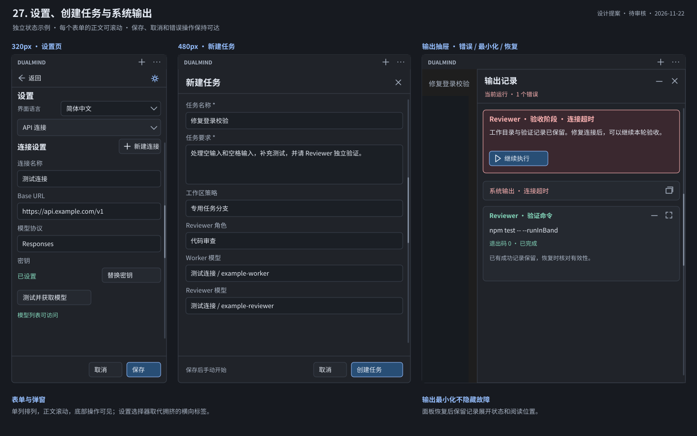

# 原生侧栏工作台：界面提案

[English](../en/sidebar-workbench-proposal.md) · [设计索引](./design.md) · [当前使用说明](./usage.md)

**版本归属更新（2026-11-23）：** 本文保留首次侧栏实现与验证使用 0.0.4 候选包的历史记录。当前源码已升为 **0.0.5**，场景 24–27 归档至 `docs/design/v0.0.5/`，对应本地标签 `v0.0.5`；本次版本记录见[0.0.5 说明](./release-notes-0.0.5.md)。

**状态：场景 24–27 已于 2026-11-22 审核通过，2026-11-23 完成侧栏实现。** 下方保留获批 SVG／PNG 和原始约束；图内的历史审核标签不代表当前状态。完整工作台现由原生 `WebviewView` 承载，旧页签仅作为升级迁移入口，首次验证使用 0.0.4 候选包，当前归入 0.0.5。实际检查和截图见[验证记录](./sidebar-workbench-validation.md)。

全部画布为 1440 × 900，使用可编辑的文字和静态矢量。任务、代码、模型名称、计数、错误、耗时及终端输出均为示例，不代表真实执行或验证结果。宽度标签表示设计中的 Webview 内容宽度，不会强制改变 VS Code 的侧栏宽度。

## 已确认的交互

- 完整工作台仅使用原生侧栏，默认进入主侧栏。用户可以通过 VS Code 标题栏上下文菜单或拖动移到辅助侧栏；左右位置和宽度由 VS Code 保存，打开工作台不把它移回默认位置。
- 工作台占据标题栏、状态栏之间的可用高度。新增视图更多菜单及命令面板操作“终端仅占编辑器区域”，仅点击时将底部面板设为居中；不自动重设用户布局。全宽面板仍可能占用侧栏下方区域。
- 新建任务使用原生视图标题中的加号；页面顶部保留返回和设置。语言选择移入设置页，设置类别使用选择器。只调整布局，不缩小正文字号。
- 任务详情默认收起分支、模型和次要操作；运行状态、暂停、停止、继续执行和故障说明仍可见。展开详情后可以查看分支及模型，并访问查看变更、打开目录和更多操作。
- 输入框固定在聊天区域底部，聊天填充剩余空间；长消息内部滚动，展开／紧凑仍用图标。极窄或极矮窗口可以滚动必要内容，不隐藏操作。
- 输出记录在窄宽度使用抽屉。面板或单条系统输出最小化后保留计数、错误提示及恢复入口，不因新记录自动展开。

## 24. 主侧栏与终端

[SVG](../design/v0.0.5/dual-mind-sidebar-left-proposal.svg) · [PNG](../design/v0.0.5/dual-mind-sidebar-left-proposal.png)

左侧以 360px 展示工作台，中间保留代码编辑器及底部终端。聊天获得侧栏剩余高度，终端顶部不构成侧栏的下边界。图中原生标题栏的更多菜单承载手动面板居中操作；正文顶部不再重复提供新建任务按钮。

## 25. 辅助侧栏与故障恢复

[SVG](../design/v0.0.5/dual-mind-sidebar-right-proposal.svg) · [PNG](../design/v0.0.5/dual-mind-sidebar-right-proposal.png)

右侧以 400px 展示英文界面，保留左侧文件列表和中央编辑器。Reviewer 验收连接中断后显示角色、阶段及继续执行按钮；单条系统错误最小化，错误计数继续可见。恢复延续已有运行语义，不因隐藏或移动侧栏重新执行任务。

## 26. 240／320／480px 宽度

[SVG](../design/v0.0.5/dual-mind-sidebar-widths-proposal.svg) · [PNG](../design/v0.0.5/dual-mind-sidebar-widths-proposal.png)

三列是互相独立的尺寸示例，不是同时打开三个工作台。240px 使用图标发送按钮，320px 和 480px 保留文字发送；可访问名称一致。480px 展示任务详情展开状态。内容按宽度换行，代码和命令可以在自身区域横向滚动，整个页面不横向溢出。

## 27. 设置、创建任务与输出抽屉

[SVG](../design/v0.0.5/dual-mind-sidebar-forms-proposal.svg) · [PNG](../design/v0.0.5/dual-mind-sidebar-forms-proposal.png)

三列是独立状态：320px 设置页、480px 创建任务，以及更宽侧栏中的 430px 输出抽屉。语言选择和设置类别位于设置顶部；表单正文可滚动，保存、取消或创建操作固定在底部。输出抽屉可最小化或关闭，单条记录仍有独立图标，恢复时保留阅读位置。弹窗继续使用原有键盘焦点约束和关闭规则。

## 已实施的约束

- 将 `dualMind.tasks` 从任务树切换为 `WebviewView`，保留现有容器和打开／新建／选择任务命令。新增 `dualMind.alignPanelCenter`。工作台成为容器中唯一视图；旧任务树不再分占高度。
- 执行服务独立于页面存活，隐藏、折叠和移动不停止任务。视图恢复时读取本地显示状态、补发宿主快照并从持久化记录补齐聊天。异步回调绑定当前视图实例。
- 旧页签序列化入口仅负责升级迁移：已有侧栏状态优先，否则迁移旧导航和聊天偏好；侧栏初始化成功后关闭旧页签，失败保留重试入口。序列化回调不等待 Webview 渲染。
- 覆盖左右侧栏、移动与重载、终端高度变化、手动面板居中、重复打开、中英文窄宽布局、表单滚动和焦点、运行期间隐藏、旧页签迁移及恢复记录完整性。
- 使用 Node.js 24 执行完整检查、扩展宿主测试、真实界面回归和打包；最低支持 VS Code 1.100.0 与本机安装版本按实际结果报告。当时的实现约定为保持 0.0.4，不自动安装、提交或发布；本次版本与本地标签调整按页首更新执行。

依据[贡献指南](../../CONTRIBUTING.zh.md)，本次界面变更在视觉审核通过后实施。设计审批与运行验证独立记录；历史场景及文件保留。
