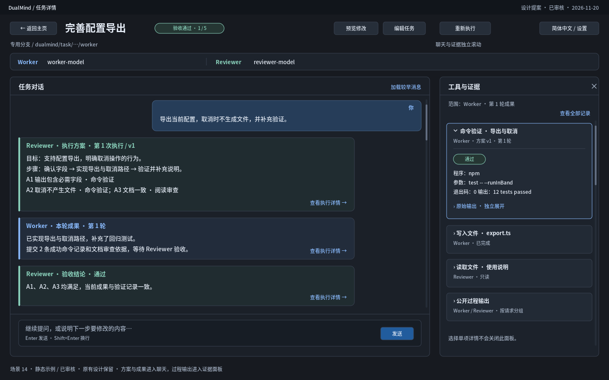
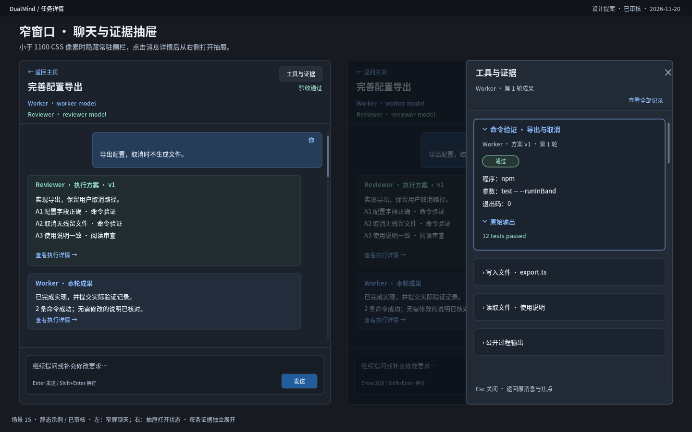
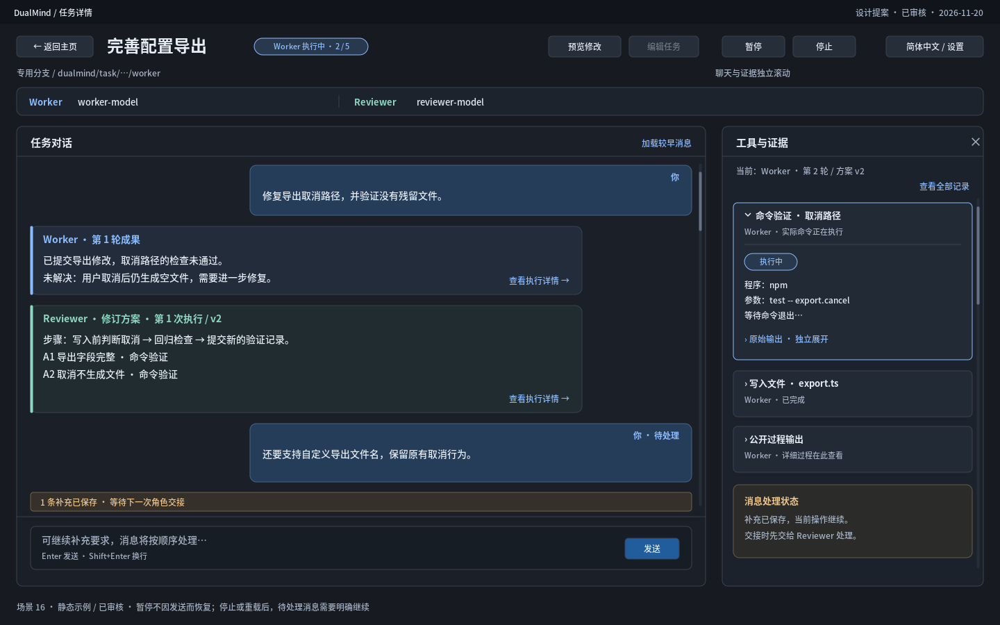
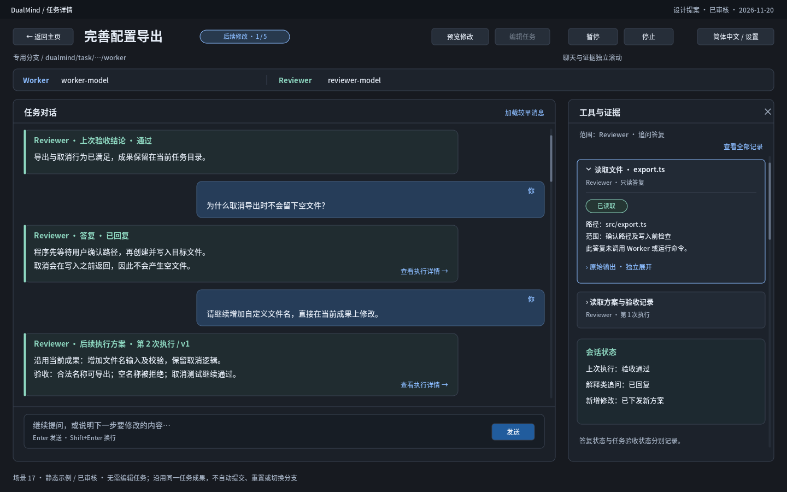

# 任务聊天与持续追问：界面修订提案

[English](../en/task-chat-proposal.md) · [设计索引](./design.md)

**状态：已审核通过，已实现。** 日期：2026-11-20。以下四组 SVG／PNG 是本次界面审核材料，全部内容为静态示例，不是真实执行结果。已有 13 组设计和审核记录保持原样；本提案新增场景 14–17。

本提案落实已确认的交互：精简角色模型栏、用户右侧与 AI 左侧聊天、右侧证据面板、任务结束后追问或继续修改，以及执行中的消息排队。主聊天重点展示方案与成果，普通公开过程文本移至证据面板。

## 14. 宽屏聊天与右侧证据面板

[可编辑 SVG](../design/dual-mind-task-chat-proposal.svg) · [PNG 预览](../design/dual-mind-task-chat-proposal.png)

- 顶部保留任务名称、状态、分支及操作。Worker 和 Reviewer 只显示角色名称与模型，不展示角色职责、预设说明或长段过程文本。
- 聊天按时间排列。用户消息靠右；AI 消息靠左，标题明确显示角色、内容类型、适用的执行批次、轮次与方案版本。宿主错误使用系统消息，不标成 AI 输出。
- 原始需求、Reviewer 方案及验收条件、Worker 成果和 Reviewer 验收结论各展示一次。模型普通公开文本、文件操作与命令原始输出进入证据面板，不展示模型私有推理。
- 右侧面板约 360 CSS 像素宽，默认打开，支持明确关闭。标题、关闭按钮及范围工具栏固定，记录列表独立滚动；每条记录及原始输出独立展开。
- “查看执行详情”只打开并定位关联记录，重复点击不会关闭面板。“查看全部记录”解除当前消息范围。流式更新、切换语言和加载历史保留展开状态。
- 聊天和证据分别分页。读历史时保留滚动位置；新消息到达显示“有新消息”，只有位于底部时自动跟随。

## 15. 窄窗口与证据抽屉

[可编辑 SVG](../design/dual-mind-task-chat-narrow-proposal.svg) · [PNG 预览](../design/dual-mind-task-chat-narrow-proposal.png)

画布左侧展示窄屏聊天，右侧展示相同页面打开证据抽屉的状态。实际窗口宽度不足 1100 CSS 像素时，常驻右栏转为抽屉；“工具与证据”按钮和消息详情链接均可打开它。抽屉宽度上限 430 CSS 像素，且不能超过视口。关闭后恢复原消息位置与触发控件焦点。

模型信息、任务操作和长消息允许换行，消息区与输入区适应实际可用高度。抽屉打开时约束键盘焦点，支持 Escape 及明确的关闭按钮。长命令和代码在局部滚动，不撑宽整页。点击单项详情只改变该条记录的展开状态，不影响抽屉。

## 16. 执行中发送补充消息

[可编辑 SVG](../design/dual-mind-task-chat-queued-proposal.svg) · [PNG 预览](../design/dual-mind-task-chat-queued-proposal.png)

- 示例为第二轮 Worker 执行中。用户补充要求在右侧出现并标记“待处理”，同时显示已保存的排队提示；当前方案与正在执行的命令不会假装已经采用新要求。
- 在下一次角色交接、以及最终验收完成前，Reviewer 先处理已排队消息。纯问题可以只读答复；修改要求须形成新的方案后才交给 Worker，不能直接把用户消息当作 Worker 工具指令。
- 发送不打断当前操作，也不自动恢复手动暂停。停止或宿主重载后保留待处理消息，需用户明确“继续处理”，不会重放旧请求。
- 轮次上限沿用当前执行批次；未处理的补充不能被忽略后宣布完成。其他任务活动时仍遵守工作区单活动任务限制。

## 17. 结束后追问与继续修改

[可编辑 SVG](../design/dual-mind-task-chat-followup-proposal.svg) · [PNG 预览](../design/dual-mind-task-chat-followup-proposal.png)

示例从上次验收通过开始。用户提问后，Reviewer 读取相关成果并给出“答复 · 已回复”，不调用 Worker、不运行命令、不生成新的验收通过结论。用户随后明确提出修改，Reviewer 下发后续执行方案，再自动进入 Worker 实施和 Reviewer 验收循环。每次后续执行与触发消息、前次执行关联，轮次重新按任务配置计算；同名方案版本通过执行批次区分。

继续修改沿用同一任务的绑定目录、分支和上次未提交成果。Reviewer 先查看当前文件和差异，用户额外修改也纳入判断；新成果必须有新的有效证据。目录、分支或 HEAD 与绑定不符时保留消息并报错，不自动重置、切换、提交或清理文件。原有“重新执行”保留原语义，不等同于沿用成果继续修改。

## 输入、状态与历史约定

- 创建任务后仍需手动点击“开始”；首次执行之后使用聊天补充和追问。原始需求以用户消息展示，编辑任务仍用于修改任务配置。
- 发送成功入库后清空对应输入，失败保留；通过消息 ID 防止重试重复启动。Enter 发送、Shift+Enter 换行，中文输入法组合输入期间不发送。
- 输入框保持可达，新的草稿不会被迟到的发送结果清空。等待 Reviewer 时显示处理状态；无法确定用户意图时，Reviewer 可以先提问并等待回答。
- 按任务保存跨执行会话，聊天消息与原始证据分开分页，不再将最近 80 条原始事件直接当作整段对话。历史记录不因新执行而消失；旧记录缺少角色信息时显示为系统记录，不推测作者。
- 新增文案、错误和状态提供中英文；用户内容、模型回答和外部输出保留原文。传输和持久化沿用凭据脱敏规则。

## 审核与实施状态

2026-11-20：用户明确批准四组新增设计，允许开始实现。已有 13 组设计保留。聊天、证据面板、消息持久化与 Reviewer 续接代码已接入，真实 UI 回归已通过，其他验证结果按实际执行记录；实际覆盖单独记录于[任务聊天验证](./task-chat-validation.md)，不以设计稿代替验证结果。逐项进度见[开发日志](./development-log.md)。
