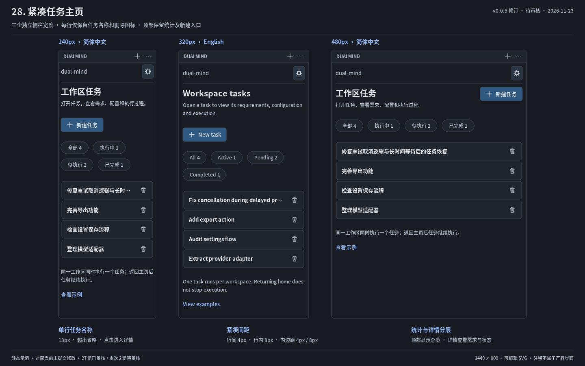
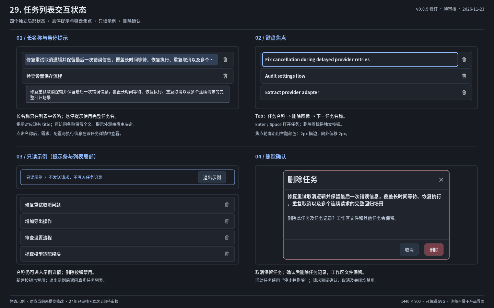

# 紧凑任务列表：主页与交互设计稿

[English](../en/task-home-compact-proposal.md) · [设计索引](./design.md) · [使用说明](./usage.md)

**审核与实现更新（2026-11-23）：**本轮已批准现有前端，图中对应界面已接入；下方早期待审核字样保留当时语境。当前总数与审核状态见[设计索引](./design.md)。

**状态：场景 28–29 待审核。记录日期：2026-11-23。** 这两组静态稿依据当前工作区尚未提交的任务列表修改补充，归档于 `v0.0.5`，晚于现有 `v0.0.5` 标签，不表示已包含在该标签或已有 VSIX 中。现有 27 组已审核图稿及审核记录保留；当前共 29 组，其中 2 组待审核。本次交付增加设计资源和说明，已有前端及测试修改保持原样。

每张画布为 **1440 × 900**，沿用深色侧栏风格，包含可编辑文字与静态矢量，不依赖脚本、内嵌图片或外部资源。任务名称、计数和状态均为静态示例，不代表执行或测试结果；画面之外的尺寸、交互及审核说明不属于产品界面。

## 28. 紧凑任务主页

[可编辑 SVG](../design/v0.0.5/dual-mind-task-home-compact-proposal.svg) · [PNG 预览](../design/v0.0.5/dual-mind-task-home-compact-proposal.png)



三列分别展示 240px 中文、320px 英文和 480px 中文视图，是独立宽度示例。宽度由 VS Code 控制，设计稿不新增强制宽度。按当前源码保留原生标题栏加号、工作区名称、设置、主页新建按钮、顶部数量和查看示例入口。统计包括全部、执行中、待执行和已完成，仅作概览；名称行不再重复显示逐项状态。

每行只有名称按钮和独立删除按钮。点击名称进入该任务详情，需求、Reviewer 角色、Git 策略、轮次及执行状态在详情中查看；进入或离开主页不改变后台执行。列表较长时在侧栏内容区滚动，窄宽度也保持名称和删除按钮同一行。

| 项目         | 当前源码对应规则                         |
| ------------ | ---------------------------------------- |
| 任务名称     | 13px，单行，超出宽度显示省略号           |
| 列表间距     | 行间 4px，列表顶部外边距为 0             |
| 行内布局     | 名称占剩余宽度，删除不收缩，间距 8px     |
| 任务行内边距 | 上下 4px，左右 8px                       |
| 名称提示     | `title` 与可访问名称均保留完整任务名     |
| 窄侧栏       | 行内不换行，顶部统计和说明按可用宽度换行 |

没有任务时仍使用原空状态；未打开工作区时保留“打开文件夹”入口。本修订不新增筛选、排序、搜索或任务字段。

## 29. 任务列表交互状态

[可编辑 SVG](../design/v0.0.5/dual-mind-task-home-interactions-proposal.svg) · [PNG 预览](../design/v0.0.5/dual-mind-task-home-interactions-proposal.png)



四个局部状态用于分别审阅，不表示它们同时出现。只读示例一格分别截取提示条与列表，省略的主页元素见场景 28。

| 状态或操作 | 对应行为                                                                                                |
| ---------- | ------------------------------------------------------------------------------------------------------- |
| 长名称悬停 | 列表省略显示；现有 `title` 提供完整名称。图中提示仅为示意，具体样式由浏览器／宿主决定，不新增自定义浮层 |
| 键盘焦点   | Tab 顺序为名称、删除、下一任务名称；Enter／Space 激活名称。沿用 2px 主题焦点轮廓及 2px 外偏移           |
| 辅助技术   | 名称按钮使用完整任务名；删除按钮使用“删除任务：任务名”对应的本地化可访问名称                            |
| 只读示例   | 名称仍可打开示例详情；删除和页面新建按钮禁用，删除提示为“只读示例”。退出示例恢复真实任务列表            |
| 删除确认   | 显示完整任务名、“取消”和“删除”；取消保留任务，确认移除任务及任务记录，保留工作区文件和其他任务          |
| 活动任务   | 现有非终态运行使用“停止并删除”；沿用宿主停止与删除流程，不增加新的删除路径                              |
| 请求期间   | 任务行删除按钮禁用；确认框的确认、取消和关闭按钮禁用，Escape 不关闭正在提交的确认框                     |
| 确认框键盘 | 焦点限制在对话框内；未提交时 Escape 关闭，关闭后尽可能恢复原触发按钮焦点                                |

## 与当前修改的对应关系

- `webview/src/Tasks.tsx`：任务行收敛为名称与删除两个按钮，名称增加完整 `title`；删除、预览、计数及导航继续使用现有逻辑。
- `webview/src/styles.css`：紧凑间距、13px 名称、单行省略与不换行的任务行；图稿按这些规则绘制。
- `tests/local/ui.test.tsx`：新增仅名称行、长名称、进入详情、取消／确认删除断言，并调整只读示例及导航查询。
- `scripts/verify-ui.mjs`：已有打开任务步骤改为按任务名称定位，替代已移除的“打开任务”按钮。

本设计交付不改变产品 API、宿主通信或持久化数据。行为说明依据源码及测试断言核对；静态图稿不能替代实际运行验证。

## 渲染与检查

使用隔离 Python 环境中的 **CairoSVG 2.7.1** 渲染；本机字体为 Noto Sans CJK SC，以 DejaVu Sans 和系统 sans-serif 回退。可在安装 CairoSVG 的环境中重渲染：

```bash
for scene in compact interactions; do
  python -m cairosvg "docs/design/v0.0.5/dual-mind-task-home-${scene}-proposal.svg" -o "docs/design/v0.0.5/dual-mind-task-home-${scene}-proposal.png"
done
npm run docs:check
npm run format:check
git diff --check
```

验收检查 PNG 的文字、长名称、省略号、焦点、图标和弹窗边界，并校验既有 54 个 SVG／PNG 文件保持原样。实际运行的检查与未运行项记录在[开发日志](./development-log.md)；设计审核与运行时测试独立记录。
