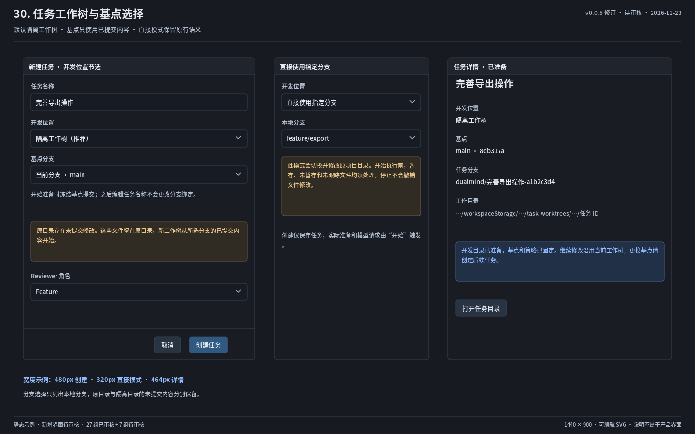
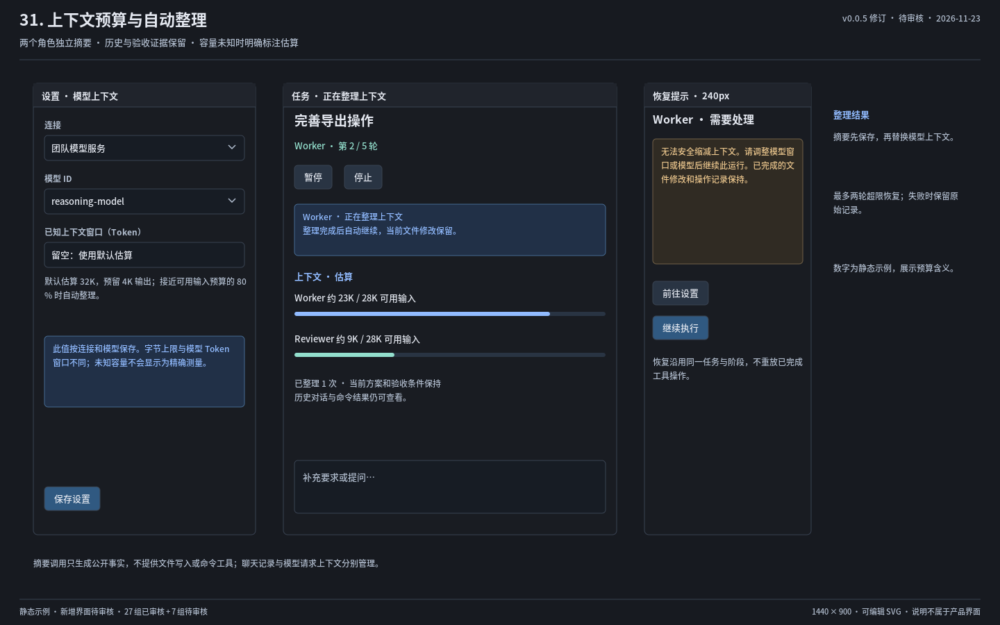
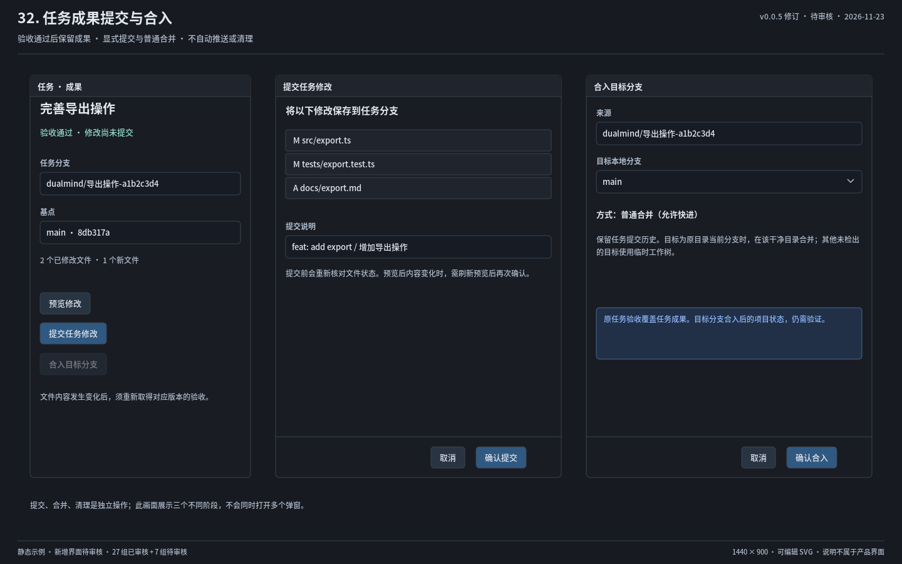
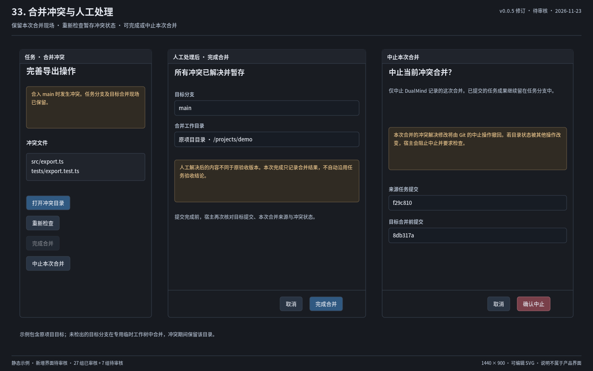
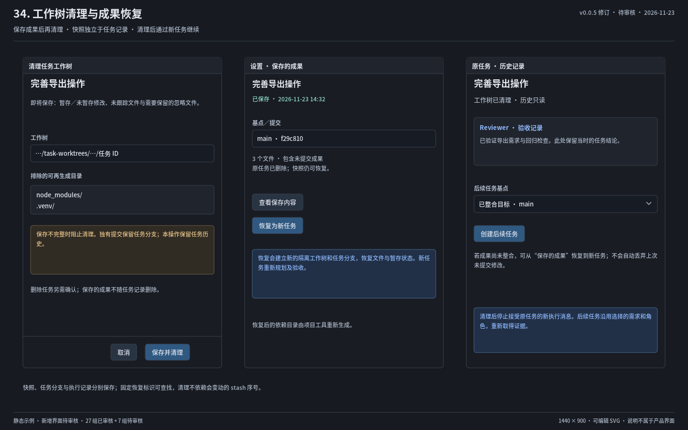

# 工作树、上下文与成果收尾：界面提案

[English](../en/task-lifecycle-proposal.md) · [宿主行为](./task-lifecycle.md) · [设计索引](./design.md)

**本地 Git 归档更新（2026-11-23）：** 对应实现已按功能提交至本地 `master`，晚于原 `v0.0.5` 标签；场景 28–37 均已审核并实现。以下较早的待审核、未提交及标签说明保留当时语境，当前归属见[开发日志](./development-log.md)。

**审核与实现更新（2026-11-23）：**本轮已批准现有前端，图中对应界面已接入；下方早期待审核字样保留当时语境。当前总数与审核状态见[设计索引](./design.md)。

**场景 30–34 待视觉审核，2026-11-23。** 宿主接口、自动摘要及测试已接入；基点、预算、成果、合并冲突和清理恢复的新界面入口尚未实现。依据贡献指南，先交付可审阅图稿，视觉批准后接入新增控件。场景 1–27 已审核、28–29 仍待审核，共 34 组，27 组已审核、7 组待审核。版本保持 0.0.5。

全部画布为 1440 × 900 可编辑静态 SVG，PNG 由 CairoSVG 2.7.1 渲染。图内目录、分支、时间、容量和结果都是示例，底部说明不属于产品界面。保留侧栏、紧凑任务主页、常驻输入框及原有焦点／对话框规则；各列是独立场景，不表示同时打开多个页面。

## 30. 工作树与基点选择

[SVG](../design/v0.0.5/dual-mind-workspace-base-proposal.svg) · [PNG](../design/v0.0.5/dual-mind-workspace-base-proposal.png)

隔离模式选择本地基点，默认为准备时当前分支。原目录脏状态只提示未提交修改不会复制；直接模式明确要求干净目录。准备后显示冻结的基点和任务目录。创建图为开发位置区域节选，原有必填需求、角色和模型字段继续适用。

## 31. 上下文预算与自动整理

[SVG](../design/v0.0.5/dual-mind-context-compaction-proposal.svg) · [PNG](../design/v0.0.5/dual-mind-context-compaction-proposal.png)

320px 展示模型窗口设置，480px 展示两个角色独立预算与整理状态，240px 展示可恢复失败。默认容量标为估算；摘要失败仍可调整设置后继续。只读历史、当前方案与文件修改保留。

## 32. 成果提交与合入

[SVG](../design/v0.0.5/dual-mind-artifact-integration-proposal.svg) · [PNG](../design/v0.0.5/dual-mind-artifact-integration-proposal.png)

任务成果、提交确认和合入确认分别展示。提交先列文件与可编辑说明；合入要求当前内容通过验收且已提交。目标默认原基点，可选其他本地分支；普通合并保留历史，合入后仍需验证。

## 33. 合并冲突处理

[SVG](../design/v0.0.5/dual-mind-merge-conflicts-proposal.svg) · [PNG](../design/v0.0.5/dual-mind-merge-conflicts-proposal.png)

冲突列表提供打开目录与重新检查。未解决时完成按钮禁用；解决并暂存后显示完成确认。中止明确影响本次合并中的冲突解决修改。外部改变或目标占用在原入口显示可操作错误，保留现场。

## 34. 工作树清理与成果恢复

[SVG](../design/v0.0.5/dual-mind-workspace-cleanup-proposal.svg) · [PNG](../design/v0.0.5/dual-mind-workspace-cleanup-proposal.png)

清理预览列出目录、保存范围及排除项；保存失败保留记录并显示重试信息。“删除任务并清理”在删除确认框中明确额外动作，旧删除仍只移除记录。保存成果列表独立存在，可恢复为新任务；清理后的原任务保持只读历史，输入区改为后续任务入口。

## 审核后接入与验证

新增字段和按钮在视觉批准后接入 `TaskForm`、任务详情、设置及删除确认。保持中英文文案配对、键盘可达、长名称提示、240／320／480px 无页面横向溢出。提交期间禁用重复操作；确认使用预览令牌，重载后显示待完成操作而不是重新开始。

设计检查与运行验证分别记录于[开发日志](./development-log.md)。现有 UI 回归只验证已有控件，不能宣称图中的新入口已通过真实界面验收。
