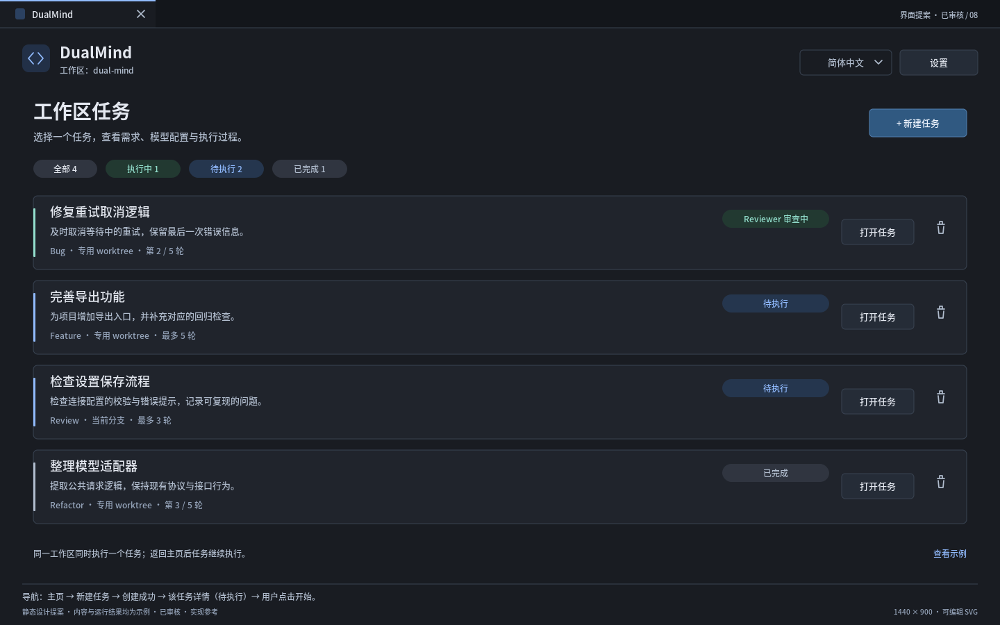
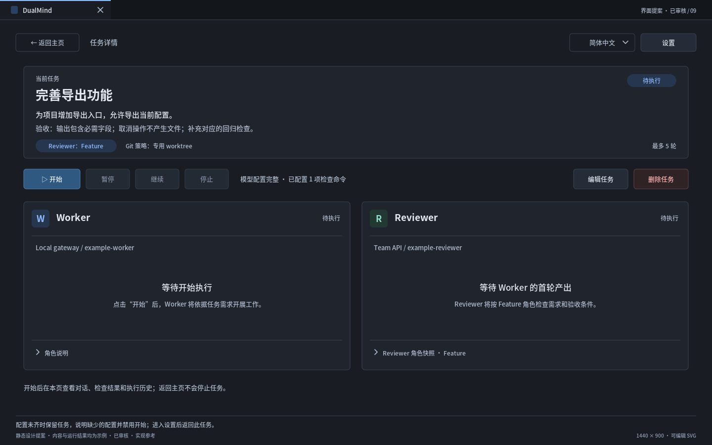
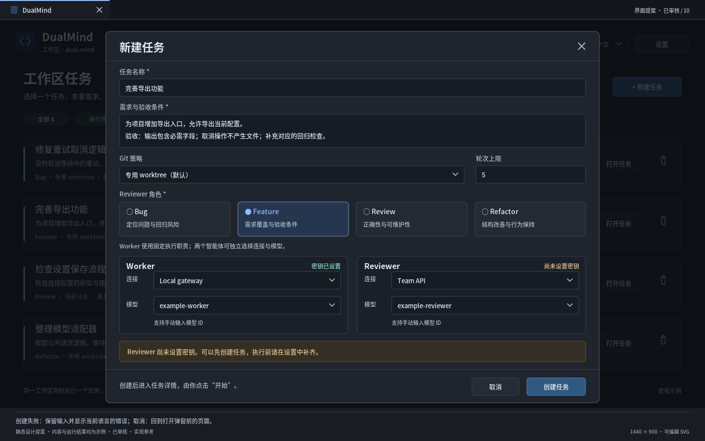
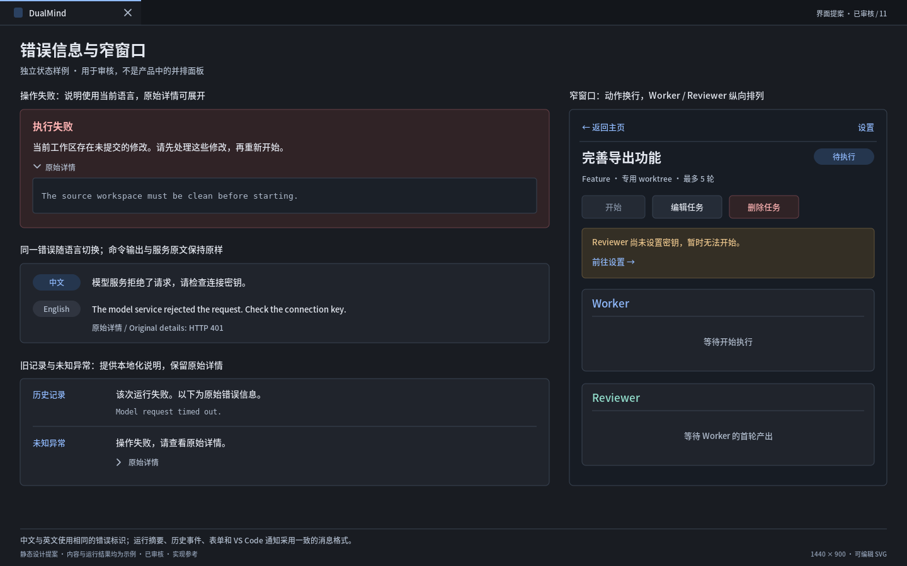

# 任务主页、详情与错误提示：界面修订提案

[English](../en/task-pages-proposal.md) · [设计索引](./design.md)

**状态：已审核，已实现。审核日期：2026-11-20。** 本次交付提供场景 8–11 的 SVG 与 PNG，保留原有场景 1–7。任务主页、导航和错误本地化已接入运行时代码；图片仍是静态设计参考，不代表真实执行结果。

本次交互已确定：主页和任务详情在同一个 VS Code 标签内切换；创建成功后进入新任务详情，状态为“待执行”，由用户点击“开始”。产品界面取消任务的“草稿”概念。默认配置、角色快照、模型选择及已有 Git 策略继续适用。

## 设计预览

每张画布均为 1440 × 900。本次提案使用简体中文主界面，场景 11 同时展示英文错误示例；实际实现根据语言设置显示一套文案。所有图形与文字均可编辑，不依赖外部图片、字体下载或脚本。底部审核说明不属于产品界面。

| 场景             | SVG                                                    | PNG                                                  |
| ---------------- | ------------------------------------------------------ | ---------------------------------------------------- |
| 8. 独立任务主页  | [源文件](../design/dual-mind-task-home-proposal.svg)   | [预览](../design/dual-mind-task-home-proposal.png)   |
| 9. 独立任务详情  | [源文件](../design/dual-mind-task-detail-proposal.svg) | [预览](../design/dual-mind-task-detail-proposal.png) |
| 10. 创建任务     | [源文件](../design/dual-mind-task-create-proposal.svg) | [预览](../design/dual-mind-task-create-proposal.png) |
| 11. 错误与窄窗口 | [源文件](../design/dual-mind-task-states-proposal.svg) | [预览](../design/dual-mind-task-states-proposal.png) |

### 8. 独立任务主页



主页展示任务名称、需求摘要、Reviewer 角色、Git 策略、轮次及当前状态。点击任务名称或“打开任务”进入详情；删除按钮是独立操作。顶部数量仅作概览，不增加筛选功能。任务较多时滚动列表；单个工作区同时执行一个任务。保留设置、新建任务和现有示例预览入口，示例仍只读。

没有任务时显示“暂无任务”和新建入口；未打开工作区时使用现有“打开文件夹”入口。主页不展示某个任务的对话或执行控件。进入或离开主页不会改变后台执行状态。

### 9. 独立任务详情



详情顶部提供“返回主页”和设置入口，显示任务名称、需求、Reviewer 角色、Git 策略及轮次上限。Worker 和 Reviewer 分列，配置未齐时说明具体缺项并提供设置入口。新任务显示“待执行”和等待开始的空对话，不自动发出模型请求。

开始、暂停、继续、停止、编辑、删除根据当前状态启用或禁用。执行期间显示流式对话；检查证据、历史分页、暂停反馈以及“预览修改”“打开任务目录”沿用现有行为，位于对话之后，随内容滚动。不增加自动应用修改的入口。图中展示的是尚未运行的任务，因此没有历史与结果面板。

| 操作或恢复条件                | 结果                                             |
| ----------------------------- | ------------------------------------------------ |
| 创建成功                      | 以保存返回的任务 ID 打开新任务详情，等待手动开始 |
| 从主页或 VS Code 侧栏打开任务 | 进入同一工作台内的对应任务详情                   |
| 返回主页                      | 展示列表，后台执行继续                           |
| 从详情进入设置后返回          | 恢复原任务详情                                   |
| 删除当前任务                  | 返回主页；执行中的任务先停止并确认，再删除       |
| 刷新或重新打开工作台          | 恢复已保存的页面与任务 ID                        |
| 恢复目标不存在                | 回到主页                                         |
| 恢复旧版 `workbench` 导航状态 | 回到新主页，不影响任务数据                       |

### 10. 创建任务



保留名称、需求、Reviewer 角色、Git 策略、轮次上限和两个独立模型绑定。主操作改为“创建任务”，编辑时为“保存任务”；不再设置提交草稿或确认草稿的步骤。Git 策略继续提供专用 worktree、当前分支和已有分支三种选择，选择已有分支时显示原有分支选择控件。角色列表继续支持自定义角色，编辑仍保留任务的角色快照。

缺少 API 配置、密钥或检查命令不阻止创建；执行条件由详情页明确提示。模型选择器沿用现有获取、刷新与手动输入行为，图中处于收起状态。创建失败在弹窗内显示错误并保留输入；取消或关闭返回原页面。保存期间禁止重复提交；成功后关闭弹窗并进入新任务详情。

### 11. 错误信息与窄窗口



图中的状态样例用于分别审核，不作为同时出现的产品面板。应用生成的错误使用当前语言说明原因和可采取的操作；有必要的原始详情在错误下方展开查看。切换语言后，结构化错误立即重新格式化；用户输入、命令输出、模型回答与外部原始错误保留原文。

运行摘要、历史错误、表单、桥接超时和 VS Code 原生通知统一使用错误标识与必要参数。旧历史记录与未知异常显示本地化说明，并保留经过脱敏的原始详情；不尝试用字符串猜测或机器翻译历史文本。原生通知使用同一消息格式并按 VS Code 支持的方式展示详情，不要求复制网页折叠控件。

宽度小于 900 CSS 像素时，Worker 在上、Reviewer 在下。主页任务行、详情操作与设置入口允许换行；长名称和需求换行显示，长模型 ID 保留完整值且不撑破布局。创建表单改为可滚动单栏，保存和取消保持可达。Tab、可见焦点、对话框焦点约束与 Escape 关闭遵循现有交互；模型候选列表先于弹窗响应 Escape。错误提示可由辅助技术读取。

## 实施与验证约定

现已实现显式的主页、详情及设置导航状态，记录任务 ID 和设置返回目标；运行记录继续决定任务的显示状态。保留已有存储中的 `status: 'draft'` 作为兼容字段，不迁移已有任务。运行错误增加结构化兼容字段，并保持旧记录可读。实现同步更新中英文文案、使用说明、协议和相关测试。

代码验收覆盖创建成功与失败、取消、侧栏导航、设置返回、刷新恢复、删除跳转、缺项阻止开始、双语错误、历史兼容、单任务执行控制和窄窗口。执行 `npm run check`、相关扩展宿主测试、真实 UI 验证与打包；真实命令验证现在使用本地进程运行器，无需用户级 systemd。

设计阶段已通过文档与格式检查，并逐张检查 PNG 的文字、边界和重叠；运行时代码的验证结果单独记录。SVG 可用单独 Python 环境中的 CairoSVG 2.7.1 重新渲染；不要改动原有七组资源：

```bash
for scene in task-home task-detail task-create task-states; do
  python3 -m cairosvg "docs/design/dual-mind-${scene}-proposal.svg" -o "docs/design/dual-mind-${scene}-proposal.png"
done
npm run docs:check
npm run format:check
```

字体使用本机 Noto Sans CJK SC，并以 DejaVu Sans 和系统 sans-serif 回退。箭头与折叠图标使用矢量路径，避免依赖缺失的符号字形。
