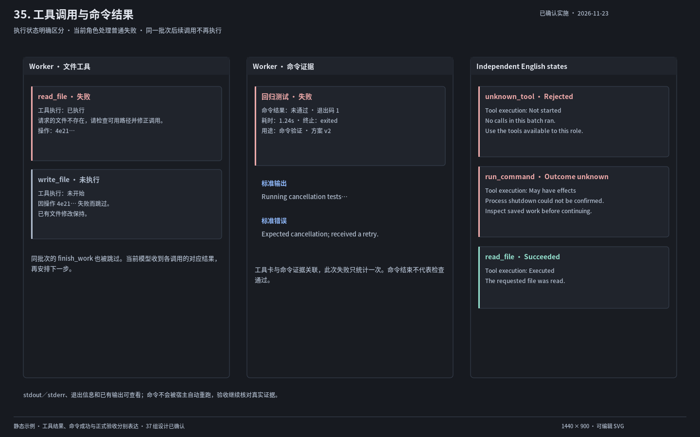
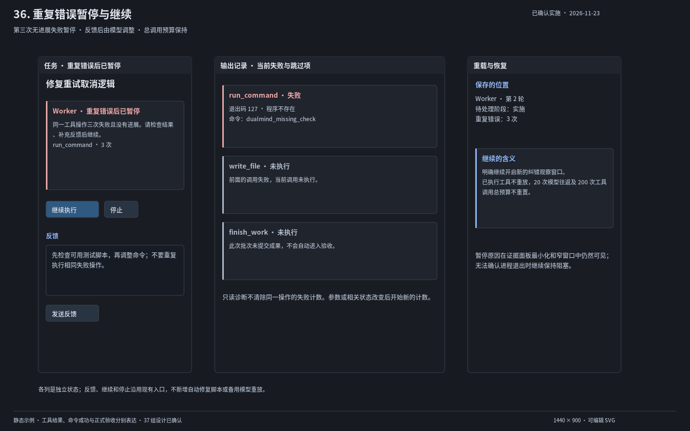
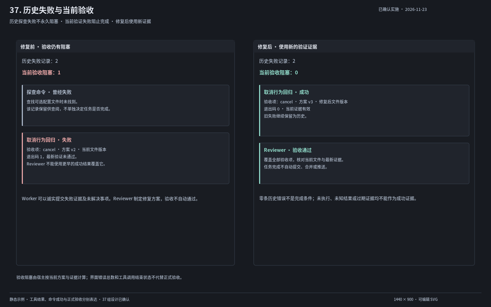

# 工具错误与验收：界面实现记录

[English](../en/tool-errors-proposal.md) · [行为说明](./tool-errors.md) · [设计索引](./design.md)

**已确认实施，2026-11-23。** 本轮明确批准现有前端并授权工具错误方案一并实现；新增场景 35–37 按此确认制作并接入，不另设视觉审批停点。共 37 组设计，场景 1–34 的原图及历史标签保留，当前审核状态以索引和本记录为准。

画布均为 1440 × 900 可编辑静态 SVG／PNG，使用本机字体渲染；任务、输出和统计是示例，不是验证结果。

## 35. 工具调用与命令结果

[SVG](../design/v0.0.5/dual-mind-tool-results-proposal.svg) · [PNG](../design/v0.0.5/dual-mind-tool-results-proposal.png)

工具返回、命令退出与验收分开表达。失败、拒绝、跳过和结果未知有明确标签；命令卡提供两个输出通道和退出信息，同一操作只统计一次。

## 36. 重复错误暂停与继续

[SVG](../design/v0.0.5/dual-mind-tool-pause-proposal.svg) · [PNG](../design/v0.0.5/dual-mind-tool-pause-proposal.png)

重复三次无进展后暂停，当前角色和原因始终可见；用户补充反馈并明确继续。继续不重置总预算，不重放已完成工具。

## 37. 历史失败与当前验收

[SVG](../design/v0.0.5/dual-mind-acceptance-errors-proposal.svg) · [PNG](../design/v0.0.5/dual-mind-acceptance-errors-proposal.png)

历史失败保留供查阅，当前验收阻塞从方案和最新证据计算；修复后的新证据可以消除阻塞，旧探查失败不永久阻止完成。

真实界面保留已有证据抽屉、最小化与键盘焦点约束，适配 240／320／480px 及中英文。测试和实际资源占用见[开发日志](./development-log.md)。
